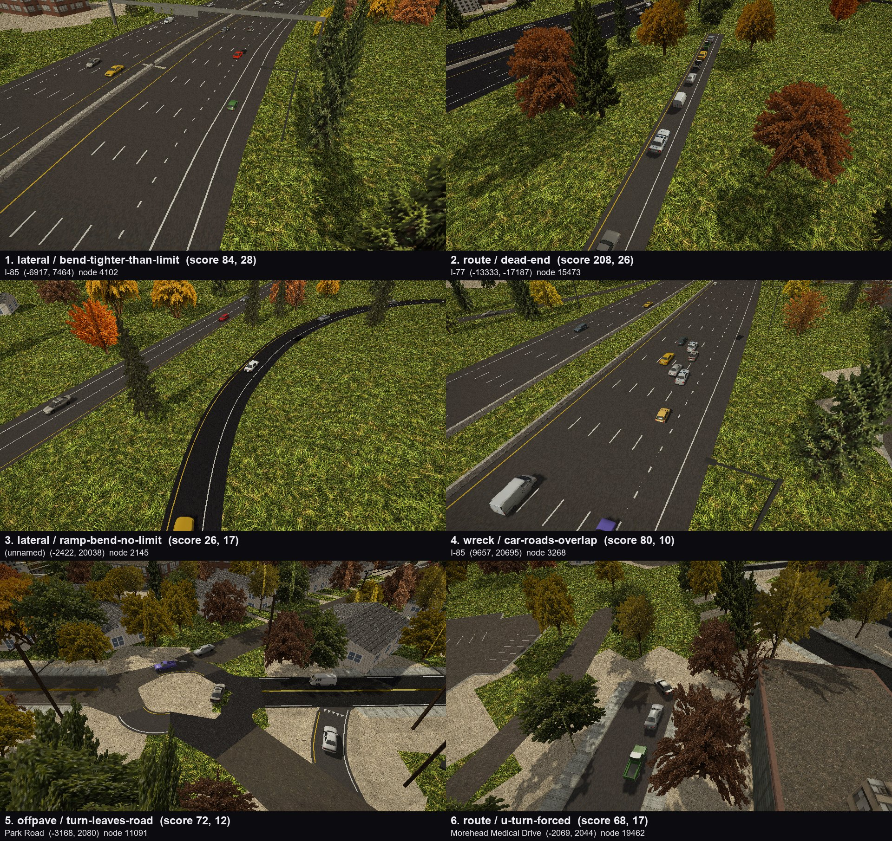

# Charlotte road logic, by traffic (census)

Generated by `tools/city-traffic-census.ps1` (Editor/CityTrafficCensus.cs, Scripts/City/CityTraffic.Census.cs, tools/traffic_census_report.py) on 2026-10-29 11:28. **Nothing here has been fixed** - this is the list to pick from.

## How it was measured

- Charlotte free roam at rush hour (17:15), the player a ghost touring **388 spots** (a greedy cover of the drivable road by 380 m discs, nearest-first from uptown), 64 cars round each spot, time scale up to 30 (physics still 1/60 s a step).
- **291.2 car-hours** simulated in 612 game minutes (41 real), **11444 km driven**, 24227 cars born, 25719 distinct junction movements taken.
- Coverage: **17063 of 25027 routable edges driven (2537 of 3842 km)**; 1848 km lie inside the visited discs.
- Every car is a probe: what it hits, where it stops for no reason, lanes it cannot reach, turns that leave the road, the drawn road's surface under it every metre (steps, crests, sags as the vertical speed a car at the limit gets), its heading (kinks, bends tighter than the limit), crossing flows in one box. Plus a static audit that needs no driving (signal phase groups, unsigned big-road crossings, one-way traps and islands, limits, lane alignment, merge room).
- Score = severity (0-10, below) x count. Counts of driven events grow with traffic, so a busy junction ranks above a quiet one with the same fault.
- Files: `Docs/traffic_census/census_map.png` (hotspots by category), `census_top6.jpg` (close-ups), `hotspots.csv` (every scored hotspot; .gz when large), `events.csv.gz` (every event), `summary.json`.




## Reading it

- Static items (move `static`) come from the network itself and cover the whole map; driven items only where the tour went (the map's bright roads). A static lane item is scored by the cars that took that movement in the census.
- Two kinds are partly the traffic's own: `lane / turn-from-wrong-lane` (the traffic changed lanes late, so its turn cuts across; check the lane alignment items at the same node first) and `lateral / turn-tighter-than-planned` (the traffic's own turn arc). `traffic / overlap` is a traffic-code fault outright.
- `contact` items say where the thing touched the car (side, nose, underside) and how high above the lane: a touch on the underside is the ground or a kerb standing above the road surface.

## Category totals

| category | events | hotspots | score |
|---|---:|---:|---:|
| Wrecks (what was hit) | 707 | 347 | 5476 |
| Contacts (grazes, bumps) | 768 | 330 | 2807 |
| Stuck and gridlock | 592 | 404 | 2137 |
| Lane changes and turn lanes | 4872 | 2445 | 17672 |
| Lane alignment across nodes | 1624 | 1086 | 12220 |
| Ramp merges and diverges | 90 | 72 | 466 |
| Off the pavement | 1378 | 797 | 4307 |
| Wrong way | 173 | 65 | 1211 |
| Routes: one-way traps, dead ends, U-turns, islands | 997 | 578 | 2822 |
| Vertical: steps, crests, sags | 173 | 88 | 965 |
| Lateral: kinks, tight bends, snaps | 13006 | 3608 | 39377 |
| Crossing flows in one junction | 32 | 32 | 162 |
| Signal phases | 15 | 10 | 135 |
| Junction control | 141 | 133 | 705 |
| Speed limits | 6 | 6 | 12 |
| Traffic-code faults | 2 | 2 | 6 |

<details><summary>Every kind, counted</summary>

- conflict/signal-crossing-flows: 6
- conflict/stop-crossing-flows: 10
- conflict/uncontrolled-crossing: 3
- conflict/yield-crossing-flows: 13
- contact/barrier: 211
- contact/car-bump: 486
- contact/ground: 61
- contact/ground-at-road-level: 24227
- contact/pole: 10
- control/no-control-major-crossing: 141
- lane/forced-into-tight-gap: 84
- lane/forced-short-change: 2010
- lane/missed-turn-lane: 406
- lane/turn-from-wrong-lane: 2372
- lanes/lanes-misaligned: 297
- lanes/no-continuing-lane: 1327
- lateral/bend-tighter-than-limit: 7720
- lateral/heading-snap: 2774
- lateral/kink: 1457
- lateral/ramp-bend-no-limit: 5454
- lateral/turn-tighter-than-planned: 1396
- merge/exit-stalled: 12
- merge/merge-stalled: 16
- merge/ramp-waiting: 5
- merge/short-merge-zone: 57
- offpave/lane-outside-pavement: 6
- offpave/no-road-under-lane: 267
- offpave/turn-clips-corner: 1057
- offpave/turn-leaves-road: 48
- route/dead-end: 128
- route/dead-end-junction: 6
- route/dead-end-map-edge: 2
- route/hairpin-turn: 3
- route/inescapable-part: 47
- route/major-road-dead-end: 30
- route/one-way-no-entry: 47
- route/one-way-trap: 56
- route/u-turn-dead-end: 610
- route/u-turn-forced: 55
- route/unreachable-part: 13
- signal/conflicting-green: 15
- speed/implausible-limit: 4
- speed/limit-jump: 2
- speed/missing-limit-arterial: 1
- speed/missing-limit-collector: 1
- speed/missing-limit-freeway: 1
- speed/missing-limit-trunk: 1
- stuck/behind-wreck: 51
- stuck/crossing-blocked: 7
- stuck/gridlock-box: 180
- stuck/lane-change-wait: 295
- stuck/left-turn-starved: 37
- stuck/stop-deadlock: 10
- stuck/yield-starved: 12
- traffic/overlap: 2
- vertical/crest: 60
- vertical/sag-jolt: 16
- vertical/step: 100
- wreck/barrier: 85
- wreck/car-in-junction: 267
- wreck/car-roads-cross-no-node: 40
- wreck/car-roads-overlap: 153
- wreck/car-same-road: 19
- wreck/ground: 55
- wreck/pole: 10
- wreck/road-surface: 78
- wrongway/across-divider: 173

</details>

## Top 25 (all categories, by score)

1. **route / dead-end** score 208 (sev 8.0 x 26) - I-77 - (-13333, -17187) - node 15473, e17364 - 26 events, 26 cars - moves: run, lane change
   - why: a car ran out of legal ways on (a one-way into nothing)
   - e.g. no legal way on at the end of its plan (a one-way into nothing): car 8 22.2 m/s run e15218 cls5L dir 1 lane 0 of 1 0.0/53.9 m to none at (-13383,-17207)
2. **route / dead-end** score 152 (sev 8.0 x 19) - Albemarle Road - (18241, 4431) - node 14853, e16285 - 19 events, 19 cars - moves: run, lane change
   - why: a car ran out of legal ways on (a one-way into nothing)
   - e.g. no legal way on at the end of its plan (a one-way into nothing): car 1 18.9 m/s run e16285 cls4 dir 1 lane 0 of 2 55.2/205.1 m to none at (18240,4429)
3. **route / dead-end** score 144 (sev 8.0 x 18) - I-85 - (13378, 26372) - node 2088, e1267 - 18 events, 13 cars - moves: run, lane change
   - why: a car ran out of legal ways on (a one-way into nothing)
   - e.g. no legal way on at the end of its plan (a one-way into nothing): car 7 24.7 m/s run e1267 cls5 dir 1 lane 0 of 4 221.2/393.7 m to none at (13373,26368)
4. **lateral / heading-snap** score 92 (sev 4.0 x 23) - I-485 - (7190, 18893) - node 3697, e2474, e10601 - 23 events, 15 cars - moves: straight, run
   - why: the heading jumps 6 deg+ where one leg hands over to the next: the turn arc does not meet the lane's direction
   - e.g. travel heading jumped 16.9 deg in one step at 28.2 m/s where one leg hands over to the next; car 19 28.2 m/s run e10601 cls5 dir 1 lane 5 of 6 0.0/192.7 m to none at (7180,18911)
5. **lateral / bend-tighter-than-limit** score 84 (sev 3.0 x 28) - I-85 - (-6917, 7464) - node 4102, e6761 - 28 events, 28 cars - moves: run, lane change
   - why: a bend tighter than its limit allows (0.46 g+ at the limit): wants a smoother curve or a lower limit
   - e.g. radius 114 m mid-road: 0.65 g at the limit 97 km/h (comfortable 64 km/h); car 20 21.1 m/s run e9932 cls5 dir 1 lane 0 of 6 72.9/240.2 m to none at (-6876,7472)
6. **lateral / bend-tighter-than-limit** score 81 (sev 3.0 x 27) - East Independence Expressway / East Independence Boulevard - (-555, 3838) - node 1892, e1129 - 27 events, 27 cars - moves: run, lane change
   - why: a bend tighter than its limit allows (0.46 g+ at the limit): wants a smoother curve or a lower limit
   - e.g. radius 14 m mid-road: 0.94 g at the limit 40 km/h (comfortable 22 km/h); car 31 5.8 m/s run e24043 cls0 dir -1 lane 0 of 1 44.7/44.7 m to none at (-553,3781)
7. **route / dead-end** score 80 (sev 8.0 x 10) - Rea Road - (914, -17190) - node 12702, e12710 - 10 events, 9 cars - moves: run
   - why: a car ran out of legal ways on (a one-way into nothing)
   - e.g. no legal way on at the end of its plan (a one-way into nothing): car 15 15.3 m/s run e12710 cls2 dir 1 lane 1 of 2 116.9/266.8 m to none at (917,-17189)
8. **wreck / car-roads-overlap** score 80 (sev 8.0 x 10) - I-85 - (9657, 20695) - node 3268, e2120 - 10 events, 10 cars - moves: run, ramp
   - why: two different roads run side by side close enough to collide: a ramp or carriageway laid over another road's lanes, or a merge with no node
   - e.g. CityTraffic_euro_hatch (Ignore Raycast), knocked 13.8 m/s; car 32 0.4 m/s run e3031 cls5L dir 1 lane 0 of 1 105.9/135.8 m to none at (9654,20690) / other: car 14 24.9 m/s run e2120 cls5 dir 1 lane 0 of 5 400.3/541.1 m to none at (9653,20687)
9. **lanes / no-continuing-lane** score 76 (sev 6.3 x 12) - (unnamed) - (-2773, 6259) - node 19735, e24028, e24029 - static, 12 cars took it
   - why: straight on, no lane lines up across the node (2 m+): the lane centres jump sideways between the two edges
   - e.g. straight on from e24028 '' (1 lanes) into e24029 '' (1 lanes): no lane within 2 m of any lane across the node (nearest 4.7 m) - the lanes jump sideways
10. **lanes / lanes-misaligned** score 76 (sev 4.7 x 16) - Weddington Road - (9842, 20299) - node 6268, e4706, e9384 - static, 16 cars took it
   - why: straight on, a lane finds no partner within 2 m though the next road has as many lanes: the lanes shift across the node
   - e.g. straight on from e8305 'Weddington Road' (2 lanes) into e20706 'Weddington Road' (2 lanes): 1 lane(s) find nothing within 2 m (worst 3.5 m) though the next road has as many lanes
11. **lanes / no-continuing-lane** score 73 (sev 7.3 x 10) - Park Road - (-3167, 2075) - node 10626, e14628, e14627 - static, 10 cars took it
   - why: straight on, no lane lines up across the node (2 m+): the lane centres jump sideways between the two edges
   - e.g. straight on from e14628 'Park Road' (1 lanes) into e14627 'Park Road' (1 lanes): no lane within 2 m of any lane across the node (nearest 6.7 m) - the lanes jump sideways
12. **offpave / turn-leaves-road** score 72 (sev 6.0 x 12) - Park Road - (-3168, 2080) - node 11091, e14629, e9849 - 12 events, 5 cars - moves: straight
   - why: the turn arc leaves the road surface: the junction surface does not cover this movement (a missing corner / curb return)
   - e.g. off the road: centre front-left front-right; car 33 4.3 m/s turn S at node 11091 e14629->e9849 lanes 0->0 1.0/7.8 m at (-3168,2080)
13. **route / dead-end** score 72 (sev 8.0 x 9) - Wilkinson Boulevard - (-19874, 7546) - node 8371, e6755 - 9 events, 9 cars - moves: run, lane change
   - why: a car ran out of legal ways on (a one-way into nothing)
   - e.g. no legal way on at the end of its plan (a one-way into nothing): car 19 20.6 m/s run e6755 cls3 dir 1 lane 0 of 3 480.1/629.8 m to none at (-19874,7550)
14. **lanes / no-continuing-lane** score 71 (sev 7.8 x 9) - George W Liles Parkway - (13606, 25666) - node 12602, e12574, e18088 - static, 9 cars took it
   - why: straight on, no lane lines up across the node (2 m+): the lane centres jump sideways between the two edges
   - e.g. straight on from e12574 'George W Liles Parkway' (2 lanes) into e18088 'George W Liles Parkway' (2 lanes): no lane within 2 m of any lane across the node (nearest 7.7 m) - the lanes jump sideways
15. **lanes / no-continuing-lane** score 70 (sev 5.4 x 13) - Providence Road - (-237, -137) - node 8010, e10233, e13939 - static, 13 cars took it
   - why: straight on, no lane lines up across the node (2 m+): the lane centres jump sideways between the two edges
   - e.g. straight on from e10233 'Providence Road' (2 lanes) into e13939 'Providence Road' (2 lanes): no lane within 2 m of any lane across the node (nearest 2.8 m) - the lanes jump sideways
16. **lateral / bend-tighter-than-limit** score 69 (sev 3.0 x 23) - Wallace Lane / Wallace Road - (6187, -975) - node 7268, e7295 - 23 events, 23 cars - moves: run
   - why: a bend tighter than its limit allows (0.46 g+ at the limit): wants a smoother curve or a lower limit
   - e.g. radius 14 m mid-road: 1.71 g at the limit 56 km/h (comfortable 23 km/h); car 14 6.7 m/s run e5572 cls1 dir 1 lane 0 of 1 29.0/31.4 m to none at (6173,-969)
17. **lateral / kink** score 68 (sev 4.0 x 17) - West Woodlawn Road - (-6073, -591) - node 1125, e9086 - 17 events, 17 cars - moves: run, lane change
   - why: a corner in the lane line mid-road (4 deg+ within a metre)
   - e.g. the lane turns 4.7 deg within 1.0 m mid-road (a corner in the line); car 30 7.5 m/s run e635 cls3 dir 1 lane 0 of 2 79.9/80.0 m to none at (-6060,-582)
18. **route / u-turn-forced** score 68 (sev 4.0 x 17) - Morehead Medical Drive - (-2069, 2044) - node 19462, e24664 - 17 events, 2 cars - moves: U-turn
   - why: a U-turn at a node with other arms: none of them was legal (one-way tags) or the 1-in-1000 pick
   - e.g. a U-turn at node 19462 (degree 2) on e24664 'Morehead Medical Drive' cls0: no other legal way on, or the 1-in-1000 pick
19. **wreck / car-roads-overlap** score 64 (sev 8.0 x 8) - East 3rd Street / East 4th Street - (-1314, 3513) - node 2261, e11201 - 8 events, 7 cars - moves: run
   - why: two different roads run side by side close enough to collide: a ramp or carriageway laid over another road's lanes, or a merge with no node
   - e.g. CityTraffic_sedan_98 (Ignore Raycast), knocked 6.2 m/s; car 11 1.6 m/s run e11201 cls3 dir 1 lane 1 of 2 249.9/257.8 m to signal at (-1316,3515) / other: car 43 14.5 m/s run e10763 cls2 dir 1 lane 1 of 2 19.0/31.2 m to signal at (-1314,3512)
20. **wreck / car-roads-overlap** score 64 (sev 8.0 x 8) - (unnamed) - (-9439, -7445) - node 343, e2669 - 8 events, 8 cars - moves: run
   - why: two different roads run side by side close enough to collide: a ramp or carriageway laid over another road's lanes, or a merge with no node
   - e.g. CityTraffic_camry_2001 (Ignore Raycast), knocked 6.0 m/s; car 9 3.4 m/s run e2669 cls5L dir 1 lane 0 of 2 270.5/294.0 m to none at (-9439,-7444) / other: car 25 0.0 m/s run e195 cls5L dir 1 lane 0 of 1 161.5/180.4 m to none at (-9437,-7440)
21. **lanes / lanes-misaligned** score 63 (sev 4.5 x 14) - West Woodlawn Road - (-6404, -459) - node 3195, e2070, e13528 - static, 14 cars took it
   - why: straight on, a lane finds no partner within 2 m though the next road has as many lanes: the lanes shift across the node
   - e.g. straight on from e2070 'West Woodlawn Road' (4 lanes) into e13528 'West Woodlawn Road' (4 lanes): 1 lane(s) find nothing within 2 m (worst 3.1 m) though the next road has as many lanes
22. **wreck / barrier** score 63 (sev 9.0 x 7) - Freedom Drive - (-7145, 7029) - node 458, e254 - 7 events, 6 cars - moves: run
   - why: a lane or turn path runs into a barrier: the barrier stands inside the drawn pavement (a taper or gore end) or the lanes are laid wider than the road here
   - e.g. Barriers (Solid), knocked 4.1 m/s; car 3 10.2 m/s run e254 cls5L dir 1 lane 0 of 1 13.4/16.7 m to yield at (-7160,7037)
23. **lateral / bend-tighter-than-limit** score 60 (sev 3.0 x 20) - I-77 - (-3718, 5428) - node 2934, e1891 - 20 events, 20 cars - moves: run, lane change
   - why: a bend tighter than its limit allows (0.46 g+ at the limit): wants a smoother curve or a lower limit
   - e.g. radius 87 m mid-road: 0.71 g at the limit 89 km/h (comfortable 56 km/h); car 17 18.8 m/s run e1891 cls5 dir 1 lane 4 of 5 48.7/52.0 m to none at (-3727,5431)
24. **lateral / heading-snap** score 60 (sev 4.0 x 15) - I-77 - (-2639, 21280) - node 2470, e8667, e1535 - 15 events, 10 cars - moves: straight, run
   - why: the heading jumps 6 deg+ where one leg hands over to the next: the turn arc does not meet the lane's direction
   - e.g. travel heading jumped 11.8 deg in one step at 25.0 m/s where one leg hands over to the next; car 17 25.0 m/s turn S at node 2470 e8667->e1535 lanes 2->1 0.4/4.5 m at (-2639,21280)
25. **lateral / heading-snap** score 60 (sev 4.0 x 15) - East Independence Expressway / Wallace Road - (6171, -959) - node 7269, e10464, e9703 - 15 events, 14 cars - moves: turn R, straight
   - why: the heading jumps 6 deg+ where one leg hands over to the next: the turn arc does not meet the lane's direction
   - e.g. travel heading jumped 18.6 deg in one step at 6.9 m/s inside the turn arc; car 5 6.9 m/s turn R at node 825 e7295->e456 lanes 0->0 0.1/2.3 m at (6123,-969)

## Wrecks (what was hit)

707 events in 347 hotspots. Kinds: barrier 85, car-in-junction 267, car-roads-cross-no-node 40, car-roads-overlap 153, car-same-road 19, ground 55, pole 10, road-surface 78.

1. **wreck / car-roads-overlap** score 80 (sev 8.0 x 10) - I-85 - (9657, 20695) - node 3268, e2120 - 10 events, 10 cars - moves: run, ramp
   - why: two different roads run side by side close enough to collide: a ramp or carriageway laid over another road's lanes, or a merge with no node
   - e.g. CityTraffic_euro_hatch (Ignore Raycast), knocked 13.8 m/s; car 32 0.4 m/s run e3031 cls5L dir 1 lane 0 of 1 105.9/135.8 m to none at (9654,20690) / other: car 14 24.9 m/s run e2120 cls5 dir 1 lane 0 of 5 400.3/541.1 m to none at (9653,20687)
2. **wreck / car-roads-overlap** score 64 (sev 8.0 x 8) - East 3rd Street / East 4th Street - (-1314, 3513) - node 2261, e11201 - 8 events, 7 cars - moves: run
   - why: two different roads run side by side close enough to collide: a ramp or carriageway laid over another road's lanes, or a merge with no node
   - e.g. CityTraffic_sedan_98 (Ignore Raycast), knocked 6.2 m/s; car 11 1.6 m/s run e11201 cls3 dir 1 lane 1 of 2 249.9/257.8 m to signal at (-1316,3515) / other: car 43 14.5 m/s run e10763 cls2 dir 1 lane 1 of 2 19.0/31.2 m to signal at (-1314,3512)
3. **wreck / car-roads-overlap** score 64 (sev 8.0 x 8) - (unnamed) - (-9439, -7445) - node 343, e2669 - 8 events, 8 cars - moves: run
   - why: two different roads run side by side close enough to collide: a ramp or carriageway laid over another road's lanes, or a merge with no node
   - e.g. CityTraffic_camry_2001 (Ignore Raycast), knocked 6.0 m/s; car 9 3.4 m/s run e2669 cls5L dir 1 lane 0 of 2 270.5/294.0 m to none at (-9439,-7444) / other: car 25 0.0 m/s run e195 cls5L dir 1 lane 0 of 1 161.5/180.4 m to none at (-9437,-7440)
4. **wreck / barrier** score 63 (sev 9.0 x 7) - Freedom Drive - (-7145, 7029) - node 458, e254 - 7 events, 6 cars - moves: run
   - why: a lane or turn path runs into a barrier: the barrier stands inside the drawn pavement (a taper or gore end) or the lanes are laid wider than the road here
   - e.g. Barriers (Solid), knocked 4.1 m/s; car 3 10.2 m/s run e254 cls5L dir 1 lane 0 of 1 13.4/16.7 m to yield at (-7160,7037)
5. **wreck / barrier** score 45 (sev 9.0 x 5) - (unnamed) - (15159, 3828) - node 4592, e3299, e3296 - 5 events, 5 cars - moves: straight, run
   - why: a lane or turn path runs into a barrier: the barrier stands inside the drawn pavement (a taper or gore end) or the lanes are laid wider than the road here
   - e.g. Barriers (Solid), knocked 5.0 m/s; car 8 5.0 m/s turn S at node 4592 e3299->e3296 lanes 2->0 38.8/41.5 m at (15157,3828)
6. **wreck / barrier** score 45 (sev 9.0 x 5) - Independence Boulevard - (14919, -11905) - node 10042, e11165, e8379 - 5 events, 5 cars - moves: exit
   - why: a lane or turn path runs into a barrier: the barrier stands inside the drawn pavement (a taper or gore end) or the lanes are laid wider than the road here
   - e.g. Barriers (Solid), knocked 4.7 m/s; car 0 13.6 m/s turn S exit at node 10042 e11165->e8379 lanes 1->0 38.4/44.2 m at (14920,-11906)
7. **wreck / barrier** score 36 (sev 9.0 x 4) - Freedom Drive - (-10837, 10182) - node 5732, e4206, e6413 - 4 events, 4 cars - moves: straight, run
   - why: a lane or turn path runs into a barrier: the barrier stands inside the drawn pavement (a taper or gore end) or the lanes are laid wider than the road here
   - e.g. Barriers (Solid), knocked 10.1 m/s; car 3 15.5 m/s run e6413 cls3 dir 1 lane 0 of 2 123.4/145.9 m to none at (-10842,10192)
8. **wreck / barrier** score 36 (sev 9.0 x 4) - Brookshire Boulevard - (-5539, 8618) - node 4084, e3572, e3578 - 4 events, 4 cars - moves: run, turn L
   - why: a lane or turn path runs into a barrier: the barrier stands inside the drawn pavement (a taper or gore end) or the lanes are laid wider than the road here
   - e.g. Barriers (Solid), knocked 8.9 m/s; car 7 8.0 m/s turn S at node 245 e3580->e145 lanes 0->0 8.1/8.9 m at (-5541,8625)
9. **wreck / car-roads-cross-no-node** score 36 (sev 9.0 x 4) - East Independence Expressway / Albemarle Road - (4203, 1690) - node 1893, e2292 - 4 events, 4 cars - moves: run, lane change
   - why: two roads cross here with no junction node between them: traffic on one cannot see the other (a missing node, or an at-grade crossing that should be a bridge)
   - e.g. CityTraffic_ford_transit (Ignore Raycast), knocked 4.9 m/s; car 15 19.7 m/s run e2292 cls4 dir 1 lane 1->0 of 3 121.7/150.4 m to none at (4209,1687) / other: car 3 22.6 m/s run e2004 cls4 dir 1 lane 1 of 2 196.3/229.5 m to none at (4212,1685)
10. **wreck / car-roads-cross-no-node** score 36 (sev 9.0 x 4) - The Plaza - (909, 5356) - node 6546, e4945 - 4 events, 4 cars - moves: run, lane change
   - why: two roads cross here with no junction node between them: traffic on one cannot see the other (a missing node, or an at-grade crossing that should be a bridge)
   - e.g. CityTraffic_volvo_estate (Ignore Raycast), knocked 5.3 m/s; car 30 0.0 m/s run e4945 cls2 dir 1 lane 0 of 2 22.9/26.1 m to signal at (913,5360) / other: car 49 9.4 m/s run e13442 cls2 dir 1 lane 0 of 2 4.6/10.7 m to none at (910,5358)
11. **wreck / car-roads-cross-no-node** score 36 (sev 9.0 x 4) - Sunset Road - (-2884, 13643) - node 303, e1402 - 4 events, 3 cars - moves: run
   - why: two roads cross here with no junction node between them: traffic on one cannot see the other (a missing node, or an at-grade crossing that should be a bridge)
   - e.g. CityTraffic_ford_transit (Ignore Raycast), knocked 5.8 m/s; car 9 16.2 m/s run e1402 cls3 dir 1 lane 2 of 4 59.0/59.8 m to none at (-2884,13639) / other: car 7 0.6 m/s run e174 cls5L dir 1 lane 0 of 1 74.0/77.8 m to stop at (-2884,13642)
12. **wreck / car-roads-cross-no-node** score 36 (sev 9.0 x 4) - Brookshire Boulevard / Pleasant Grove Road - (-9857, 13915) - node 1974, e1186 - 4 events, 4 cars - moves: run
   - why: two roads cross here with no junction node between them: traffic on one cannot see the other (a missing node, or an at-grade crossing that should be a bridge)
   - e.g. CityTraffic_sedan_98 (Ignore Raycast), knocked 5.5 m/s; car 17 7.9 m/s run e1186 cls4 dir 1 lane 0 of 2 5.1/5.9 m to none at (-9856,13915) / other: car 20 0.0 m/s run e17718 cls1 dir 1 lane 0 of 1 38.0/41.2 m to signal at (-9858,13914)

... and 335 more in `hotspots.csv`.

## Contacts (grazes, bumps)

768 events in 2756 hotspots. Kinds: barrier 211, car-bump 486, ground 61, ground-at-road-level 24227, pole 10.

1. **contact / barrier** score 50 (sev 5.0 x 10) - Freedom Drive - (-10839, 10183) - node 5732, e6413 - 10 events, 7 cars - moves: run, straight
   - why: a lane or turn passes within a car's half width of a barrier (grazes it)
   - e.g. Barriers (Solid) touched its right side (+0.8 m across, -2.4 along, 0.92 m above the lane height); car 2 9.0 m/s turn S at node 5732 e6413->e4206 lanes 0->0 0.2/4.2 m at (-10838,10170)
2. **contact / barrier** score 35 (sev 5.0 x 7) - South College Street - (-2929, 4048) - node 7717, e5992, e16787 - 7 events, 7 cars - moves: straight
   - why: a lane or turn passes within a car's half width of a barrier (grazes it)
   - e.g. Barriers (Solid) touched its nose (-0.6 m across, +1.9 along, 0.30 m above the lane height); car 36 9.1 m/s turn S at node 7717 e5992->e16787 lanes 0->1 2.8/4.2 m at (-2929,4049)
3. **contact / car-bump** score 33 (sev 3.0 x 11) - I-85 - (9657, 20694) - node 3268, e3031 - 11 events, 11 cars - moves: ramp, run
   - why: two traffic cars bumped (below the wreck line): their paths touch here
   - e.g. a bump below the wreck line: car 11 22.7 m/s run e2120 cls5 dir 1 lane 0 of 5 529.6/657.7 m to none at (9660,20698) / other: car 12 16.7 m/s run e3031 cls5L dir 1 lane 0 of 1 119.4/135.8 m to none at (9661,20702)
4. **contact / barrier** score 30 (sev 5.0 x 6) - Hambright Road - (-2758, 21295) - node 10239, e8651 - 6 events, 6 cars - moves: run
   - why: a lane or turn passes within a car's half width of a barrier (grazes it)
   - e.g. Barriers (Solid) touched its right side (+1.1 m across, -2.3 along, 0.99 m above the lane height); car 12 16.7 m/s run e8651 cls2 dir -1 lane 0 of 1 29.5/61.5 m to none at (-2758,21295)
5. **contact / barrier** score 30 (sev 5.0 x 6) - Alexandriana Road - (-236, 20295) - node 4281, e3046, e3042 - 6 events, 5 cars - moves: straight
   - why: a lane or turn passes within a car's half width of a barrier (grazes it)
   - e.g. Barriers (Solid) touched its left side (-1.2 m across, +2.0 along, 0.36 m above the lane height); car 3 15.9 m/s turn S at node 4281 e3046->e3042 lanes 0->1 1.2/4.3 m at (-236,20295)
6. **contact / barrier** score 30 (sev 5.0 x 6) - (unnamed) - (15159, 3828) - node 4592, e3299, e3296 - 6 events, 5 cars - moves: straight, run
   - why: a lane or turn passes within a car's half width of a barrier (grazes it)
   - e.g. Barriers (Solid) touched its left side (-0.8 m across, +2.2 along, 0.66 m above the lane height); car 21 5.1 m/s run e1078 cls5L dir 1 lane 0 of 1 2.2/7.8 m to none at (15169,3828)
7. **contact / barrier** score 30 (sev 5.0 x 6) - (unnamed) - (-14390, 7532) - node 1915, e1145, e1146 - 6 events, 6 cars - moves: run, straight
   - why: a lane or turn passes within a car's half width of a barrier (grazes it)
   - e.g. Barriers (Solid) touched its left side (-1.3 m across, +1.9 along, 0.39 m above the lane height); car 7 19.3 m/s run e1145 cls5L dir 1 lane 1 of 2 49.0/71.5 m to none at (-14380,7530)
8. **contact / barrier** score 25 (sev 5.0 x 5) - West W T Harris Boulevard - (-4290, 18562) - node 2459, e1587, e15648 - 5 events, 4 cars - moves: run, straight
   - why: a lane or turn passes within a car's half width of a barrier (grazes it)
   - e.g. Barriers (Solid) touched its right side (+1.1 m across, -1.8 along, 0.96 m above the lane height); car 0 6.0 m/s run e1587 cls5L dir 1 lane 0 of 1 2.2/489.6 m to none at (-4280,18562)
9. **contact / barrier** score 25 (sev 5.0 x 5) - Hambright Road - (-2595, 21313) - node 10236, e8648 - 5 events, 5 cars - moves: run
   - why: a lane or turn passes within a car's half width of a barrier (grazes it)
   - e.g. Guardrail (Solid) touched its right side (+1.0 m across, +1.6 along, 0.80 m above the lane height); car 16 16.6 m/s run e8648 cls2 dir -1 lane 0 of 3 13.9/64.5 m to none at (-2585,21316)
10. **contact / barrier** score 25 (sev 5.0 x 5) - Beatties Ford Road - (-6044, 17893) - node 13042, e13164, e17416 - 5 events, 5 cars - moves: straight
   - why: a lane or turn passes within a car's half width of a barrier (grazes it)
   - e.g. Barriers (Solid) touched its right side (+1.1 m across, +2.5 along, 0.61 m above the lane height); car 19 3.9 m/s turn S at node 13042 e13164->e17416 lanes 0->0 1.7/4.1 m at (-6042,17894)
11. **contact / barrier** score 25 (sev 5.0 x 5) - Independence Boulevard - (14919, -11905) - node 10042, e11165, e8379 - 5 events, 5 cars - moves: exit
   - why: a lane or turn passes within a car's half width of a barrier (grazes it)
   - e.g. Barriers (Solid) touched its left side (-0.9 m across, +2.1 along, 0.55 m above the lane height); car 17 5.3 m/s turn S exit at node 10042 e11165->e8379 lanes 1->0 38.9/44.2 m at (14919,-11905)
12. **contact / barrier** score 25 (sev 5.0 x 5) - Ballantyne Commons Parkway - (1889, -13538) - node 2859, e1831, e1829 - 5 events, 4 cars - moves: run, straight
   - why: a lane or turn passes within a car's half width of a barrier (grazes it)
   - e.g. Barriers (Solid) touched its right side (+1.0 m across, -2.5 along, 0.49 m above the lane height); car 2 11.6 m/s turn S at node 2859 e1831->e1829 lanes 0->0 0.6/4.2 m at (1878,-13542)

... and 2744 more in `hotspots.csv`.

## Stuck and gridlock

592 events in 404 hotspots. Kinds: behind-wreck 51, crossing-blocked 7, gridlock-box 180, lane-change-wait 295, left-turn-starved 37, stop-deadlock 10, yield-starved 12.

1. **stuck / lane-change-wait** score 30 (sev 3.0 x 10) - (unnamed) - (-5162, 5760) - node 13071, e13723 - 10 events, 4 cars - moves: run
   - why: cars wait short of the junction for the lane their turn needs: the turn lane begins too late
   - e.g. held by the lane its turn needs 0.1 m ahead, wants 7.0 m/s; car 36 0.0 m/s run e13723 cls2 dir 1 lane 1 of 2 0.8/5.4 m to none at (-5153,5754)
2. **stuck / gridlock-box** score 25 (sev 5.0 x 5) - Johnson and Wales Way / North Irwin Avenue - (-3159, 5578) - node 11905, e16650, e11360 - 5 events, 5 cars - moves: straight
   - why: a queue stands in the junction box 15 s+: the next junction is too close (no storage) or something blocks the exit
   - e.g. held by a car ahead 2.2 m ahead, wants 7.5 m/s; car 34 0.0 m/s turn S at node 11905 e16650->e11360 lanes 0->1 14.4/22.5 m at (-3160,5574)
3. **stuck / gridlock-box** score 25 (sev 5.0 x 5) - Matthews Township Parkway - (8106, -6920) - node 9359, e12369, e12371 - 5 events, 5 cars - moves: straight
   - why: a queue stands in the junction box 15 s+: the next junction is too close (no storage) or something blocks the exit
   - e.g. held by a car ahead 2.2 m ahead, wants 17.8 m/s; car 14 0.0 m/s turn S at node 9359 e12369->e12371 lanes 2->0 15.3/23.6 m at (8108,-6913)
4. **stuck / gridlock-box** score 20 (sev 5.0 x 4) - North Sharon Amity Road / Albemarle Road - (5202, 1899) - node 11937, e13645, e11417 - 4 events, 4 cars - moves: straight
   - why: a queue stands in the junction box 15 s+: the next junction is too close (no storage) or something blocks the exit
   - e.g. held by a car ahead 2.1 m ahead, wants 14.8 m/s; car 12 0.0 m/s turn S at node 7998 e6286->e11415 lanes 2->0 17.3/25.2 m at (5191,1909)
5. **stuck / gridlock-box** score 20 (sev 5.0 x 4) - Rea Road / Pineville-Matthews Road - (534, -10789) - node 12474, e12376, e12377 - 4 events, 4 cars - moves: straight
   - why: a queue stands in the junction box 15 s+: the next junction is too close (no storage) or something blocks the exit
   - e.g. held by a car ahead 2.2 m ahead, wants 16.9 m/s; car 2 0.0 m/s turn S at node 12474 e12376->e12377 lanes 0->0 12.6/20.9 m at (537,-10796)
6. **stuck / gridlock-box** score 20 (sev 5.0 x 4) - Carmel Road - (-2503, -10748) - node 10468, e14089, e16871 - 4 events, 4 cars - moves: straight
   - why: a queue stands in the junction box 15 s+: the next junction is too close (no storage) or something blocks the exit
   - e.g. held by a car ahead 2.2 m ahead, wants 14.4 m/s; car 9 0.0 m/s turn S at node 10473 e20462->e17349 lanes 3->2 15.3/24.0 m at (-2500,-10765)
7. **stuck / gridlock-box** score 20 (sev 5.0 x 4) - Moores Chapel Loop - (-16866, 6595) - node 4993, e5317, e5318 - 4 events, 3 cars - moves: straight
   - why: a queue stands in the junction box 15 s+: the next junction is too close (no storage) or something blocks the exit
   - e.g. held by a car ahead 2.2 m ahead, wants 7.8 m/s; car 5 0.0 m/s turn S at node 4993 e5317->e5318 lanes 0->0 6.2/13.1 m at (-16868,6597)
8. **stuck / gridlock-box** score 20 (sev 5.0 x 4) - Queens Road West / Queens Road - (-1272, 1759) - node 6376, e16434, e16427 - 4 events, 4 cars - moves: straight, turn L
   - why: a queue stands in the junction box 15 s+: the next junction is too close (no storage) or something blocks the exit
   - e.g. held by a car ahead 2.2 m ahead, wants 7.9 m/s; car 14 0.0 m/s turn S at node 6376 e16434->e16427 lanes 0->0 9.3/16.3 m at (-1265,1774)
9. **stuck / gridlock-box** score 15 (sev 5.0 x 3) - West W T Harris Boulevard / Old Statesville Road - (-674, 16746) - node 8079, e15293, e15295 - 3 events, 3 cars - moves: straight
   - why: a queue stands in the junction box 15 s+: the next junction is too close (no storage) or something blocks the exit
   - e.g. held by a car ahead 2.2 m ahead, wants 22.6 m/s; car 2 0.0 m/s turn S at node 8085 e15293->e15295 lanes 3->3 11.7/20.9 m at (-664,16751)
10. **stuck / gridlock-box** score 15 (sev 5.0 x 3) - Reese Boulevard - (-4079, 24747) - node 10347, e12885, e8912 - 3 events, 3 cars - moves: straight, turn L
   - why: a queue stands in the junction box 15 s+: the next junction is too close (no storage) or something blocks the exit
   - e.g. held by a car ahead 1.5 m ahead, wants 7.9 m/s; car 19 0.0 m/s turn S at node 10347 e12885->e8912 lanes 1->0 15.8/21.9 m at (-4077,24749)
11. **stuck / gridlock-box** score 15 (sev 5.0 x 3) - Pavilion Boulevard - (9271, 16739) - node 6456, e4862, e4849 - 3 events, 3 cars - moves: straight
   - why: a queue stands in the junction box 15 s+: the next junction is too close (no storage) or something blocks the exit
   - e.g. held by a car ahead 2.2 m ahead, wants 8.1 m/s; car 24 0.0 m/s turn S at node 6456 e4862->e4849 lanes 2->0 26.2/32.5 m at (9269,16745)
12. **stuck / gridlock-box** score 15 (sev 5.0 x 3) - Morehead Road - (11559, 18341) - node 98, e5584, e14691 - 3 events, 3 cars - moves: straight
   - why: a queue stands in the junction box 15 s+: the next junction is too close (no storage) or something blocks the exit
   - e.g. held by a car ahead 1.5 m ahead, wants 8.4 m/s; car 0 0.0 m/s turn S at node 98 e5584->e14691 lanes 2->0 21.4/29.3 m at (11571,18339)

... and 392 more in `hotspots.csv`.

## Lane changes and turn lanes

4872 events in 2445 hotspots. Kinds: forced-into-tight-gap 84, forced-short-change 2010, missed-turn-lane 406, turn-from-wrong-lane 2372.

1. **lane / missed-turn-lane** score 56 (sev 4.0 x 14) - Charlottetowne Avenue - (-1802, 3269) - node 2308, e5963 - 14 events, 1 cars - moves: run
   - why: cars cannot reach the lane their turn needs in time (14 s with no gap): the turn lane is too short or opens too late
   - e.g. waited 14 s for a gap into lane 1 of 2 from lane 0 for its left at node 2308: replanned; car 34 0.0 m/s run e5963 cls2 dir -1 lane 0 of 2 0.9/1.4 m to none at (-1801,3269)
2. **lane / turn-from-wrong-lane** score 55 (sev 5.0 x 11) - West Sugar Creek Road - (2058, 8582) - node 14255, e17453, e15333 - 11 events, 9 cars - moves: straight, turn R
   - why: a turn begun from the wrong lane: it cuts across a lane in the box
   - e.g. began its right at node 14255 from lane 1; the turn is laid from lane 0: it cuts across in the box; car 9 18.4 m/s turn R at node 14255 e17453->e17450 lanes 0->0 0.2/24.7 m at (2050,8589)
3. **lane / turn-from-wrong-lane** score 50 (sev 5.0 x 10) - Fairview Road / Providence Road - (2069, -3358) - node 8894, e14004, e14003 - 10 events, 10 cars - moves: straight, turn R
   - why: a turn begun from the wrong lane: it cuts across a lane in the box
   - e.g. began its left at node 735 from lane 0; the turn is laid from lane 3: it cuts across in the box; car 1 3.4 m/s turn L at node 735 e13999->e14004 lanes 3->3 0.0/6.1 m at (2057,-3359)
4. **lane / turn-from-wrong-lane** score 50 (sev 5.0 x 10) - Monroe Road / North Wendover Road - (2394, 1361) - node 11719, e10976, e10978 - 10 events, 9 cars - moves: straight, turn L
   - why: a turn begun from the wrong lane: it cuts across a lane in the box
   - e.g. began its straight on at node 11719 from lane 0 (still changing to 1); the turn is laid from lane 2: it cuts across in the box; car 5 12.6 m/s turn S at node 11719 e10976->e10978 lanes 2->0 0.0/22.2 m at (2378,1358)
5. **lane / turn-from-wrong-lane** score 50 (sev 5.0 x 10) - West Morehead Street / Wilkinson Boulevard - (-5534, 4363) - node 2249, e5989, e1384 - 10 events, 9 cars - moves: turn L, straight
   - why: a turn begun from the wrong lane: it cuts across a lane in the box
   - e.g. began its left at node 2249 from lane 1 (still changing to 2); the turn is laid from lane 3: it cuts across in the box; car 33 10.5 m/s turn L at node 2249 e13478->e5989 lanes 3->1 0.1/12.9 m at (-5548,4347)
6. **lane / turn-from-wrong-lane** score 45 (sev 5.0 x 9) - Statesville Road - (-2228, 20966) - node 10253, e20756, e8702 - 9 events, 9 cars - moves: turn R
   - why: a turn begun from the wrong lane: it cuts across a lane in the box
   - e.g. began its right at node 10253 from lane 1 (still changing to 0); the turn is laid from lane 0: it cuts across in the box; car 16 20.5 m/s turn R at node 10253 e20756->e8702 lanes 0->0 0.2/27.7 m at (-2228,20966)
7. **lane / turn-from-wrong-lane** score 45 (sev 5.0 x 9) - I-77 - (-3149, 23133) - node 3277, e8906, e2126 - 9 events, 9 cars - moves: straight
   - why: a turn begun from the wrong lane: it cuts across a lane in the box
   - e.g. began its straight on at node 3277 from lane 3; the turn is laid from lane 4: it cuts across in the box; car 15 22.4 m/s turn S at node 3277 e8906->e2126 lanes 4->2 0.3/4.2 m at (-3138,23127)
8. **lane / turn-from-wrong-lane** score 45 (sev 5.0 x 9) - East 7th Street - (-1219, 4185) - node 8855, e7270, e7273 - 9 events, 5 cars - moves: turn R, turn L
   - why: a turn begun from the wrong lane: it cuts across a lane in the box
   - e.g. began its right at node 8855 from lane 2 (still changing to 1); the turn is laid from lane 0: it cuts across in the box; car 17 9.3 m/s turn R at node 8855 e7270->e16550 lanes 0->0 0.1/31.3 m at (-1221,4194)
9. **lane / turn-from-wrong-lane** score 45 (sev 5.0 x 9) - Charlottetowne Avenue / South Kings Drive - (-1474, 3200) - node 7701, e5962, e13146 - 9 events, 8 cars - moves: straight, turn L
   - why: a turn begun from the wrong lane: it cuts across a lane in the box
   - e.g. began its left at node 7700 from lane 0; the turn is laid from lane 2: it cuts across in the box; car 19 3.3 m/s turn L at node 7700 e12031->e5962 lanes 2->1 0.0/3.9 m at (-1468,3200)
10. **lane / turn-from-wrong-lane** score 45 (sev 5.0 x 9) - Idlewild Road - (7979, 152) - node 4525, e11449, e6713 - 9 events, 8 cars - moves: straight, turn R
   - why: a turn begun from the wrong lane: it cuts across a lane in the box
   - e.g. began its straight on at node 4525 from lane 3; the turn is laid from lane 1: it cuts across in the box; car 1 13.8 m/s turn S at node 4525 e11449->e6713 lanes 1->1 0.1/17.3 m at (7982,148)
11. **lane / forced-short-change** score 44 (sev 2.0 x 22) - Weddington Road - (9837, 20310) - node 4252, e9384 - 22 events, 14 cars - moves: lane change
   - why: a lane change squeezed into under 2.2 s: too little room before the node (a lane drop or turn lane right at it)
   - e.g. lane 1->0 in 1.8 s with 21 m left at 9.2 m/s; car 11 9.2 m/s run e4706 cls2 dir 1 lane 1->0 of 2 6.3/26.8 m to none at (9843,20330)
12. **lane / turn-from-wrong-lane** score 40 (sev 5.0 x 8) - I-77 - (-2295, 19635) - node 3671, e2451, e2456 - 8 events, 7 cars - moves: straight
   - why: a turn begun from the wrong lane: it cuts across a lane in the box
   - e.g. began its straight on at node 3671 from lane 1; the turn is laid from lane 0: it cuts across in the box; car 21 23.3 m/s turn S at node 3671 e2451->e2456 lanes 0->0 0.1/4.0 m at (-2297,19635)

... and 2433 more in `hotspots.csv`.

## Lane alignment across nodes

1624 events in 1086 hotspots. Kinds: lanes-misaligned 297, no-continuing-lane 1327.

1. **lanes / no-continuing-lane** score 76 (sev 6.3 x 12) - (unnamed) - (-2773, 6259) - node 19735, e24028, e24029 - static, 12 cars took it
   - why: straight on, no lane lines up across the node (2 m+): the lane centres jump sideways between the two edges
   - e.g. straight on from e24028 '' (1 lanes) into e24029 '' (1 lanes): no lane within 2 m of any lane across the node (nearest 4.7 m) - the lanes jump sideways
2. **lanes / lanes-misaligned** score 76 (sev 4.7 x 16) - Weddington Road - (9842, 20299) - node 6268, e4706, e9384 - static, 16 cars took it
   - why: straight on, a lane finds no partner within 2 m though the next road has as many lanes: the lanes shift across the node
   - e.g. straight on from e8305 'Weddington Road' (2 lanes) into e20706 'Weddington Road' (2 lanes): 1 lane(s) find nothing within 2 m (worst 3.5 m) though the next road has as many lanes
3. **lanes / no-continuing-lane** score 73 (sev 7.3 x 10) - Park Road - (-3167, 2075) - node 10626, e14628, e14627 - static, 10 cars took it
   - why: straight on, no lane lines up across the node (2 m+): the lane centres jump sideways between the two edges
   - e.g. straight on from e14628 'Park Road' (1 lanes) into e14627 'Park Road' (1 lanes): no lane within 2 m of any lane across the node (nearest 6.7 m) - the lanes jump sideways
4. **lanes / no-continuing-lane** score 71 (sev 7.8 x 9) - George W Liles Parkway - (13606, 25666) - node 12602, e12574, e18088 - static, 9 cars took it
   - why: straight on, no lane lines up across the node (2 m+): the lane centres jump sideways between the two edges
   - e.g. straight on from e12574 'George W Liles Parkway' (2 lanes) into e18088 'George W Liles Parkway' (2 lanes): no lane within 2 m of any lane across the node (nearest 7.7 m) - the lanes jump sideways
5. **lanes / no-continuing-lane** score 70 (sev 5.4 x 13) - Providence Road - (-237, -137) - node 8010, e10233, e13939 - static, 13 cars took it
   - why: straight on, no lane lines up across the node (2 m+): the lane centres jump sideways between the two edges
   - e.g. straight on from e10233 'Providence Road' (2 lanes) into e13939 'Providence Road' (2 lanes): no lane within 2 m of any lane across the node (nearest 2.8 m) - the lanes jump sideways
6. **lanes / lanes-misaligned** score 63 (sev 4.5 x 14) - West Woodlawn Road - (-6404, -459) - node 3195, e2070, e13528 - static, 14 cars took it
   - why: straight on, a lane finds no partner within 2 m though the next road has as many lanes: the lanes shift across the node
   - e.g. straight on from e2070 'West Woodlawn Road' (4 lanes) into e13528 'West Woodlawn Road' (4 lanes): 1 lane(s) find nothing within 2 m (worst 3.1 m) though the next road has as many lanes
7. **lanes / no-continuing-lane** score 56 (sev 5.1 x 11) - Elmhurst Road - (-4085, 1341) - node 18500, e23041, e23042 - static, 11 cars took it
   - why: straight on, no lane lines up across the node (2 m+): the lane centres jump sideways between the two edges
   - e.g. straight on from e23041 'Elmhurst Road' (1 lanes) into e23042 'Elmhurst Road' (1 lanes): no lane within 2 m of any lane across the node (nearest 2.2 m) - the lanes jump sideways
8. **lanes / no-continuing-lane** score 52 (sev 6.5 x 8) - Remount Road - (-5043, 2674) - node 3990, e2789, e12339 - static, 8 cars took it
   - why: straight on, no lane lines up across the node (2 m+): the lane centres jump sideways between the two edges
   - e.g. straight on from e2789 'Remount Road' (1 lanes) into e12339 'Remount Road' (1 lanes): no lane within 2 m of any lane across the node (nearest 5.0 m) - the lanes jump sideways
9. **lanes / no-continuing-lane** score 52 (sev 7.4 x 7) - Winston Drive - (2144, 6207) - node 19317, e23249, e23250 - static, 7 cars took it
   - why: straight on, no lane lines up across the node (2 m+): the lane centres jump sideways between the two edges
   - e.g. straight on from e23250 'Winston Drive' (1 lanes) into e23249 'Winston Drive' (1 lanes): no lane within 2 m of any lane across the node (nearest 6.8 m) - the lanes jump sideways
10. **lanes / no-continuing-lane** score 50 (sev 6.3 x 8) - (unnamed) - (2569, 20416) - node 5380, e6489, e14723 - static, 8 cars took it
   - why: straight on, no lane lines up across the node (2 m+): the lane centres jump sideways between the two edges
   - e.g. straight on from e6489 '' (1 lanes) into e14723 '' (1 lanes): no lane within 2 m of any lane across the node (nearest 4.6 m) - the lanes jump sideways
11. **lanes / no-continuing-lane** score 48 (sev 8.0 x 6) - (unnamed) - (-6427, 7694) - node 729, e5229, e401 - static, 6 cars took it
   - why: straight on, no lane lines up across the node (2 m+): the lane centres jump sideways between the two edges
   - e.g. straight on from e5229 '' (2 lanes) into e401 '' (1 lanes): no lane within 2 m of any lane across the node (nearest 18.1 m) - the lanes jump sideways
12. **lanes / no-continuing-lane** score 48 (sev 8.0 x 6) - Statesville Avenue / Newland Road - (-1673, 8061) - node 1009, e19689, e6042 - static, 6 cars took it
   - why: straight on, no lane lines up across the node (2 m+): the lane centres jump sideways between the two edges
   - e.g. straight on from e24169 'Newland Road' (1 lanes) into e566 'Norris Avenue' (1 lanes): no lane within 2 m of any lane across the node (nearest 8.7 m) - the lanes jump sideways

... and 1074 more in `hotspots.csv`.

## Ramp merges and diverges

90 events in 72 hotspots. Kinds: exit-stalled 12, merge-stalled 16, ramp-waiting 5, short-merge-zone 57.

1. **merge / exit-stalled** score 25 (sev 5.0 x 5) - Independence Boulevard - (14929, -11914) - node 10042, e11165, e8379 - 5 events, 5 cars - moves: exit
   - why: cars stall in the diverge onto the ramp
   - e.g. under 2 m/s for 4 s in the diverge, held by a car ahead; car 17 1.1 m/s turn S exit at node 10042 e11165->e8379 lanes 1->0 24.8/44.2 m at (14930,-11914)
2. **merge / merge-stalled** score 24 (sev 6.0 x 4) - (unnamed) - (-2492, 9625) - node 1981, e2840, e2135 - 4 events, 4 cars - moves: merge
   - why: cars stall in the ramp merge: the merge zone is short or the ramp meets the freeway badly
   - e.g. under 2 m/s for 4 s in the merge, held by a wreck ahead; car 22 0.0 m/s turn S merge at node 1981 e2840->e2135 lanes 0->3 6.9/43.3 m at (-2492,9624)
3. **merge / merge-stalled** score 24 (sev 6.0 x 4) - (unnamed) - (4173, 11555) - node 4344, e9339, e3086 - 4 events, 4 cars - moves: merge
   - why: cars stall in the ramp merge: the merge zone is short or the ramp meets the freeway badly
   - e.g. under 2 m/s for 4 s in the merge, held by a wreck ahead; car 3 0.0 m/s turn S merge at node 4344 e9339->e3086 lanes 0->0 37.8/134.5 m at (4170,11552)
4. **merge / exit-stalled** score 20 (sev 5.0 x 4) - East Independence Boulevard - (6559, -1450) - node 6954, e15282, e5576 - 4 events, 4 cars - moves: exit
   - why: cars stall in the diverge onto the ramp
   - e.g. under 2 m/s for 4 s in the diverge, held by a red; car 18 0.0 m/s turn S exit at node 6954 e15282->e5576 lanes 3->0 86.7/89.8 m at (6571,-1463)
5. **merge / merge-stalled** score 18 (sev 6.0 x 3) - (unnamed) - (-9656, 3845) - node 417, e232, e10278 - 3 events, 3 cars - moves: merge
   - why: cars stall in the ramp merge: the merge zone is short or the ramp meets the freeway badly
   - e.g. under 2 m/s for 4 s in the merge, held by a wreck ahead; car 1 0.0 m/s turn S merge at node 417 e232->e10278 lanes 0->0 36.2/134.8 m at (-9654,3840)
6. **merge / merge-stalled** score 12 (sev 6.0 x 2) - (unnamed) - (-9931, -8155) - node 3867, e2661, e5889 - 2 events, 2 cars - moves: merge
   - why: cars stall in the ramp merge: the merge zone is short or the ramp meets the freeway badly
   - e.g. under 2 m/s for 4 s in the merge, held by a wreck ahead; car 2 0.0 m/s turn S merge at node 3867 e2661->e5889 lanes 0->0 54.8/135.2 m at (-9932,-8157)
7. **merge / short-merge-zone** score 10 (sev 5.0 x 2) - (unnamed) - (-3148, 6105) - node 267, e156, e8467 - static
   - why: the ramp runs alongside the freeway under 30 m before it joins: no room to merge
   - e.g. ramp e156 '' (238 m) runs within 12 deg of the freeway for only 20 m before it joins e8467 'I-77'
8. **merge / ramp-waiting** score 10 (sev 5.0 x 2) - (unnamed) - (-10447, -10584) - node 2362, e2646, e2633 - 2 events, 2 cars - moves: ramp
   - why: cars stop on the ramp for the mainline: no room to merge (no acceleration lane)
   - e.g. stopped on the ramp 8 s, held by a red; car 1 0.0 m/s run e2646 cls5L dir 1 lane 0 of 1 2.7/5.9 m to signal at (-10447,-10584)
9. **merge / merge-stalled** score 6 (sev 6.0 x 1) - (unnamed) - (-13720, 1250) - node 5202, e3758, e14154 - 1 events, 1 cars - moves: merge
   - why: cars stall in the ramp merge: the merge zone is short or the ramp meets the freeway badly
   - e.g. under 2 m/s for 4 s in the merge, held by a wreck ahead; car 18 0.0 m/s turn S merge at node 5202 e3758->e14154 lanes 0->0 30.7/135.1 m at (-13721,1250)
10. **merge / merge-stalled** score 6 (sev 6.0 x 1) - (unnamed) - (-9492, -7464) - node 579, e319, e2682 - 1 events, 1 cars - moves: merge
   - why: cars stall in the ramp merge: the merge zone is short or the ramp meets the freeway badly
   - e.g. under 2 m/s for 4 s in the merge, held by a wreck ahead; car 20 0.0 m/s turn S merge at node 579 e319->e2682 lanes 0->0 45.3/135.0 m at (-9492,-7464)
11. **merge / merge-stalled** score 6 (sev 6.0 x 1) - (unnamed) - (-10428, -9975) - node 3443, e2638, e2247 - 1 events, 1 cars - moves: merge
   - why: cars stall in the ramp merge: the merge zone is short or the ramp meets the freeway badly
   - e.g. under 2 m/s for 4 s in the merge, held by a wreck ahead; car 16 0.0 m/s turn S merge at node 3443 e2638->e2247 lanes 0->0 41.3/135.0 m at (-10428,-9975)
12. **merge / short-merge-zone** score 5 (sev 5.0 x 1) - (unnamed) - (-10549, -10352) - node 8, e4, e15234 - static
   - why: the ramp runs alongside the freeway under 30 m before it joins: no room to merge
   - e.g. ramp e4 '' (290 m) runs within 12 deg of the freeway for only 25 m before it joins e15234 'I-77'

... and 60 more in `hotspots.csv`.

## Off the pavement

1378 events in 797 hotspots. Kinds: lane-outside-pavement 6, no-road-under-lane 267, turn-clips-corner 1057, turn-leaves-road 48.

1. **offpave / turn-leaves-road** score 72 (sev 6.0 x 12) - Park Road - (-3168, 2080) - node 11091, e14629, e9849 - 12 events, 5 cars - moves: straight
   - why: the turn arc leaves the road surface: the junction surface does not cover this movement (a missing corner / curb return)
   - e.g. off the road: centre front-left front-right; car 33 4.3 m/s turn S at node 11091 e14629->e9849 lanes 0->0 1.0/7.8 m at (-3168,2080)
2. **offpave / no-road-under-lane** score 42 (sev 7.0 x 6) - I-485 - (17118, -3586) - node 11164, e11106 - 6 events, 5 cars - moves: run
   - why: no road surface under a lane inside the pavement band: a hole or gap in the road mesh
   - e.g. no road collider under the lane centre (inside the line model pavement); car 0 24.0 m/s run e11106 cls5 dir 1 lane 1 of 3 121.7/167.4 m to none at (17117,-3587)
3. **offpave / no-road-under-lane** score 35 (sev 7.0 x 5) - I-485 - (-7939, -7334) - node 2766, e2604 - 5 events, 4 cars - moves: run, lane change
   - why: no road surface under a lane inside the pavement band: a hole or gap in the road mesh
   - e.g. no road collider under the lane centre (inside the line model pavement); car 13 29.6 m/s run e2604 cls5 dir 1 lane 1 of 4 12.1/206.4 m to none at (-7939,-7333)
4. **offpave / no-road-under-lane** score 28 (sev 7.0 x 4) - I-77 - (-2957, 11518) - node 10174, e8523 - 4 events, 4 cars - moves: run, lane change
   - why: no road surface under a lane inside the pavement band: a hole or gap in the road mesh
   - e.g. no road collider under the lane centre (inside the line model pavement); car 16 27.2 m/s run e8523 cls5 dir 1 lane 2->1 of 3 247.8/633.8 m to none at (-2958,11518)
5. **offpave / no-road-under-lane** score 28 (sev 7.0 x 4) - North Tryon Street - (6452, 13821) - node 2633, e1657 - 4 events, 4 cars - moves: run
   - why: no road surface under a lane inside the pavement band: a hole or gap in the road mesh
   - e.g. no road collider under the lane centre (inside the line model pavement); car 1 13.2 m/s run e1657 cls3 dir 1 lane 0 of 2 145.4/211.0 m to none at (6454,13820)
6. **offpave / no-road-under-lane** score 28 (sev 7.0 x 4) - I-485 - (12116, 12799) - node 1106, e625 - 4 events, 4 cars - moves: run, lane change
   - why: no road surface under a lane inside the pavement band: a hole or gap in the road mesh
   - e.g. no road collider under the lane centre (inside the line model pavement); car 15 26.5 m/s run e625 cls5 dir 1 lane 2 of 3 215.0/2608.0 m to none at (12115,12798)
7. **offpave / no-road-under-lane** score 28 (sev 7.0 x 4) - East Independence Expressway - (3326, 1854) - node 13284, e13564 - 4 events, 4 cars - moves: run
   - why: no road surface under a lane inside the pavement band: a hole or gap in the road mesh
   - e.g. no road collider under the lane centre (inside the line model pavement); car 4 23.6 m/s run e13564 cls4 dir 1 lane 0 of 4 20.0/72.4 m to none at (3326,1853)
8. **offpave / no-road-under-lane** score 28 (sev 7.0 x 4) - I-485 - (-13454, 10494) - node 3714, e2497 - 4 events, 3 cars - moves: run
   - why: no road surface under a lane inside the pavement band: a hole or gap in the road mesh
   - e.g. no road collider under the lane centre (inside the line model pavement); car 0 25.2 m/s run e2497 cls5 dir 1 lane 0 of 3 80.5/1057.7 m to none at (-13454,10495)
9. **offpave / no-road-under-lane** score 28 (sev 7.0 x 4) - I-85 - (-7589, 6408) - node 9691, e7996 - 4 events, 3 cars - moves: run
   - why: no road surface under a lane inside the pavement band: a hole or gap in the road mesh
   - e.g. no road collider under the lane centre (inside the line model pavement); car 24 22.4 m/s run e7996 cls5 dir 1 lane 0 of 5 36.8/1327.2 m to none at (-7590,6407)
10. **offpave / no-road-under-lane** score 28 (sev 7.0 x 4) - I-485 - (-13781, 259) - node 5200, e9933 - 4 events, 4 cars - moves: run
   - why: no road surface under a lane inside the pavement band: a hole or gap in the road mesh
   - e.g. no road collider under the lane centre (inside the line model pavement); car 8 30.1 m/s run e9933 cls5 dir 1 lane 1 of 3 428.1/565.6 m to none at (-13781,260)
11. **offpave / no-road-under-lane** score 28 (sev 7.0 x 4) - I-77 - (-2163, 8194) - node 444, e2818 - 4 events, 4 cars - moves: run, lane change
   - why: no road surface under a lane inside the pavement band: a hole or gap in the road mesh
   - e.g. no road collider under the lane centre (inside the line model pavement); car 18 21.2 m/s run e2818 cls5 dir 1 lane 2 of 4 561.2/743.9 m to none at (-2159,8192)
12. **offpave / turn-clips-corner** score 24 (sev 2.0 x 12) - Park Road - (-3162, 2076) - node 13889, e14627, e14629 - 12 events, 5 cars - moves: straight
   - why: the car's nose crosses the walk on this turn: the curb return is tight for the arc
   - e.g. off the road: front-left front-right; car 55 4.9 m/s turn S at node 13889 e14627->e14629 lanes 0->0 3.2/7.6 m at (-3163,2077)

... and 785 more in `hotspots.csv`.

## Wrong way

173 events in 65 hotspots. Kinds: across-divider 173.

1. **wrongway / across-divider** score 56 (sev 7.0 x 8) - Carmel Road - (740, -5797) - node 8139, e20503 - 8 events, 8 cars - moves: run
   - why: a car in its own lane sits across the centre line: the lane layout disagrees with the divider
   - e.g. lat -3.6 vs divider -5.5; car 20 12.6 m/s run e20503 cls2 dir 1 lane 0 of 1 18.3/44.9 m to none at (738,-5799)
2. **wrongway / across-divider** score 49 (sev 7.0 x 7) - West Morehead Street - (-3869, 4938) - node 3162, e15305 - 7 events, 7 cars - moves: run
   - why: a car in its own lane sits across the centre line: the lane layout disagrees with the divider
   - e.g. lat 2.3 vs divider 3.7; car 1 16.2 m/s run e15305 cls3 dir -1 lane 0 of 1 21.5/22.2 m to none at (-3872,4938)
3. **wrongway / across-divider** score 42 (sev 7.0 x 6) - Rozzelles Ferry Road - (-6503, 9673) - node 16662, e19298 - 6 events, 6 cars - moves: run
   - why: a car in its own lane sits across the centre line: the lane layout disagrees with the divider
   - e.g. lat -2.5 vs divider -3.7; car 2 16.6 m/s run e19298 cls1 dir 1 lane 0 of 1 81.5/88.9 m to none at (-6504,9675)
4. **wrongway / across-divider** score 35 (sev 7.0 x 5) - Oaklawn Avenue - (-3441, 7562) - node 6140, e20443 - 5 events, 5 cars - moves: run
   - why: a car in its own lane sits across the centre line: the lane layout disagrees with the divider
   - e.g. lat -0.6 vs divider -1.8; car 32 11.9 m/s run e20443 cls1 dir 1 lane 0 of 1 43.5/44.8 m to none at (-3439,7561)
5. **wrongway / across-divider** score 35 (sev 7.0 x 5) - Ridge Road - (3294, 20883) - node 13444, e13864 - 5 events, 5 cars - moves: run
   - why: a car in its own lane sits across the centre line: the lane layout disagrees with the divider
   - e.g. lat 1.2 vs divider 0.0; car 32 16.9 m/s run e13864 cls2 dir 1 lane 0 of 1 62.7/62.8 m to none at (3291,20884)
6. **wrongway / across-divider** score 35 (sev 7.0 x 5) - Monroe Road - (5471, -458) - node 15253, e17030 - 5 events, 4 cars - moves: run
   - why: a car in its own lane sits across the centre line: the lane layout disagrees with the divider
   - e.g. lat -1.6 vs divider 3.7; car 16 16.5 m/s run e17030 cls2 dir -1 lane 1 of 2 5.9/32.2 m to none at (5473,-461)
7. **wrongway / across-divider** score 35 (sev 7.0 x 5) - West Sugar Creek Road - (1577, 12688) - node 15105, e16765 - 5 events, 4 cars - moves: run
   - why: a car in its own lane sits across the centre line: the lane layout disagrees with the divider
   - e.g. lat -1.4 vs divider 1.8; car 4 16.1 m/s run e16765 cls2 dir -1 lane 0 of 1 0.1/23.0 m to none at (1576,12689)
8. **wrongway / across-divider** score 35 (sev 7.0 x 5) - Carmel Road - (957, -5661) - node 1077, e18053 - 5 events, 5 cars - moves: run
   - why: a car in its own lane sits across the centre line: the lane layout disagrees with the divider
   - e.g. lat 0.7 vs divider 1.8; car 18 12.8 m/s run e18053 cls2 dir -1 lane 0 of 1 52.3/54.1 m to none at (958,-5660)
9. **wrongway / across-divider** score 35 (sev 7.0 x 5) - Old Mount Holly Road - (-10848, 10446) - node 7808, e19932 - 5 events, 5 cars - moves: run
   - why: a car in its own lane sits across the centre line: the lane layout disagrees with the divider
   - e.g. lat 2.5 vs divider 3.7; car 18 12.3 m/s run e19932 cls1 dir -1 lane 0 of 1 51.6/55.8 m to none at (-10846,10448)
10. **wrongway / across-divider** score 35 (sev 7.0 x 5) - Wesley Chapel Road - (15328, -15562) - node 16105, e18420 - 5 events, 5 cars - moves: run
   - why: a car in its own lane sits across the centre line: the lane layout disagrees with the divider
   - e.g. lat 2.5 vs divider 3.7; car 0 17.1 m/s run e18420 cls2 dir -1 lane 0 of 1 0.2/24.7 m to none at (15334,-15555)
11. **wrongway / across-divider** score 28 (sev 7.0 x 4) - South Tryon Street - (-2754, 4364) - node 1643, e14148 - 4 events, 4 cars - moves: run
   - why: a car in its own lane sits across the centre line: the lane layout disagrees with the divider
   - e.g. lat 0.7 vs divider 1.8; car 4 7.3 m/s run e14148 cls3 dir -1 lane 0 of 1 45.8/49.2 m to none at (-2753,4365)
12. **wrongway / across-divider** score 28 (sev 7.0 x 4) - West Morehead Street - (-4006, 4943) - node 9245, e15318 - 4 events, 4 cars - moves: run
   - why: a car in its own lane sits across the centre line: the lane layout disagrees with the divider
   - e.g. lat -2.5 vs divider -3.7; car 29 15.0 m/s run e15318 cls3 dir 1 lane 0 of 1 11.4/19.0 m to none at (-4005,4944)

... and 53 more in `hotspots.csv`.

## Routes: one-way traps, dead ends, U-turns, islands

997 events in 578 hotspots. Kinds: dead-end 128, dead-end-junction 6, dead-end-map-edge 2, hairpin-turn 3, inescapable-part 47, major-road-dead-end 30, one-way-no-entry 47, one-way-trap 56, u-turn-dead-end 610, u-turn-forced 55, unreachable-part 13.

1. **route / dead-end** score 208 (sev 8.0 x 26) - I-77 - (-13333, -17187) - node 15473, e17364 - 26 events, 26 cars - moves: run, lane change
   - why: a car ran out of legal ways on (a one-way into nothing)
   - e.g. no legal way on at the end of its plan (a one-way into nothing): car 8 22.2 m/s run e15218 cls5L dir 1 lane 0 of 1 0.0/53.9 m to none at (-13383,-17207)
2. **route / dead-end** score 152 (sev 8.0 x 19) - Albemarle Road - (18241, 4431) - node 14853, e16285 - 19 events, 19 cars - moves: run, lane change
   - why: a car ran out of legal ways on (a one-way into nothing)
   - e.g. no legal way on at the end of its plan (a one-way into nothing): car 1 18.9 m/s run e16285 cls4 dir 1 lane 0 of 2 55.2/205.1 m to none at (18240,4429)
3. **route / dead-end** score 144 (sev 8.0 x 18) - I-85 - (13378, 26372) - node 2088, e1267 - 18 events, 13 cars - moves: run, lane change
   - why: a car ran out of legal ways on (a one-way into nothing)
   - e.g. no legal way on at the end of its plan (a one-way into nothing): car 7 24.7 m/s run e1267 cls5 dir 1 lane 0 of 4 221.2/393.7 m to none at (13373,26368)
4. **route / dead-end** score 80 (sev 8.0 x 10) - Rea Road - (914, -17190) - node 12702, e12710 - 10 events, 9 cars - moves: run
   - why: a car ran out of legal ways on (a one-way into nothing)
   - e.g. no legal way on at the end of its plan (a one-way into nothing): car 15 15.3 m/s run e12710 cls2 dir 1 lane 1 of 2 116.9/266.8 m to none at (917,-17189)
5. **route / dead-end** score 72 (sev 8.0 x 9) - Wilkinson Boulevard - (-19874, 7546) - node 8371, e6755 - 9 events, 9 cars - moves: run, lane change
   - why: a car ran out of legal ways on (a one-way into nothing)
   - e.g. no legal way on at the end of its plan (a one-way into nothing): car 19 20.6 m/s run e6755 cls3 dir 1 lane 0 of 3 480.1/629.8 m to none at (-19874,7550)
6. **route / u-turn-forced** score 68 (sev 4.0 x 17) - Morehead Medical Drive - (-2069, 2044) - node 19462, e24664 - 17 events, 2 cars - moves: U-turn
   - why: a U-turn at a node with other arms: none of them was legal (one-way tags) or the 1-in-1000 pick
   - e.g. a U-turn at node 19462 (degree 2) on e24664 'Morehead Medical Drive' cls0: no other legal way on, or the 1-in-1000 pick
7. **route / dead-end** score 56 (sev 8.0 x 7) - Highway 160 West - (-13585, -17194) - node 10953, e9631 - 7 events, 7 cars - moves: run
   - why: a car ran out of legal ways on (a one-way into nothing)
   - e.g. no legal way on at the end of its plan (a one-way into nothing): car 13 13.3 m/s run e9631 cls3 dir 1 lane 1 of 2 0.0/106.9 m to none at (-13569,-17213)
8. **route / dead-end** score 56 (sev 8.0 x 7) - (unnamed) - (-8770, -6965) - node 9870, e8190 - 7 events, 7 cars - moves: run
   - why: a car ran out of legal ways on (a one-way into nothing)
   - e.g. no legal way on at the end of its plan (a one-way into nothing): car 14 16.5 m/s run e8190 cls5L dir 1 lane 0 of 1 460.9/610.7 m to none at (-8770,-6965)
9. **route / dead-end** score 48 (sev 8.0 x 6) - (unnamed) - (6443, 12985) - node 4441, e3173 - 6 events, 6 cars - moves: run
   - why: a car ran out of legal ways on (a one-way into nothing)
   - e.g. no legal way on at the end of its plan (a one-way into nothing): car 13 14.5 m/s run e3173 cls3L dir 1 lane 0 of 1 0.0/139.6 m to none at (6439,12993)
10. **route / dead-end** score 24 (sev 8.0 x 3) - Kannapolis Parkway - (13167, 26086) - node 7105, e8979, e5425 - 3 events, 3 cars - moves: straight, run
   - why: a car ran out of legal ways on (a one-way into nothing)
   - e.g. no legal way on at the end of its plan (a one-way into nothing): car 23 5.5 m/s run e5425 cls3 dir 1 lane 1 of 4 0.0/56.8 m to signal at (13160,26096)
11. **route / u-turn-forced** score 20 (sev 4.0 x 5) - Berkeley Avenue - (-2172, 2770) - node 18058, e21444 - 5 events, 5 cars - moves: U-turn
   - why: a U-turn at a node with other arms: none of them was legal (one-way tags) or the 1-in-1000 pick
   - e.g. a U-turn at node 18058 (degree 2) on e21444 'Berkeley Avenue' cls0: no other legal way on, or the 1-in-1000 pick
12. **route / one-way-trap** score 18 (sev 9.0 x 2) - I-85 - (13445, 26527) - node 2088, e1267 - static
   - why: a one-way runs into a node with no legal way on: a wrong one-way tag or a missing connection
   - e.g. one-way e1267 'I-85' cls5 ends at node 2088 with no legal way on (1 other arms, all one-way inbound or none)

... and 566 more in `hotspots.csv`.

## Vertical: steps, crests, sags

173 events in 88 hotspots. Kinds: crest 60, sag-jolt 16, step 100.

1. **vertical / step** score 60 (sev 6.0 x 10) - Billy Graham Parkway - (-9573, 3479) - node 11305, e10315, e10314 - 10 events, 9 cars - moves: straight, run
   - why: a step in the road surface: a lip between pieces (junction tile vs ribbon, a deck end)
   - e.g. the road surface drops 20 cm in 1.1 m (grade -2% before); car 7 5.9 m/s run e4260 cls4L dir 1 lane 0 of 1 8.4/20.9 m to none at (-9566,3487)
2. **vertical / crest** score 45 (sev 5.0 x 9) - Billy Graham Parkway - (-9585, 3460) - node 5809, e10281 - 9 events, 9 cars - moves: run
   - why: a sharp crest: a car at the limit goes light
   - e.g. grade -1.4% -> -12.5% within 6 m (vertical radius 29 m): 2.2 m/s vertical at the limit 72 km/h (floats 25 cm); car 7 6.1 m/s run e4260 cls4L dir 1 lane 0 of 1 9.4/20.9 m to none at (-9567,3487)
3. **vertical / step** score 42 (sev 6.0 x 7) - Spratt Street - (-1851, 6097) - node 17771, e21157 - 7 events, 5 cars - moves: run
   - why: a step in the road surface: a lip between pieces (junction tile vs ribbon, a deck end)
   - e.g. the road surface rises 31 cm in 1.1 m (grade 2% before); car 3 7.4 m/s run e21157 cls0 dir 1 lane 0 of 1 172.7/175.2 m to none at (-1852,6096)
4. **vertical / step** score 24 (sev 6.0 x 4) - Salome Church Road - (9038, 16702) - node 2636, e1659, e1661 - 4 events, 4 cars - moves: run, turn L
   - why: a step in the road surface: a lip between pieces (junction tile vs ribbon, a deck end)
   - e.g. the road surface drops 18 cm in 1.1 m (grade -4% before); car 20 4.9 m/s run e1659 cls2 dir 1 lane 0 of 1 1.1/41.8 m to none at (9032,16710)
5. **vertical / step** score 24 (sev 6.0 x 4) - Park Street - (-19255, 7326) - node 9020, e7426 - 4 events, 4 cars - moves: run
   - why: a step in the road surface: a lip between pieces (junction tile vs ribbon, a deck end)
   - e.g. the road surface rises 23 cm in 1.1 m (grade 8% before); car 17 9.5 m/s run e7426 cls2 dir 1 lane 1 of 2 123.9/131.8 m to none at (-19255,7326)
6. **vertical / step** score 24 (sev 6.0 x 4) - (unnamed) - (-13975, 729) - node 14093, e14994 - 4 events, 4 cars - moves: lane change, run
   - why: a step in the road surface: a lip between pieces (junction tile vs ribbon, a deck end)
   - e.g. the road surface rises 11 cm in 1.1 m (grade -4% before); car 16 7.8 m/s run e14994 cls5L dir 1 lane 1->0 of 2 23.3/47.3 m to signal at (-13977,728)
7. **vertical / crest** score 20 (sev 5.0 x 4) - (unnamed) - (11785, 18703) - node 4271, e3032 - 4 events, 4 cars - moves: run
   - why: a sharp crest: a car at the limit goes light
   - e.g. grade -0.7% -> -8.5% within 6 m (vertical radius 40 m): 1.6 m/s vertical at the limit 72 km/h (floats 13 cm); car 13 7.8 m/s run e3032 cls3L dir 1 lane 0 of 1 13.6/52.7 m to none at (11784,18703)
8. **vertical / crest** score 20 (sev 5.0 x 4) - Stallings Commerce Drive - (12613, -9221) - node 8482, e6867, e6875 - 4 events, 4 cars - moves: turn R
   - why: a sharp crest: a car at the limit goes light
   - e.g. grade -0.8% -> -10.7% within 6 m (vertical radius 31 m): 1.5 m/s vertical at the limit 56 km/h (floats 12 cm); car 24 4.3 m/s turn R at node 8482 e6867->e6875 lanes 0->0 9.2/16.3 m at (12613,-9221)
9. **vertical / crest** score 20 (sev 5.0 x 4) - Park Street - (-19255, 7322) - node 9020, e7426 - 4 events, 4 cars - moves: run
   - why: a sharp crest: a car at the limit goes light
   - e.g. grade 12.7% -> 1.3% within 6 m (vertical radius 27 m): 2.0 m/s vertical at the limit 64 km/h (floats 21 cm); car 8 1.2 m/s run e7426 cls2 dir 1 lane 1 of 2 128.6/131.8 m to none at (-19255,7322)
10. **vertical / step** score 18 (sev 6.0 x 3) - North Tryon Street - (7934, 15586) - node 13045, e15826 - 3 events, 3 cars - moves: run
   - why: a step in the road surface: a lip between pieces (junction tile vs ribbon, a deck end)
   - e.g. the road surface drops 16 cm in 1.1 m (grade 1% before); car 7 8.5 m/s run e15826 cls3 dir 1 lane 1 of 2 16.3/245.0 m to none at (7934,15586)
11. **vertical / step** score 18 (sev 6.0 x 3) - University City Boulevard - (6911, 12479) - node 297, e171, e9645 - 3 events, 3 cars - moves: straight, turn R
   - why: a step in the road surface: a lip between pieces (junction tile vs ribbon, a deck end)
   - e.g. the road surface rises 14 cm in 1.1 m (grade -2% before); car 25 11.5 m/s turn S at node 297 e171->e9645 lanes 0->0 32.9/33.8 m at (6911,12480)
12. **vertical / step** score 18 (sev 6.0 x 3) - (unnamed) - (4795, 1010) - node 6832, e5251, e5188 - 3 events, 3 cars - moves: turn R
   - why: a step in the road surface: a lip between pieces (junction tile vs ribbon, a deck end)
   - e.g. the road surface drops 15 cm in 1.1 m (grade 1% before); car 15 10.8 m/s turn R at node 6832 e5251->e5188 lanes 0->0 0.6/44.7 m at (4796,1009)

... and 76 more in `hotspots.csv`.

## Lateral: kinks, tight bends, snaps

13006 events in 3608 hotspots. Kinds: bend-tighter-than-limit 7720, heading-snap 2774, kink 1457, ramp-bend-no-limit 5454, turn-tighter-than-planned 1396.

1. **lateral / heading-snap** score 92 (sev 4.0 x 23) - I-485 - (7190, 18893) - node 3697, e2474, e10601 - 23 events, 15 cars - moves: straight, run
   - why: the heading jumps 6 deg+ where one leg hands over to the next: the turn arc does not meet the lane's direction
   - e.g. travel heading jumped 16.9 deg in one step at 28.2 m/s where one leg hands over to the next; car 19 28.2 m/s run e10601 cls5 dir 1 lane 5 of 6 0.0/192.7 m to none at (7180,18911)
2. **lateral / bend-tighter-than-limit** score 84 (sev 3.0 x 28) - I-85 - (-6917, 7464) - node 4102, e6761 - 28 events, 28 cars - moves: run, lane change
   - why: a bend tighter than its limit allows (0.46 g+ at the limit): wants a smoother curve or a lower limit
   - e.g. radius 114 m mid-road: 0.65 g at the limit 97 km/h (comfortable 64 km/h); car 20 21.1 m/s run e9932 cls5 dir 1 lane 0 of 6 72.9/240.2 m to none at (-6876,7472)
3. **lateral / bend-tighter-than-limit** score 81 (sev 3.0 x 27) - East Independence Expressway / East Independence Boulevard - (-555, 3838) - node 1892, e1129 - 27 events, 27 cars - moves: run, lane change
   - why: a bend tighter than its limit allows (0.46 g+ at the limit): wants a smoother curve or a lower limit
   - e.g. radius 14 m mid-road: 0.94 g at the limit 40 km/h (comfortable 22 km/h); car 31 5.8 m/s run e24043 cls0 dir -1 lane 0 of 1 44.7/44.7 m to none at (-553,3781)
4. **lateral / bend-tighter-than-limit** score 69 (sev 3.0 x 23) - Wallace Lane / Wallace Road - (6187, -975) - node 7268, e7295 - 23 events, 23 cars - moves: run
   - why: a bend tighter than its limit allows (0.46 g+ at the limit): wants a smoother curve or a lower limit
   - e.g. radius 14 m mid-road: 1.71 g at the limit 56 km/h (comfortable 23 km/h); car 14 6.7 m/s run e5572 cls1 dir 1 lane 0 of 1 29.0/31.4 m to none at (6173,-969)
5. **lateral / kink** score 68 (sev 4.0 x 17) - West Woodlawn Road - (-6073, -591) - node 1125, e9086 - 17 events, 17 cars - moves: run, lane change
   - why: a corner in the lane line mid-road (4 deg+ within a metre)
   - e.g. the lane turns 4.7 deg within 1.0 m mid-road (a corner in the line); car 30 7.5 m/s run e635 cls3 dir 1 lane 0 of 2 79.9/80.0 m to none at (-6060,-582)
6. **lateral / bend-tighter-than-limit** score 60 (sev 3.0 x 20) - I-77 - (-3718, 5428) - node 2934, e1891 - 20 events, 20 cars - moves: run, lane change
   - why: a bend tighter than its limit allows (0.46 g+ at the limit): wants a smoother curve or a lower limit
   - e.g. radius 87 m mid-road: 0.71 g at the limit 89 km/h (comfortable 56 km/h); car 17 18.8 m/s run e1891 cls5 dir 1 lane 4 of 5 48.7/52.0 m to none at (-3727,5431)
7. **lateral / heading-snap** score 60 (sev 4.0 x 15) - I-77 - (-2639, 21280) - node 2470, e8667, e1535 - 15 events, 10 cars - moves: straight, run
   - why: the heading jumps 6 deg+ where one leg hands over to the next: the turn arc does not meet the lane's direction
   - e.g. travel heading jumped 11.8 deg in one step at 25.0 m/s where one leg hands over to the next; car 17 25.0 m/s turn S at node 2470 e8667->e1535 lanes 2->1 0.4/4.5 m at (-2639,21280)
8. **lateral / heading-snap** score 60 (sev 4.0 x 15) - East Independence Expressway / Wallace Road - (6171, -959) - node 7269, e10464, e9703 - 15 events, 14 cars - moves: turn R, straight
   - why: the heading jumps 6 deg+ where one leg hands over to the next: the turn arc does not meet the lane's direction
   - e.g. travel heading jumped 18.6 deg in one step at 6.9 m/s inside the turn arc; car 5 6.9 m/s turn R at node 825 e7295->e456 lanes 0->0 0.1/2.3 m at (6123,-969)
9. **lateral / bend-tighter-than-limit** score 57 (sev 3.0 x 19) - South Boulevard - (-4624, 1523) - node 10490, e9051 - 19 events, 19 cars - moves: run, lane change
   - why: a bend tighter than its limit allows (0.46 g+ at the limit): wants a smoother curve or a lower limit
   - e.g. radius 27 m mid-road: 1.20 g at the limit 64 km/h (comfortable 31 km/h); car 41 7.2 m/s run e9051 cls2 dir 1 lane 0 of 2 9.3/14.5 m to none at (-4619,1519)
10. **lateral / heading-snap** score 56 (sev 4.0 x 14) - (unnamed) - (-13591, 7592) - node 3757, e9830, e2545 - 14 events, 12 cars - moves: straight
   - why: the heading jumps 6 deg+ where one leg hands over to the next: the turn arc does not meet the lane's direction
   - e.g. travel heading jumped 8.3 deg in one step at 18.4 m/s inside the turn arc; car 30 18.4 m/s turn S at node 3757 e9830->e2545 lanes 1->1 0.4/4.7 m at (-13591,7592)
11. **lateral / heading-snap** score 52 (sev 4.0 x 13) - South Boulevard - (-4627, 1513) - node 10490, e9042, e9051 - 13 events, 13 cars - moves: turn R
   - why: the heading jumps 6 deg+ where one leg hands over to the next: the turn arc does not meet the lane's direction
   - e.g. travel heading jumped 49.3 deg in one step at 5.9 m/s inside the turn arc; car 38 5.9 m/s turn R at node 10490 e9042->e9051 lanes 0->0 0.1/0.6 m at (-4627,1513)
12. **lateral / heading-snap** score 52 (sev 4.0 x 13) - (unnamed) - (-1923, 1686) - node 19971, e24562, e24561 - 13 events, 3 cars - moves: turn L
   - why: the heading jumps 6 deg+ where one leg hands over to the next: the turn arc does not meet the lane's direction
   - e.g. travel heading jumped 17.0 deg in one step at 5.3 m/s inside the turn arc; car 4 5.3 m/s turn L at node 19971 e24562->e24561 lanes 1->1 0.1/2.0 m at (-1926,1689)

... and 3596 more in `hotspots.csv`.

## Crossing flows in one junction

32 events in 32 hotspots. Kinds: signal-crossing-flows 6, stop-crossing-flows 10, uncontrolled-crossing 3, yield-crossing-flows 13.

1. **conflict / signal-crossing-flows** score 7 (sev 7.0 x 1) - West Trade Street - (-3733, 5837) - node 10936, e9617, e24216 - 1 events, 1 cars - moves: straight
   - why: cars from crossing approaches in the box together under signals: phase groups or clearance wrong
   - e.g. two cars cross in one junction box 2.7 m apart (signal / signal); A: car 2 6.2 m/s turn S at node 10936 e9617->e13384 lanes 0->0 17.1/36.7 m at (-3733,5837) / B: car 35 7.5 m/s turn S at node 10936 e24216->e21808 lanes 0->0 17.8/35.3 m at (-3731,5837)
2. **conflict / signal-crossing-flows** score 7 (sev 7.0 x 1) - West Trade Street - (-3644, 5763) - node 4115, e9613, e11442 - 1 events, 1 cars - moves: straight
   - why: cars from crossing approaches in the box together under signals: phase groups or clearance wrong
   - e.g. two cars cross in one junction box 3.0 m apart (signal / signal); A: car 26 7.4 m/s turn S at node 4115 e9613->e13384 lanes 1->0 17.7/38.7 m at (-3644,5763) / B: car 40 7.4 m/s turn S at node 4115 e11442->e2907 lanes 0->0 22.6/47.2 m at (-3647,5764)
3. **conflict / signal-crossing-flows** score 7 (sev 7.0 x 1) - (unnamed) - (1447, 12901) - node 8064, e14959, e14960 - 1 events, 1 cars - moves: straight
   - why: cars from crossing approaches in the box together under signals: phase groups or clearance wrong
   - e.g. two cars cross in one junction box 3.3 m apart (signal / signal); A: car 14 2.9 m/s turn S at node 8064 e14959->e14960 lanes 0->0 2.0/6.6 m at (1447,12901) / B: car 13 4.1 m/s turn S at node 8064 e14960->e6361 lanes 0->0 2.2/4.0 m at (1444,12900)
4. **conflict / signal-crossing-flows** score 7 (sev 7.0 x 1) - Guion Lane - (12923, -9661) - node 8394, e6865, e6861 - 1 events, 1 cars - moves: straight
   - why: cars from crossing approaches in the box together under signals: phase groups or clearance wrong
   - e.g. two cars cross in one junction box 4.6 m apart (signal / signal); A: car 5 7.9 m/s turn S at node 8394 e6865->e6863 lanes 1->1 16.6/28.1 m at (12923,-9661) / B: car 14 2.6 m/s turn S at node 8394 e6861->e6779 lanes 2->0 7.7/28.9 m at (12927,-9658)
5. **conflict / signal-crossing-flows** score 7 (sev 7.0 x 1) - Park Road - (-3145, 1789) - node 9249, e9227, e24148 - 1 events, 1 cars - moves: straight
   - why: cars from crossing approaches in the box together under signals: phase groups or clearance wrong
   - e.g. two cars cross in one junction box 5.0 m apart (signal / signal); A: car 50 4.2 m/s turn S at node 9249 e9227->e7619 lanes 0->0 5.9/23.6 m at (-3145,1789) / B: car 0 7.2 m/s turn S at node 9249 e24148->e20935 lanes 0->0 14.6/27.2 m at (-3142,1785)
6. **conflict / signal-crossing-flows** score 7 (sev 7.0 x 1) - Colville Road - (-70, 2206) - node 11380, e22558, e16449 - 1 events, 1 cars - moves: straight
   - why: cars from crossing approaches in the box together under signals: phase groups or clearance wrong
   - e.g. two cars cross in one junction box 4.5 m apart (signal / signal); A: car 21 4.8 m/s turn S at node 11380 e22558->e23070 lanes 0->0 23.9/40.3 m at (-70,2206) / B: car 37 7.6 m/s turn S at node 11380 e16449->e10411 lanes 0->0 20.9/28.5 m at (-68,2210)
7. **conflict / uncontrolled-crossing** score 6 (sev 6.0 x 1) - North Tryon Street - (143, 7117) - node 9885, e9345, e15436 - 1 events, 1 cars - moves: straight
   - why: crossing flows meet in a junction with no control at all: a signal or STOP missing
   - e.g. two cars cross in one junction box 4.7 m apart (no control / no control); A: car 11 7.3 m/s turn S at node 9885 e9345->e8206 lanes 0->0 4.8/7.4 m at (143,7117) / B: car 20 13.6 m/s turn S at node 9885 e15436->e9345 lanes 0->0 3.8/4.2 m at (147,7115)
8. **conflict / uncontrolled-crossing** score 6 (sev 6.0 x 1) - Clanton Road - (-5020, 1082) - node 7795, e6083, e11039 - 1 events, 1 cars - moves: turn L
   - why: crossing flows meet in a junction with no control at all: a signal or STOP missing
   - e.g. two cars cross in one junction box 4.1 m apart (no control / no control); A: car 8 4.8 m/s turn L at node 7795 e6083->e6082 lanes 0->1 9.5/12.9 m at (-5020,1082) / B: car 30 3.8 m/s turn L at node 7795 e11039->e6083 lanes 1->0 3.2/12.7 m at (-5018,1078)
9. **conflict / uncontrolled-crossing** score 6 (sev 6.0 x 1) - Hermitage Road - (-1047, 2379) - node 1470, e20841, e851 - 1 events, 1 cars - moves: turn L
   - why: crossing flows meet in a junction with no control at all: a signal or STOP missing
   - e.g. two cars cross in one junction box 4.6 m apart (no control / no control); A: car 9 3.4 m/s turn L at node 1470 e20841->e852 lanes 0->1 1.7/9.3 m at (-1047,2379) / B: car 28 5.3 m/s turn L at node 1470 e851->e20841 lanes 1->0 0.5/9.5 m at (-1046,2383)
10. **conflict / stop-crossing-flows** score 5 (sev 5.0 x 1) - Commonwealth Avenue - (917, 3546) - node 7263, e5566, e20826 - 1 events, 1 cars - moves: straight
   - why: crossing flows meet in the box at a STOP junction
   - e.g. two cars cross in one junction box 4.4 m apart (STOP / STOP); A: car 37 6.5 m/s turn S at node 7263 e5566->e5565 lanes 0->0 6.0/23.5 m at (917,3546) / B: car 49 6.5 m/s turn S at node 7263 e20826->e20827 lanes 0->0 11.4/23.5 m at (912,3546)
11. **conflict / stop-crossing-flows** score 5 (sev 5.0 x 1) - Thomas Avenue - (631, 4663) - node 18265, e22210, e21669 - 1 events, 1 cars - moves: straight
   - why: crossing flows meet in the box at a STOP junction
   - e.g. two cars cross in one junction box 3.8 m apart (STOP / STOP); A: car 27 4.7 m/s turn S at node 18265 e22210->e22209 lanes 0->0 9.8/23.3 m at (631,4663) / B: car 2 7.1 m/s turn S at node 18265 e21669->e21670 lanes 0->0 8.9/23.3 m at (629,4659)
12. **conflict / stop-crossing-flows** score 5 (sev 5.0 x 1) - Maryland Avenue - (-2197, 193) - node 1338, e21727, e765 - 1 events, 1 cars - moves: straight
   - why: crossing flows meet in the box at a STOP junction
   - e.g. two cars cross in one junction box 4.9 m apart (STOP / no control); A: car 7 7.9 m/s turn S at node 1338 e21727->e21728 lanes 0->0 20.1/27.2 m at (-2197,193) / B: car 18 8.6 m/s turn S at node 1338 e765->e766 lanes 0->0 8.2/27.0 m at (-2200,197)

... and 20 more in `hotspots.csv`.

## Signal phases

15 events in 10 hotspots. Kinds: conflicting-green 15.

1. **signal / conflicting-green** score 27 (sev 9.0 x 3) - Clanton Road - (-5823, 1442) - node 3965, e2768 - static
   - why: crossing approaches share a phase group: both green at once
   - e.g. junction 73: approaches e2760 'Clanton Road' and e2768 '' cross at 109 deg and are both phase group 0: green together
2. **signal / conflicting-green** score 18 (sev 9.0 x 2) - Clanton Road - (-5991, 1512) - node 460, e20307, e14065 - static
   - why: crossing approaches share a phase group: both green at once
   - e.g. junction 45: approaches e20307 'Clanton Road' and e14065 '' cross at 121 deg and are both phase group 1: green together
3. **signal / conflicting-green** score 18 (sev 9.0 x 2) - (unnamed) - (-3169, 18239) - node 1577, e5624, e1996 - static
   - why: crossing approaches share a phase group: both green at once
   - e.g. junction 211: approaches e5624 '' and e1996 '' cross at 67 deg and are both phase group 0: green together
4. **signal / conflicting-green** score 18 (sev 9.0 x 2) - West Mallard Creek Church Road - (6837, 16357) - node 10534, e9107, e10575 - static
   - why: crossing approaches share a phase group: both green at once
   - e.g. junction 841: approaches e9107 'West Mallard Creek Church Road' and e10575 '' cross at 107 deg and are both phase group 1: green together
5. **signal / conflicting-green** score 9 (sev 9.0 x 1) - (unnamed) - (-3581, 18059) - node 2527, e5212, e5210 - static
   - why: crossing approaches share a phase group: both green at once
   - e.g. junction 327: approaches e5212 '' and e5210 '' cross at 116 deg and are both phase group 1: green together
6. **signal / conflicting-green** score 9 (sev 9.0 x 1) - North Sharon Amity Road - (7315, 5952) - node 3261, e13151, e3205 - static
   - why: crossing approaches share a phase group: both green at once
   - e.g. junction 366: approaches e13151 'North Sharon Amity Road' and e3205 '' cross at 81 deg and are both phase group 1: green together
7. **signal / conflicting-green** score 9 (sev 9.0 x 1) - The Plaza - (5932, 7020) - node 5765, e7819, e7821 - static
   - why: crossing approaches share a phase group: both green at once
   - e.g. junction 552: approaches e7819 'The Plaza' and e7821 'Milton Road' cross at 110 deg and are both phase group 1: green together
8. **signal / conflicting-green** score 9 (sev 9.0 x 1) - Tom Hunter Road - (4653, 10313) - node 10566, e9154, e14223 - static
   - why: crossing approaches share a phase group: both green at once
   - e.g. junction 743: approaches e9154 'Tom Hunter Road' and e14223 '' cross at 122 deg and are both phase group 0: green together
9. **signal / conflicting-green** score 9 (sev 9.0 x 1) - Margaret Wallace Road - (11411, -385) - node 9002, e7409, e12629 - static
   - why: crossing approaches share a phase group: both green at once
   - e.g. junction 784: approaches e7409 'Margaret Wallace Road' and e12629 'Lebanon Road' cross at 94 deg and are both phase group 1: green together
10. **signal / conflicting-green** score 9 (sev 9.0 x 1) - Camden Road - (-3504, 3506) - node 12817, e14567, e24821 - static
   - why: crossing approaches share a phase group: both green at once
   - e.g. junction 911: approaches e14567 'Camden Road' and e24821 'West Summit Avenue' cross at 121 deg and are both phase group 0: green together

## Junction control

141 events in 133 hotspots. Kinds: no-control-major-crossing 141.

1. **control / no-control-major-crossing** score 15 (sev 5.0 x 3) - Monroe Road - (5243, -138) - node 11452, e14079, e14622 - static
   - why: three or more class-2+ arms meet with no signal or STOP and no through road: the data likely misses a signal
   - e.g. node 11452: 3 arms of class 2+ ('Monroe Road' / 'Monroe Road') meet with no signal or STOP and no through road: everyone yields, the car on the right first
2. **control / no-control-major-crossing** score 10 (sev 5.0 x 2) - Colony Road - (-392, -3687) - node 4640, e3331, e10985 - static
   - why: three or more class-2+ arms meet with no signal or STOP and no through road: the data likely misses a signal
   - e.g. node 4640: 4 arms of class 2+ ('Colony Road' / 'Colony Road') meet with no signal or STOP and no through road: everyone yields, the car on the right first
3. **control / no-control-major-crossing** score 10 (sev 5.0 x 2) - South Graham Street - (-3000, 4819) - node 4862, e3488, e14093 - static
   - why: three or more class-2+ arms meet with no signal or STOP and no through road: the data likely misses a signal
   - e.g. node 4862: 3 arms of class 2+ ('South Graham Street' / 'South Graham Street') meet with no signal or STOP and no through road: everyone yields, the car on the right first
4. **control / no-control-major-crossing** score 10 (sev 5.0 x 2) - Dalton Avenue - (-1722, 6104) - node 6343, e4755, e6392 - static
   - why: three or more class-2+ arms meet with no signal or STOP and no through road: the data likely misses a signal
   - e.g. node 6343: 4 arms of class 2+ ('Dalton Avenue' / 'Statesville Avenue') meet with no signal or STOP and no through road: everyone yields, the car on the right first
5. **control / no-control-major-crossing** score 10 (sev 5.0 x 2) - Johnston Oehler Road - (4531, 20299) - node 6364, e4768, e4770 - static
   - why: three or more class-2+ arms meet with no signal or STOP and no through road: the data likely misses a signal
   - e.g. node 6364: 3 arms of class 2+ ('Johnston Oehler Road' / 'Johnston Oehler Road') meet with no signal or STOP and no through road: everyone yields, the car on the right first
6. **control / no-control-major-crossing** score 10 (sev 5.0 x 2) - Monroe Road - (6357, -3279) - node 8127, e6440, e14074 - static
   - why: three or more class-2+ arms meet with no signal or STOP and no through road: the data likely misses a signal
   - e.g. node 8127: 3 arms of class 2+ ('Monroe Road' / 'Monroe Road') meet with no signal or STOP and no through road: everyone yields, the car on the right first
7. **control / no-control-major-crossing** score 10 (sev 5.0 x 2) - North Graham Street - (-2604, 5167) - node 11084, e9841, e14091 - static
   - why: three or more class-2+ arms meet with no signal or STOP and no through road: the data likely misses a signal
   - e.g. node 11084: 3 arms of class 2+ ('North Graham Street' / 'North Graham Street') meet with no signal or STOP and no through road: everyone yields, the car on the right first
8. **control / no-control-major-crossing** score 5 (sev 5.0 x 1) - Tega Cay Drive - (-17614, -14841) - node 20, e11, e5132 - static
   - why: three or more class-2+ arms meet with no signal or STOP and no through road: the data likely misses a signal
   - e.g. node 20: 3 arms of class 2+ ('Tega Cay Drive' / 'Tega Cay Drive') meet with no signal or STOP and no through road: everyone yields, the car on the right first
9. **control / no-control-major-crossing** score 5 (sev 5.0 x 1) - Lucia Riverbend Highway - (-17412, 22602) - node 190, e111, e1817 - static
   - why: three or more class-2+ arms meet with no signal or STOP and no through road: the data likely misses a signal
   - e.g. node 190: 4 arms of class 2+ ('Lucia Riverbend Highway' / 'NC 16 BUS') meet with no signal or STOP and no through road: everyone yields, the car on the right first
10. **control / no-control-major-crossing** score 5 (sev 5.0 x 1) - Sardis Road - (3589, -2726) - node 889, e497, e12575 - static
   - why: three or more class-2+ arms meet with no signal or STOP and no through road: the data likely misses a signal
   - e.g. node 889: 3 arms of class 2+ ('Sardis Road' / 'Sardis Road') meet with no signal or STOP and no through road: everyone yields, the car on the right first
11. **control / no-control-major-crossing** score 5 (sev 5.0 x 1) - West 10th Street - (-2041, 5600) - node 1016, e572, e2372 - static
   - why: three or more class-2+ arms meet with no signal or STOP and no through road: the data likely misses a signal
   - e.g. node 1016: 3 arms of class 2+ ('West 10th Street' / 'West 10th Street') meet with no signal or STOP and no through road: everyone yields, the car on the right first
12. **control / no-control-major-crossing** score 5 (sev 5.0 x 1) - Remount Road - (-4666, 2292) - node 1036, e584, e12828 - static
   - why: three or more class-2+ arms meet with no signal or STOP and no through road: the data likely misses a signal
   - e.g. node 1036: 3 arms of class 2+ ('Remount Road' / 'Remount Road') meet with no signal or STOP and no through road: everyone yields, the car on the right first

... and 121 more in `hotspots.csv`.

## Speed limits

6 events in 6 hotspots. Kinds: implausible-limit 4, limit-jump 2, missing-limit-arterial 1, missing-limit-collector 1, missing-limit-freeway 1, missing-limit-trunk 1.

1. **speed / implausible-limit** score 2 (sev 2.0 x 1) - (unnamed) - (2327, 20550) - node 4699, e3383 - static
   - why: an implausible maxspeed for the road's class
   - e.g. e3383 '' cls5 ramp maxspeed 113 km/h (70 mph): over 65 mph on a ramp
2. **speed / implausible-limit** score 2 (sev 2.0 x 1) - (unnamed) - (3679, 20425) - node 4705, e3385 - static
   - why: an implausible maxspeed for the road's class
   - e.g. e3385 '' cls5 ramp maxspeed 113 km/h (70 mph): over 65 mph on a ramp
3. **speed / implausible-limit** score 2 (sev 2.0 x 1) - (unnamed) - (11242, -8389) - node 381, e6893 - static
   - why: an implausible maxspeed for the road's class
   - e.g. e6893 '' cls5 ramp maxspeed 113 km/h (70 mph): over 65 mph on a ramp
4. **speed / implausible-limit** score 2 (sev 2.0 x 1) - (unnamed) - (11000, -8550) - node 8492, e6894 - static
   - why: an implausible maxspeed for the road's class
   - e.g. e6894 '' cls5 ramp maxspeed 113 km/h (70 mph): over 65 mph on a ramp
5. **speed / limit-jump** score 2 (sev 2.0 x 1) - Allen Black Road - (17511, -2292) - node 1630, e955, e4959 - static
   - why: the limit jumps 20+ mph along one road at a node
   - e.g. 'Allen Black Road' changes from 56 to 89 km/h at node 1630 with nothing between
6. **speed / limit-jump** score 2 (sev 2.0 x 1) - Billy Graham Parkway - (-6825, -296) - node 3600, e2389, e6989 - static
   - why: the limit jumps 20+ mph along one road at a node
   - e.g. 'Billy Graham Parkway' changes from 56 to 89 km/h at node 3600 with nothing between

## Traffic-code faults

2 events in 2 hotspots. Kinds: overlap 2.

1. **traffic / overlap** score 3 (sev 3.0 x 1) - West Trade Street - (-3733, 5837) - e9617, e24216 - 1 events, 1 cars - moves: turn
   - why: a traffic-code fault (two cars overlapping), not the road's
   - e.g. cars 2 and 35 overlap 0.05 m (a traffic fault, not the road's)
2. **traffic / overlap** score 3 (sev 3.0 x 1) - The Plaza - (907, 5352) - e4945, e5110 - 1 events, 1 cars - moves: run
   - why: a traffic-code fault (two cars overlapping), not the road's
   - e.g. cars 8 and 27 overlap 0.17 m (a traffic fault, not the road's)

## City-wide

- speed / missing-limit-collector: 4688 collector edges (563.6 km) carry no maxspeed
- speed / missing-limit-arterial: 2041 arterial edges (227.9 km) carry no maxspeed
- speed / missing-limit-trunk: 535 trunk edges (70.8 km) carry no maxspeed
- speed / missing-limit-freeway: 1281 freeway edges (264.5 km) carry no maxspeed

## Never driven

| class | edges | km | in visited discs | driven | in discs, never driven (km) |
|---|---:|---:|---:|---:|---:|
| local | 4217 | 517 | 3770 (441 km) | 3778 (483 km) | 0 |
| minor | 5155 | 988 | 2115 (223 km) | 2557 (425 km) | 0 |
| collector | 7505 | 914 | 3984 (324 km) | 4650 (496 km) | 0 |
| arterial | 4090 | 490 | 2358 (214 km) | 2681 (296 km) | 0 |
| trunk | 869 | 147 | 529 (71 km) | 649 (105 km) | 0 |
| freeway | 991 | 446 | 738 (269 km) | 922 (419 km) | 0 |
| ramp | 2200 | 340 | 1874 (305 km) | 1826 (313 km) | 0 |

Longest class-2+ edges and ramps inside the visited discs that no car drove (a road nobody routes onto is often a broken connection):

- e10787 'West Mallard Creek Church Road' cls2 one-way 191 m at (7117, 16240)
- e10708 '' cls5 ramp one-way 187 m at (-7059, 6988)
- e12406 '' cls2 ramp one-way 153 m at (-18858, 10741)
- e4110 '' cls2 ramp one-way 153 m at (11291, 24199)
- e11028 '' cls4 ramp one-way 152 m at (14344, -11247)
- e4410 '' cls2 ramp one-way 145 m at (10548, 24263)
- e14184 '' cls2 ramp one-way 143 m at (4407, -13325)
- e13340 '' cls1 ramp one-way 141 m at (6366, 14128)
- e11140 '' cls3 ramp one-way 131 m at (-16844, -9864)
- e4140 '' cls3 ramp one-way 131 m at (8739, 13675)
- e5895 'South Cedar Street' cls2 130 m at (-3012, 5302)
- e4927 '' cls3 ramp one-way 123 m at (15963, 22319)
- e13183 '' cls3 ramp one-way 122 m at (7402, 14959)
- e13969 '' cls1 ramp one-way 121 m at (-11176, 5776)
- e8380 '' cls4 ramp one-way 120 m at (15220, -12258)

## Static audit (as the census printed it)

```
Charlotte road-logic census by traffic: budget 60 min, cap 64 cars, time scale up to 30, rush hour 17:15
Static audit (0.2 s):
  the map: (-24658,-20398)..(20937,31476); local streets (-6624,-434)..(6912,13914) - a road cut within 400 m of the map's edge (150 m of the streets' box for a local) is the data's end, not a dead end
  signals: 1000 signalised junctions, 505 STOP junctions (103 all-way); crossing approaches green together: 15 pairs
  unsigned junctions (3+ arms): 2906; of them big roads crossing with no control: 141
  directed network: 213 strongly connected parts; the biggest holds 5700 of 5799 km (directed); outside it 98.9 km in 212 parts (60 of 150 m+ logged; 7 more, 19.2 km, touch the data's edge and are not counted)
  one-way traps 56, one-ways nobody can enter 47, dead ends of class 2+ roads or with only inbound arms 36; roads cut at the data's edge (not counted) 91
  speed limits missing (the traffic's class default used): local 446/517 km, minor 649/994 km, collector 564/932 km, arterial 228/521 km, trunk 71/176 km, freeway 264/703 km
  implausible limits 4, limit jumps of 20+ mph along one road 2
  straight-throughs 32375: no lane continues 1327, lanes misaligned (as many lanes, not lined up) 297
  ramp merges 247: merge zone under 30 m 57
Tour: 1974 spots cover 93% of the weighted road (3539 km weighted) within 380 m
Driven: 388 spots, 612 game minutes in 41 real, 291.2 car-hours, 11444 km driven, 24227 cars born, 25719 distinct movements taken
Coverage by class (edges driven / in visited discs / all routable; km):
  local     driven 3778 (483 km) / in discs 3770 (441 km) / all 4217 (517 km)
  minor     driven 2557 (425 km) / in discs 2115 (223 km) / all 5155 (988 km)
  collector driven 4650 (496 km) / in discs 3984 (324 km) / all 7505 (914 km)
  arterial  driven 2681 (296 km) / in discs 2358 (214 km) / all 4090 (490 km)
  trunk     driven 649 (105 km) / in discs 529 (71 km) / all 869 (147 km)
  freeway   driven 922 (419 km) / in discs 738 (269 km) / all 991 (446 km)
  ramp      driven 1826 (313 km) / in discs 1874 (305 km) / all 2200 (340 km)
Spawns: 356673 tries - no free car 133, no road within 45 m 192180, not a spawn road 9641, weight said no 118875, too near an end 6646, too near a car 4971; born 24227
Events: 54605 (2046 static)
  conflict/signal-crossing-flows 6
  conflict/stop-crossing-flows 10
  conflict/uncontrolled-crossing 3
  conflict/yield-crossing-flows 13
  contact/barrier 211
  contact/car-bump 486
  contact/ground 24288
  contact/pole 10
  control/no-control-major-crossing 141
  lane/forced-into-tight-gap 84
  lane/forced-short-change 2010
  lane/missed-turn-lane 406
  lane/turn-from-wrong-lane 2372
  lanes/lanes-misaligned 297
  lanes/no-continuing-lane 1327
  lateral/bend-tighter-than-limit 7720
  lateral/heading-snap 2774
  lateral/kink 1457
  lateral/ramp-bend-no-limit 5454
  lateral/turn-tighter-than-planned 1396
  merge/exit-stalled 12
  merge/merge-stalled 16
  merge/ramp-waiting 5
  merge/short-merge-zone 57
  offpave/lane-outside-pavement 6
  offpave/no-road-under-lane 267
  offpave/turn-clips-corner 1057
  offpave/turn-leaves-road 48
  route/dead-end 128
  route/dead-end-junction 6
  route/dead-end-map-edge 2
  route/hairpin-turn 3
  route/inescapable-part 47
  route/major-road-dead-end 30
  route/one-way-no-entry 47
  route/one-way-trap 56
  route/unreachable-part 13
  route/u-turn-dead-end 610
  route/u-turn-forced 55
  signal/conflicting-green 15
  speed/implausible-limit 4
  speed/limit-jump 2
  speed/missing-limit-arterial 1
  speed/missing-limit-collector 1
  speed/missing-limit-freeway 1
  speed/missing-limit-trunk 1
  stuck/behind-wreck 51
  stuck/crossing-blocked 7
  stuck/gridlock-box 180
  stuck/lane-change-wait 295
  stuck/left-turn-starved 37
  stuck/stop-deadlock 10
  stuck/yield-starved 12
  traffic/overlap 2
  vertical/crest 60
  vertical/sag-jolt 16
  vertical/step 100
  wreck/barrier 85
  wreck/car 479
  wreck/ground 55
  wreck/pole 10
  wreck/road-surface 78
  wrongway/across-divider 173
```

## Severity table

| kind | severity | diagnosis guess |
|---|---:|---|
| wreck / barrier | 9 | a lane or turn path runs into a barrier: the barrier stands inside the drawn pavement (a taper or gore end) or the lanes are laid wider than the road here |
| wreck / building | 9 | a lane or turn path crosses a building footprint: the footprint sits on the road |
| wreck / water | 9 | a lane runs into water |
| wreck / car-roads-cross-no-node | 9 | two roads cross here with no junction node between them: traffic on one cannot see the other (a missing node, or an at-grade crossing that should be a bridge) |
| wreck / pole | 8 | a pole or sign post stands in a lane or a turn arc |
| wreck / ground | 8 | the ground mesh rises through the road surface (terrain above the drawn road) |
| wreck / road-surface | 8 | the car body meets the road collider: a step or a sharp grade change in the drawn road (junction tile vs ribbon height, or the car pitched off the surface) |
| wreck / car-roads-overlap | 8 | two different roads run side by side close enough to collide: a ramp or carriageway laid over another road's lanes, or a merge with no node |
| wreck / tree | 7 | a tree trunk stands in a lane or a turn arc |
| wreck / prop | 7 | a solid prop stands in a lane or a turn arc |
| wreck / bank | 7 | a creek bank rises into the road |
| wreck / car | 7 | two traffic cars collided: their paths conflict here (control, lane mapping or a merge) |
| wreck / car-in-junction | 7 | two cars collided crossing or turning in one junction: the junction's control lets conflicting movements in together |
| wreck / car-same-road | 6 | two cars on one road collided: lanes too narrow for side-by-side cars here (a taper squeezing the lanes) or a lane change into a car |
| wreck / unknown | 6 | a hit with no contact named |
| wreck / other | 6 | a hit on something unnamed |
| wreck / player | 1 | the player (the ghost should never be hit) |
| contact / barrier | 5 | a lane or turn passes within a car's half width of a barrier (grazes it) |
| contact / building | 5 | a lane or turn grazes a building |
| contact / pole | 5 | a lane or turn grazes a pole or sign post |
| contact / water | 5 | water touches the car |
| contact / ground | 4 | the ground touches the car's body: terrain at road height or above at the edge |
| contact / tree | 4 | a lane or turn grazes a tree |
| contact / prop | 4 | a lane or turn grazes a prop |
| contact / bank | 4 | a creek bank touches the car |
| contact / car-bump | 3 | two traffic cars bumped (below the wreck line): their paths touch here |
| contact / other | 3 | a touch on something unnamed |
| contact / unknown | 3 | a touch on something unnamed |
| contact / ground-at-road-level | 0 | the ground surface within a few cm of the lane height beside or under the car (a speculative contact at speed): the verge at the road edge, not ground in the way |
| stuck / red-never-ends | 8 | a red held 60 s+ (the cycle is 38 s): the approach's phase or a blocked box |
| stuck / crawl | 7 | cars crawl under 1 m/s with nothing ahead: the lane's line has a hairpin or kink the speed planner reads as a tiny radius |
| stuck / crawl-in-turn | 7 | cars crawl in this turn with nothing ahead: the arc or the road after it reads as a hairpin |
| stuck / stop-deadlock | 7 | cars wait 30 s+ at a STOP and never get to go: a STOP facing a busy road with no gap, or STOP approaches waiting on each other |
| stuck / gridlock-box | 5 | a queue stands in the junction box 15 s+: the next junction is too close (no storage) or something blocks the exit |
| stuck / box-blocked-on-green | 5 | cars hold 25 s+ on a green for a car still in the box: something stands in the junction |
| stuck / crossing-blocked | 5 | a car crossing its path holds it 15 s+: two flows lock at a conflict point |
| stuck / yield-starved | 4 | a minor road waits 40 s+ for a gap in the major one: a busy unsigned junction (a signal or STOP missing) |
| stuck / left-turn-starved | 4 | a left turn waits 45 s+ for the oncoming flow: wants a protected left phase |
| stuck / lane-change-wait | 3 | cars wait short of the junction for the lane their turn needs: the turn lane begins too late |
| stuck / behind-wreck | 1 | held behind a wreck (a consequence of a wreck nearby) |
| lane / turn-from-wrong-lane | 5 | a turn begun from the wrong lane: it cuts across a lane in the box |
| lane / missed-turn-lane | 4 | cars cannot reach the lane their turn needs in time (14 s with no gap): the turn lane is too short or opens too late |
| lane / forced-short-change | 2 | a lane change squeezed into under 2.2 s: too little room before the node (a lane drop or turn lane right at it) |
| lane / forced-into-tight-gap | 2 | a driver forced into a tight gap after waiting 5 s+: the lanes are too busy to change here |
| lanes / no-continuing-lane | 6 | straight on, no lane lines up across the node (2 m+): the lane centres jump sideways between the two edges |
| lanes / lanes-misaligned | 4 | straight on, a lane finds no partner within 2 m though the next road has as many lanes: the lanes shift across the node |
| merge / merge-stalled | 6 | cars stall in the ramp merge: the merge zone is short or the ramp meets the freeway badly |
| merge / ramp-waiting | 5 | cars stop on the ramp for the mainline: no room to merge (no acceleration lane) |
| merge / short-merge-zone | 5 | the ramp runs alongside the freeway under 30 m before it joins: no room to merge |
| merge / exit-stalled | 5 | cars stall in the diverge onto the ramp |
| offpave / no-road-under-lane | 7 | no road surface under a lane inside the pavement band: a hole or gap in the road mesh |
| offpave / lane-outside-pavement | 6 | the traffic lane lies outside the drawn pavement: the line set (lanes x width) is wider than the ribbon here |
| offpave / turn-leaves-road | 6 | the turn arc leaves the road surface: the junction surface does not cover this movement (a missing corner / curb return) |
| offpave / turn-clips-corner | 2 | the car's nose crosses the walk on this turn: the curb return is tight for the arc |
| wrongway / across-divider | 7 | a car in its own lane sits across the centre line: the lane layout disagrees with the divider |
| route / one-way-trap | 9 | a one-way runs into a node with no legal way on: a wrong one-way tag or a missing connection |
| route / inescapable-part | 8 | a part of the network a car can drive into and never out of |
| route / dead-end | 8 | a car ran out of legal ways on (a one-way into nothing) |
| route / one-way-no-entry | 6 | a one-way nobody may drive into: a wrong one-way tag or a missing connection |
| route / dead-end-junction | 6 | the road meets other roads but may enter none (all one-way inbound): only a U-turn |
| route / unreachable-part | 5 | a part of the network no car from the rest of the city can drive into |
| route / major-road-dead-end | 4 | a class-2+ road (or ramp) simply ends: a missing connection in the data |
| route / u-turn-forced | 4 | a U-turn at a node with other arms: none of them was legal (one-way tags) or the 1-in-1000 pick |
| route / hairpin-turn | 4 | a movement of more than 150 deg between two roads at one node: an acute junction |
| route / u-turn-dead-end | 0.3 | a U-turn at a cul-de-sac (normal) |
| route / dead-end-map-edge | 0.2 | the road is cut where the data stops (the map's edge, not a road-logic fault) |
| vertical / crest-launch | 8 | a crest sharp enough to launch a car at the limit: a grade break in the profile (a station spike, a deck end) |
| vertical / step | 6 | a step in the road surface: a lip between pieces (junction tile vs ribbon, a deck end) |
| vertical / crest | 5 | a sharp crest: a car at the limit goes light |
| vertical / sag-jolt | 5 | a sharp sag: a car at the limit bottoms out |
| vertical / pose-off-surface | 3 | the traffic's height model (the profile) disagrees with the drawn road by 35 cm+ |
| lateral / kink | 4 | a corner in the lane line mid-road (4 deg+ within a metre) |
| lateral / heading-snap | 4 | the heading jumps 6 deg+ where one leg hands over to the next: the turn arc does not meet the lane's direction |
| lateral / bend-tighter-than-limit | 3 | a bend tighter than its limit allows (0.46 g+ at the limit): wants a smoother curve or a lower limit |
| lateral / turn-tighter-than-planned | 3 | the turn arc is tighter than its planned radius (0.4 g+): the junction mouths are offset or close |
| lateral / ramp-bend-no-limit | 1.5 | a ramp bend tighter than the traffic's ramp default (72 km/h): the ramp carries no maxspeed of its own - wants an advisory limit, not new geometry |
| conflict / signal-crossing-flows | 7 | cars from crossing approaches in the box together under signals: phase groups or clearance wrong |
| conflict / uncontrolled-crossing | 6 | crossing flows meet in a junction with no control at all: a signal or STOP missing |
| conflict / stop-crossing-flows | 5 | crossing flows meet in the box at a STOP junction |
| conflict / yield-crossing-flows | 4 | crossing flows meet in the box at a yield junction |
| signal / conflicting-green | 9 | crossing approaches share a phase group: both green at once |
| control / no-control-major-crossing | 5 | three or more class-2+ arms meet with no signal or STOP and no through road: the data likely misses a signal |
| speed / implausible-limit | 2 | an implausible maxspeed for the road's class |
| speed / limit-jump | 2 | the limit jumps 20+ mph along one road at a node |
| traffic / overlap | 3 | a traffic-code fault (two cars overlapping), not the road's |

## Re-run

```
powershell -ExecutionPolicy Bypass -File tools\city-traffic-census.ps1 -Minutes 60       # the full tour + close-ups (2 Unity jobs)
powershell -ExecutionPolicy Bypass -File tools\city-traffic-census.ps1 -Minutes 8 -MaxSpots 6 -NoShots   # a smoke run
powershell -ExecutionPolicy Bypass -File tools\city-traffic-census.ps1 -ReportOnly       # re-rank the last raw data
```

The sandbox is `$env:PSX_SANDBOX` (default C:\Users\mcgee\PSXCity). Compare runs by the category totals and the hotspot ids; the tour is random (spawns, routes), so expect +-20% in counts between runs of the same code.
