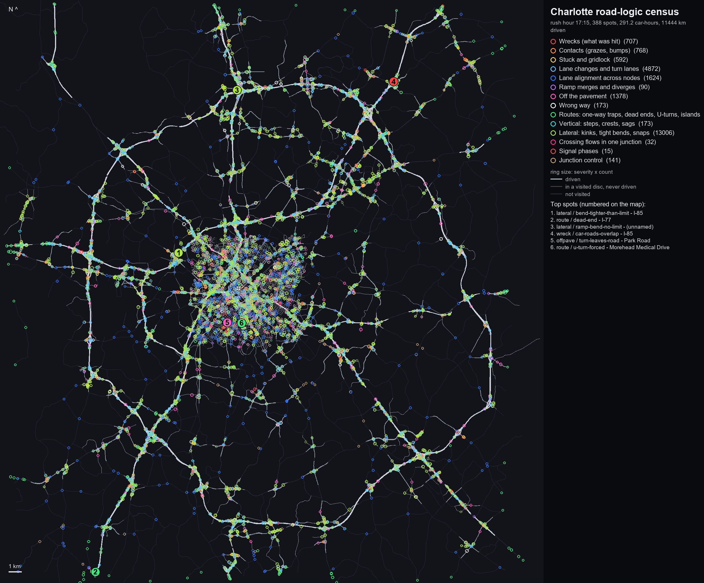

# Charlotte road logic, by traffic (census)

Generated by `tools/city-traffic-census.ps1` (Editor/CityTrafficCensus.cs, Scripts/City/CityTraffic.Census.cs, tools/traffic_census_report.py) on 2026-10-29 17:28. **Nothing here has been fixed** - this is the list to pick from.

## How it was measured

- Charlotte free roam at rush hour (17:15), the player a ghost touring **40 spots** (a greedy cover of the drivable road by 380 m discs, nearest-first from uptown), 64 cars round each spot, time scale up to 30 (physics still 1/60 s a step).
- **135.2 car-hours** simulated in 205 game minutes (14 real), **2679 km driven**, 5800 cars born, 5636 distinct junction movements taken.
- Coverage: **3343 of 25027 routable edges driven (384 of 3842 km)**; 214 km lie inside the visited discs.
- Every car is a probe: what it hits, where it stops for no reason, lanes it cannot reach, turns that leave the road, the drawn road's surface under it every metre (steps, crests, sags as the vertical speed a car at the limit gets), its heading (kinks, bends tighter than the limit), crossing flows in one box. Plus a static audit that needs no driving (signal phase groups, unsigned big-road crossings, one-way traps and islands, limits, lane alignment, merge room).
- Score = severity (0-10, below) x count. Counts of driven events grow with traffic, so a busy junction ranks above a quiet one with the same fault.
- Files: `Docs/traffic_census/census_map.png` (hotspots by category), `census_top6.jpg` (close-ups), `hotspots.csv` (every scored hotspot; .gz when large), `events.csv` (every event), `summary.json`.



## Reading it

- Static items (move `static`) come from the network itself and cover the whole map; driven items only where the tour went (the map's bright roads). A static lane item is scored by the cars that took that movement in the census.
- Two kinds are partly the traffic's own: `lane / turn-from-wrong-lane` (the traffic changed lanes late, so its turn cuts across; check the lane alignment items at the same node first) and `lateral / turn-tighter-than-planned` (the traffic's own turn arc). `traffic / overlap` is a traffic-code fault outright.
- `contact` items say where the thing touched the car (side, nose, underside) and how high above the lane: a touch on the underside is the ground or a kerb standing above the road surface.

## Category totals

| category | events | hotspots | score |
|---|---:|---:|---:|
| Wrecks (what was hit) | 175 | 65 | 1321 |
| Contacts (grazes, bumps) | 168 | 64 | 596 |
| Stuck and gridlock | 502 | 257 | 2078 |
| Lane changes and turn lanes | 1539 | 409 | 5791 |
| Lane alignment across nodes | 1624 | 1086 | 9517 |
| Ramp merges and diverges | 70 | 58 | 350 |
| Off the pavement | 462 | 194 | 1527 |
| Wrong way | 89 | 13 | 623 |
| Routes: one-way traps, dead ends, U-turns, islands | 240 | 109 | 135 |
| Vertical: steps, crests, sags | 64 | 24 | 367 |
| Lateral: kinks, tight bends, snaps | 3518 | 647 | 10990 |
| Crossing flows in one junction | 14 | 12 | 66 |
| Junction control | 18 | 16 | 90 |
| Speed limits | 6 | 6 | 12 |
| Traffic-code faults | 51 | 5 | 153 |

<details><summary>Every kind, counted</summary>

- conflict/signal-crossing-flows: 1
- conflict/stop-crossing-flows: 3
- conflict/uncontrolled-crossing: 2
- conflict/yield-crossing-flows: 8
- contact/barrier: 30
- contact/car-bump: 109
- contact/ground: 26
- contact/pole: 3
- control/no-control-major-crossing: 18
- lane/forced-into-tight-gap: 31
- lane/forced-short-change: 432
- lane/missed-turn-lane: 515
- lane/turn-from-wrong-lane: 561
- lanes/lanes-misaligned: 297
- lanes/no-continuing-lane: 1327
- lateral/bend-tighter-than-limit: 2481
- lateral/heading-snap: 611
- lateral/kink: 598
- lateral/ramp-bend-no-limit: 1203
- lateral/turn-tighter-than-planned: 526
- merge/exit-stalled: 7
- merge/ramp-waiting: 6
- merge/short-merge-zone: 57
- offpave/lane-outside-pavement: 2
- offpave/no-road-under-lane: 107
- offpave/turn-clips-corner: 338
- offpave/turn-leaves-road: 15
- route/dead-end-junction: 4
- route/dead-end-map-edge: 76
- route/hairpin-turn: 5
- route/u-turn-dead-end: 147
- route/u-turn-forced: 8
- speed/implausible-limit: 4
- speed/limit-jump: 2
- speed/missing-limit-arterial: 1
- speed/missing-limit-collector: 1
- speed/missing-limit-freeway: 1
- speed/missing-limit-trunk: 1
- stuck/behind-wreck: 16
- stuck/box-blocked-on-green: 57
- stuck/crossing-blocked: 19
- stuck/gridlock-box: 141
- stuck/keep-clear-wait: 20
- stuck/lane-change-wait: 170
- stuck/left-turn-starved: 21
- stuck/other-road-in-lane: 4
- stuck/stop-deadlock: 37
- stuck/yield-starved: 17
- traffic/overlap: 51
- vertical/crest: 19
- vertical/crest-launch: 1
- vertical/sag-jolt: 1
- vertical/step: 44
- wreck/barrier: 9
- wreck/car-across-node: 4
- wreck/car-in-junction: 72
- wreck/car-merging-roads: 10
- wreck/car-parting-roads: 7
- wreck/car-same-road: 6
- wreck/ground: 19
- wreck/pole: 3
- wreck/road-surface: 45
- wrongway/across-divider: 89

</details>

## Top 25 (all categories, by score)

1. **lane / missed-turn-lane** score 184 (sev 4.0 x 46) - Concord Parkway South / Morehead Road - (11540, 18327) - node 11699, e10943 - 46 events, 12 cars - moves: run
   - why: cars cannot reach the lane their turn needs in time (14 s with no gap): the turn lane is too short or opens too late
   - e.g. waited 14 s for a gap into lane 0 of 4 from lane 3 for its right at node 11699: replanned; car 4 0.0 m/s run e10943 cls3 dir 1 lane 3 of 4 39.3/47.9 m to signal at (11549,18312)
2. **lane / missed-turn-lane** score 148 (sev 4.0 x 37) - North Graham Street - (2210, 12434) - node 11714, e11084 - 37 events, 4 cars - moves: run
   - why: cars cannot reach the lane their turn needs in time (14 s with no gap): the turn lane is too short or opens too late
   - e.g. waited 14 s for a gap into lane 0 of 3 from lane 1 for its straight on at node 11714: replanned; car 4 0.0 m/s run e11084 cls2 dir 1 lane 1 of 3 155.6/164.1 m to signal at (2211,12428)
3. **wreck / car-in-junction** score 140 (sev 7.0 x 20) - Independence Boulevard - (13172, -10057) - node 8444, e6852, e6823 - 20 events, 14 cars - moves: straight, run
   - why: two cars collided crossing or turning in one junction: the junction's control lets conflicting movements in together
   - e.g. CityTraffic_camry_2001 (Ignore Raycast), knocked 16.2 m/s; car 27 22.1 m/s turn S at node 8444 e6852->e6823 lanes 1->1 2.6/13.8 m at (13174,-10056) / other: car 21 4.6 m/s turn S at node 8444 e6852->e6823 lanes 0->0 3.6/11.5 m at (13170,-10059)
4. **lane / turn-from-wrong-lane** score 130 (sev 5.0 x 26) - West 5th Street - (-3266, 5855) - node 4122, e10043, e2912 - 26 events, 21 cars - moves: straight, turn L
   - why: a turn begun from the wrong lane: it cuts across a lane in the box
   - e.g. began its straight on at node 4122 from lane 0; the turn is laid from lane 1: it cuts across in the box; car 10 8.4 m/s turn S at node 4122 e10043->e2912 lanes 1->0 0.0/24.8 m at (-3265,5857)
5. **lanes / no-continuing-lane** score 112 (sev 8.0 x 14) - Parkwood Avenue / North McDowell Street - (-80, 5594) - node 6731, e11728, e13271 - static, 14 cars took it
   - why: straight on, no lane lines up across the node (2 m+): the lane centres jump sideways between the two edges
   - e.g. straight on from e13271 'Parkwood Avenue' (2 lanes) into e5114 'Parkwood Avenue' (1 lanes): no lane within 2 m of any lane across the node (nearest 8.9 m) - the lanes jump sideways
6. **offpave / no-road-under-lane** score 112 (sev 7.0 x 16) - I-77 - (-3088, 6141) - node 10147, e8479 - 16 events, 13 cars - moves: run, lane change
   - why: no road surface under a lane inside the pavement band: a hole or gap in the road mesh
   - e.g. no road collider under the lane centre (inside the line model pavement); car 19 21.7 m/s run e8479 cls5 dir 1 lane 0 of 5 61.2/234.5 m to none at (-3090,6138)
7. **lane / missed-turn-lane** score 112 (sev 4.0 x 28) - North Sharon Amity Road / Albemarle Road - (5200, 1877) - node 11937, e13645 - 28 events, 8 cars - moves: run
   - why: cars cannot reach the lane their turn needs in time (14 s with no gap): the turn lane is too short or opens too late
   - e.g. waited 14 s for a gap into lane 0 of 4 from lane 3 for its right at node 11937: replanned; car 51 0.0 m/s run e13645 cls2 dir 1 lane 3 of 4 44.2/52.4 m to signal at (5197,1876)
8. **lanes / lanes-misaligned** score 107 (sev 5.4 x 20) - North Church Street - (-118, 7047) - node 9887, e8207, e8208 - static, 20 cars took it
   - why: straight on, a lane finds no partner within 2 m though the next road has as many lanes: the lanes shift across the node
   - e.g. straight on from e8207 'North Church Street' (2 lanes) into e8208 'North Church Street' (2 lanes): 1 lane(s) find nothing within 2 m (worst 4.7 m) though the next road has as many lanes
9. **wrongway / across-divider** score 105 (sev 7.0 x 15) - West Sugar Creek Road - (1577, 12687) - node 15105, e16765 - 15 events, 14 cars - moves: run
   - why: a car in its own lane sits across the centre line: the lane layout disagrees with the divider
   - e.g. lat -1.4 vs divider 1.8; car 44 7.2 m/s run e16765 cls2 dir -1 lane 0 of 1 0.1/23.0 m to none at (1576,12689)
10. **lanes / no-continuing-lane** score 102 (sev 6.0 x 17) - East Morehead Street - (-1866, 2476) - node 13077, e19353, e13227 - static, 17 cars took it
   - why: straight on, no lane lines up across the node (2 m+): the lane centres jump sideways between the two edges
   - e.g. straight on from e19353 'East Morehead Street' (2 lanes) into e13227 'East Morehead Street' (1 lanes): no lane within 2 m of any lane across the node (nearest 3.9 m) - the lanes jump sideways
11. **lanes / lanes-misaligned** score 101 (sev 5.6 x 18) - South Kings Drive - (-1664, 2493) - node 918, e512, e9716 - static, 18 cars took it
   - why: straight on, a lane finds no partner within 2 m though the next road has as many lanes: the lanes shift across the node
   - e.g. straight on from e9715 'South Kings Drive' (2 lanes) into e512 'South Kings Drive' (2 lanes): 1 lane(s) find nothing within 2 m (worst 5.3 m) though the next road has as many lanes
12. **lane / missed-turn-lane** score 100 (sev 4.0 x 25) - Pineville-Matthews Road - (-2242, -10767) - node 10477, e9027 - 25 events, 5 cars - moves: run
   - why: cars cannot reach the lane their turn needs in time (14 s with no gap): the turn lane is too short or opens too late
   - e.g. waited 14 s for a gap into lane 1 of 2 from lane 0 for its left at node 10477: replanned; car 2 0.0 m/s run e9027 cls3 dir 1 lane 0 of 2 2.9/4.8 m to none at (-2245,-10766)
13. **wrongway / across-divider** score 98 (sev 7.0 x 14) - Morehead Road - (11510, 18366) - node 13928, e14689 - 14 events, 7 cars - moves: run
   - why: a car in its own lane sits across the centre line: the lane layout disagrees with the divider
   - e.g. lat 1.1 vs divider 5.5; car 1 16.0 m/s run e14690 cls1 dir -1 lane 0 of 1 7.5/12.7 m to none at (11495,18373)
14. **wreck / road-surface** score 96 (sev 8.0 x 12) - Christenbury Parkway - (7480, 21592) - node 4201, e14497, e2978 - 12 events, 11 cars - moves: straight
   - why: the car body meets the road collider: a step or a sharp grade change in the drawn road (junction tile vs ribbon height, or the car pitched off the surface)
   - e.g. Roads (Road), knocked 5.2 m/s; car 1 7.0 m/s turn S at node 4201 e14497->e2978 lanes 1->1 13.7/49.1 m at (7479,21591)
15. **lane / missed-turn-lane** score 88 (sev 4.0 x 22) - Pavilion Boulevard / North Tryon Street - (9269, 16746) - node 6455, e4849 - 22 events, 5 cars - moves: run
   - why: cars cannot reach the lane their turn needs in time (14 s with no gap): the turn lane is too short or opens too late
   - e.g. waited 14 s for a gap into lane 2 of 3 from lane 0 for its left at node 6455: replanned; car 6 0.0 m/s run e4849 cls2 dir 1 lane 0 of 3 0.2/2.0 m to none at (9266,16750)
16. **lane / missed-turn-lane** score 88 (sev 4.0 x 22) - West W T Harris Boulevard / IBM Drive - (3787, 14777) - node 4385, e11971 - 22 events, 7 cars - moves: run
   - why: cars cannot reach the lane their turn needs in time (14 s with no gap): the turn lane is too short or opens too late
   - e.g. waited 14 s for a gap into lane 0 of 4 from lane 3 for its right at node 4385: replanned; car 24 0.0 m/s run e11971 cls3 dir 1 lane 3 of 4 27.9/36.1 m to signal at (3794,14778)
17. **lanes / no-continuing-lane** score 82 (sev 5.9 x 14) - (unnamed) - (6521, 16451) - node 6240, e9865, e9393 - static, 14 cars took it
   - why: straight on, no lane lines up across the node (2 m+): the lane centres jump sideways between the two edges
   - e.g. straight on from e9865 '' (2 lanes) into e9393 '' (1 lanes): no lane within 2 m of any lane across the node (nearest 3.8 m) - the lanes jump sideways
18. **wreck / barrier** score 81 (sev 9.0 x 9) - Independence Boulevard - (13170, -10059) - node 8444, e6852, e6823 - 9 events, 9 cars - moves: straight
   - why: a lane or turn path runs into a barrier: the barrier stands inside the drawn pavement (a taper or gore end) or the lanes are laid wider than the road here
   - e.g. Barriers (Solid), knocked 17.8 m/s; car 10 20.4 m/s turn S at node 8444 e6852->e6823 lanes 0->0 3.6/11.5 m at (13170,-10059)
19. **lateral / kink** score 80 (sev 4.0 x 20) - North Graham Street - (-1503, 6357) - node 13558, e16627 - 20 events, 20 cars - moves: run
   - why: a corner in the lane line mid-road (4 deg+ within a metre)
   - e.g. the lane turns 5.3 deg within 1.2 m mid-road (a corner in the line); car 9 13.9 m/s run e16627 cls2 dir -1 lane 0 of 1 37.8/184.2 m to none at (-1503,6357)
20. **lateral / heading-snap** score 80 (sev 4.0 x 20) - West W T Harris Boulevard - (3549, 14890) - node 10744, e9362, e17327 - 20 events, 16 cars - moves: straight
   - why: the heading jumps 6 deg+ where one leg hands over to the next: the turn arc does not meet the lane's direction
   - e.g. travel heading jumped 7.6 deg in one step at 21.8 m/s where one leg hands over to the next; car 45 21.8 m/s turn S at node 10744 e9362->e17327 lanes 3->1 0.3/3.5 m at (3547,14887)
21. **lane / missed-turn-lane** score 80 (sev 4.0 x 20) - Central Avenue / Eastway Drive - (3340, 3451) - node 6910, e6167 - 20 events, 7 cars - moves: run
   - why: cars cannot reach the lane their turn needs in time (14 s with no gap): the turn lane is too short or opens too late
   - e.g. waited 14 s for a gap into lane 0 of 4 from lane 2 for its right at node 6910: replanned; car 23 0.0 m/s run e6167 cls2 dir 1 lane 2 of 4 55.1/61.8 m to signal at (3335,3449)
22. **lanes / no-continuing-lane** score 80 (sev 8.0 x 10) - South Clarkson Street - (-3169, 5255) - node 18792, e22334, e22335 - static, 10 cars took it
   - why: straight on, no lane lines up across the node (2 m+): the lane centres jump sideways between the two edges
   - e.g. straight on from e22334 'South Clarkson Street' (1 lanes) into e22335 'South Clarkson Street' (1 lanes): no lane within 2 m of any lane across the node (nearest 8.0 m) - the lanes jump sideways
23. **lateral / bend-tighter-than-limit** score 78 (sev 3.0 x 26) - Albemarle Road - (5431, 2001) - node 2964, e1903 - 26 events, 26 cars - moves: run, lane change
   - why: a bend tighter than its limit allows (0.46 g+ at the limit): wants a smoother curve or a lower limit
   - e.g. radius 88 m mid-road: 0.70 g at the limit 89 km/h (comfortable 56 km/h); car 13 15.0 m/s run e1903 cls4 dir -1 lane 0->1 of 2 23.0/23.8 m to none at (5437,2013)
24. **wrongway / across-divider** score 77 (sev 7.0 x 11) - Monroe Road - (5471, -457) - node 15253, e17030 - 11 events, 7 cars - moves: run
   - why: a car in its own lane sits across the centre line: the lane layout disagrees with the divider
   - e.g. lat -1.7 vs divider 3.7; car 10 15.1 m/s run e17030 cls2 dir -1 lane 1 of 2 7.4/32.2 m to none at (5473,-462)
25. **lateral / heading-snap** score 76 (sev 4.0 x 19) - I-85 - (6555, 15996) - node 4342, e9390, e3083 - 19 events, 16 cars - moves: straight, run
   - why: the heading jumps 6 deg+ where one leg hands over to the next: the turn arc does not meet the lane's direction
   - e.g. travel heading jumped 11.5 deg in one step at 26.9 m/s where one leg hands over to the next; car 7 26.9 m/s run e3083 cls5 dir 1 lane 4 of 5 0.2/1117.9 m to none at (6559,15991)

## Wrecks (what was hit)

175 events in 65 hotspots. Kinds: barrier 9, car-across-node 4, car-in-junction 72, car-merging-roads 10, car-parting-roads 7, car-same-road 6, ground 19, pole 3, road-surface 45.

1. **wreck / car-in-junction** score 140 (sev 7.0 x 20) - Independence Boulevard - (13172, -10057) - node 8444, e6852, e6823 - 20 events, 14 cars - moves: straight, run
   - why: two cars collided crossing or turning in one junction: the junction's control lets conflicting movements in together
   - e.g. CityTraffic_camry_2001 (Ignore Raycast), knocked 16.2 m/s; car 27 22.1 m/s turn S at node 8444 e6852->e6823 lanes 1->1 2.6/13.8 m at (13174,-10056) / other: car 21 4.6 m/s turn S at node 8444 e6852->e6823 lanes 0->0 3.6/11.5 m at (13170,-10059)
2. **wreck / road-surface** score 96 (sev 8.0 x 12) - Christenbury Parkway - (7480, 21592) - node 4201, e14497, e2978 - 12 events, 11 cars - moves: straight
   - why: the car body meets the road collider: a step or a sharp grade change in the drawn road (junction tile vs ribbon height, or the car pitched off the surface)
   - e.g. Roads (Road), knocked 5.2 m/s; car 1 7.0 m/s turn S at node 4201 e14497->e2978 lanes 1->1 13.7/49.1 m at (7479,21591)
3. **wreck / barrier** score 81 (sev 9.0 x 9) - Independence Boulevard - (13170, -10059) - node 8444, e6852, e6823 - 9 events, 9 cars - moves: straight
   - why: a lane or turn path runs into a barrier: the barrier stands inside the drawn pavement (a taper or gore end) or the lanes are laid wider than the road here
   - e.g. Barriers (Solid), knocked 17.8 m/s; car 10 20.4 m/s turn S at node 8444 e6852->e6823 lanes 0->0 3.6/11.5 m at (13170,-10059)
4. **wreck / ground** score 64 (sev 8.0 x 8) - (unnamed) - (12715, -9347) - node 8399, e6798 - 8 events, 7 cars - moves: ramp
   - why: the ground mesh rises through the road surface (terrain above the drawn road)
   - e.g. Ground (Default), knocked 13.6 m/s; car 15 17.6 m/s run e6798 cls5L dir 1 lane 0 of 1 288.4/304.3 m to none at (12713,-9345)
5. **wreck / road-surface** score 48 (sev 8.0 x 6) - Idlewild Road - (5171, -44) - node 6952, e8394 - 6 events, 6 cars - moves: run
   - why: the car body meets the road collider: a step or a sharp grade change in the drawn road (junction tile vs ribbon height, or the car pitched off the surface)
   - e.g. Roads (Road), knocked 11.2 m/s; car 2 13.7 m/s run e8394 cls2 dir -1 lane 0 of 2 18.9/22.4 m to none at (5172,-44)
6. **wreck / road-surface** score 32 (sev 8.0 x 4) - (unnamed) - (-3223, 5615) - node 7203, e5513 - 4 events, 4 cars - moves: run
   - why: the car body meets the road collider: a step or a sharp grade change in the drawn road (junction tile vs ribbon height, or the car pitched off the surface)
   - e.g. Roads (Road), knocked 9.7 m/s; car 53 5.8 m/s run e5513 cls3L dir 1 lane 0 of 2 5.2/79.9 m to signal at (-3222,5615)
7. **wreck / road-surface** score 32 (sev 8.0 x 4) - Pineville-Matthews Road - (-2944, -10761) - node 14045, e14927, e17329 - 4 events, 4 cars - moves: straight, turn L
   - why: the car body meets the road collider: a step or a sharp grade change in the drawn road (junction tile vs ribbon height, or the car pitched off the surface)
   - e.g. Roads (Road), knocked 5.1 m/s; car 24 4.2 m/s turn L at node 14045 e14927->e14929 lanes 3->3 2.6/4.3 m at (-2943,-10762)
8. **wreck / road-surface** score 32 (sev 8.0 x 4) - Old Statesville Road - (-727, 16405) - node 4314, e20631, e8944 - 4 events, 4 cars - moves: turn R
   - why: the car body meets the road collider: a step or a sharp grade change in the drawn road (junction tile vs ribbon height, or the car pitched off the surface)
   - e.g. Roads (Road), knocked 5.7 m/s; car 20 4.2 m/s turn R at node 4314 e20631->e8944 lanes 0->0 0.6/1.1 m at (-727,16406)
9. **wreck / car-merging-roads** score 32 (sev 8.0 x 4) - West Sugar Creek Road - (1457, 12894) - node 8064, e6361 - 4 events, 4 cars - moves: run
   - why: two cars on two roads that meet at a node collided short of it: the two roads' lanes run together before the node (a ramp beside lane 0, two approaches at a sharp angle) and one car did not see the other
   - e.g. CityTraffic_sedan_98 (Ignore Raycast), knocked 4.9 m/s; car 12 15.0 m/s run e6361 cls2 dir 1 lane 0 of 1 2.9/14.1 m to none at (1457,12892) / other: car 20 6.6 m/s run e14959 cls2L dir 1 lane 0 of 1 90.6/99.7 m to signal at (1455,12896)
10. **wreck / car-in-junction** score 28 (sev 7.0 x 4) - Kenilworth Avenue - (-1851, 2804) - node 11947, e11431, e11432 - 4 events, 4 cars - moves: turn L, straight
   - why: two cars collided crossing or turning in one junction: the junction's control lets conflicting movements in together
   - e.g. CityTraffic_citroen_cx (Ignore Raycast), knocked 4.7 m/s; car 25 0.0 m/s turn L at node 11947 e11431->e11432 lanes 1->0 5.2/7.1 m at (-1851,2806) / other: car 53 2.6 m/s turn S at node 11947 e13674->e11432 lanes 0->0 21.3/26.2 m at (-1852,2803)
11. **wreck / car-in-junction** score 28 (sev 7.0 x 4) - Colony Road / Carnegie Boulevard - (-381, -3687) - node 11887, e18271 - 4 events, 4 cars - moves: turn L, straight
   - why: two cars collided crossing or turning in one junction: the junction's control lets conflicting movements in together
   - e.g. CityTraffic_volvo_estate (Ignore Raycast), knocked 6.0 m/s; car 22 1.1 m/s turn L at node 11887 e11327->e18271 lanes 1->2 2.2/9.6 m at (-381,-3692) / other: car 11 12.1 m/s turn S at node 11887 e18270->e18271 lanes 2->2 3.4/15.3 m at (-379,-3696)
12. **wreck / road-surface** score 24 (sev 8.0 x 3) - North Church Street - (-113, 7055) - node 9887, e8207, e22491 - 3 events, 3 cars - moves: turn R
   - why: the car body meets the road collider: a step or a sharp grade change in the drawn road (junction tile vs ribbon height, or the car pitched off the surface)
   - e.g. Roads (Road), knocked 5.1 m/s; car 19 7.8 m/s turn R at node 9887 e8207->e22491 lanes 0->0 11.6/30.1 m at (-113,7055)

... and 53 more in `hotspots.csv`.

## Contacts (grazes, bumps)

168 events in 64 hotspots. Kinds: barrier 30, car-bump 109, ground 26, pole 3.

1. **contact / barrier** score 70 (sev 5.0 x 14) - Independence Boulevard - (13173, -10066) - node 8444, e6852, e6823 - 14 events, 14 cars - moves: straight, run
   - why: a lane or turn passes within a car's half width of a barrier (grazes it)
   - e.g. Barriers (Solid) touched its nose (+0.1 m across, +2.2 along, 0.81 m above the lane height); car 22 5.0 m/s turn S at node 8444 e6852->e6823 lanes 0->0 3.7/11.5 m at (13170,-10059)
2. **contact / car-bump** score 36 (sev 3.0 x 12) - Independence Boulevard - (13173, -10056) - node 8444, e6852, e6823 - 12 events, 9 cars - moves: straight, run
   - why: two traffic cars bumped (below the wreck line): their paths touch here
   - e.g. a bump below the wreck line: car 30 21.4 m/s turn S at node 8444 e6852->e6823 lanes 1->1 1.5/13.8 m at (13175,-10056) / other: car 14 9.2 m/s turn S at node 8444 e6852->e6823 lanes 1->1 5.7/13.7 m at (13172,-10058)
3. **contact / barrier** score 30 (sev 5.0 x 6) - West Mallard Creek Church Road - (6654, 16417) - node 6239, e4681, e4682 - 6 events, 5 cars - moves: straight
   - why: a lane or turn passes within a car's half width of a barrier (grazes it)
   - e.g. Barriers (Solid) touched its right side (+1.0 m across, +2.1 along, 0.53 m above the lane height); car 2 13.8 m/s turn S at node 6239 e4681->e4682 lanes 0->0 2.4/4.2 m at (6654,16417)
4. **contact / ground** score 24 (sev 4.0 x 6) - North Church Street - (-110, 7055) - node 9887, e8207, e22491 - 6 events, 6 cars - moves: turn R
   - why: the ground touches the car's body: terrain at road height or above at the edge
   - e.g. Ground (Default) touched its nose (-0.1 m across, +2.1 along, 0.41 m above the lane height); car 3 5.2 m/s turn R at node 9887 e8207->e22491 lanes 0->0 11.6/30.1 m at (-113,7055)
5. **contact / car-bump** score 21 (sev 3.0 x 7) - Colony Road / Carnegie Boulevard - (-379, -3706) - node 11887, e11327, e18271 - 7 events, 7 cars - moves: turn L, run
   - why: two traffic cars bumped (below the wreck line): their paths touch here
   - e.g. a bump below the wreck line: car 5 4.2 m/s turn L at node 11887 e11327->e18271 lanes 1->2 2.4/5.9 m at (-382,-3688) / other: car 4 0.6 m/s run e18271 cls2 dir 1 lane 2 of 3 1.2/1.3 m to none at (-382,-3683)
6. **contact / car-bump** score 18 (sev 3.0 x 6) - South Kings Drive - (-1673, 2333) - node 16587, e19192, e16593 - 6 events, 3 cars - moves: run, turn R
   - why: two traffic cars bumped (below the wreck line): their paths touch here
   - e.g. a bump below the wreck line: car 59 0.0 m/s run e19192 cls2 dir -1 lane 1 of 2 0.4/6.0 m to none at (-1672,2334) / other: car 27 3.4 m/s turn R at node 15010 e19192->e16593 lanes 0->0 0.9/1.2 m at (-1675,2332)
7. **contact / ground** score 16 (sev 4.0 x 4) - North Tryon Street - (142, 7119) - node 9885, e9345, e8206 - 4 events, 4 cars - moves: straight
   - why: the ground touches the car's body: terrain at road height or above at the edge
   - e.g. Ground (Default) touched its left side (-0.7 m across, -2.4 along, 0.20 m above the lane height); car 2 10.8 m/s turn S at node 9885 e9345->e8206 lanes 1->1 9.0/9.1 m at (145,7112)
8. **contact / barrier** score 15 (sev 5.0 x 3) - West Mallard Creek Church Road - (6718, 16386) - node 6242, e4683, e10965 - 3 events, 3 cars - moves: straight
   - why: a lane or turn passes within a car's half width of a barrier (grazes it)
   - e.g. Barriers (Solid) touched its left side (-1.0 m across, +2.1 along, 0.33 m above the lane height); car 25 13.4 m/s turn S at node 6242 e4683->e10965 lanes 1->2 2.5/4.3 m at (6718,16386)
9. **contact / ground** score 12 (sev 4.0 x 3) - Christenbury Parkway - (7747, 21307) - node 15791, e20624, e20625 - 3 events, 3 cars - moves: turn L, straight
   - why: the ground touches the car's body: terrain at road height or above at the edge
   - e.g. Ground (Default) touched its left side (-0.8 m across, -2.2 along, 0.24 m above the lane height); car 18 4.4 m/s turn L at node 15791 e20624->e20625 lanes 0->1 1.2/6.7 m at (7750,21307)
10. **contact / car-bump** score 12 (sev 3.0 x 4) - University City Boulevard / North Graham Street - (2233, 12370) - node 10426, e8955 - 4 events, 4 cars - moves: run
   - why: two traffic cars bumped (below the wreck line): their paths touch here
   - e.g. a bump below the wreck line: car 39 0.0 m/s run e8955 cls2L dir 1 lane 0 of 1 11.0/47.6 m to signal at (2227,12357) / other: car 26 2.8 m/s run e10828 cls2 dir 1 lane 0 of 3 4.7/23.8 m to signal at (2225,12353)
11. **contact / car-bump** score 12 (sev 3.0 x 4) - Kenilworth Avenue - (-1851, 2804) - node 11947, e11431, e11432 - 4 events, 4 cars - moves: turn L, straight
   - why: two traffic cars bumped (below the wreck line): their paths touch here
   - e.g. a bump below the wreck line: car 25 0.0 m/s turn L at node 11947 e11431->e11432 lanes 1->0 5.2/7.1 m at (-1851,2806) / other: car 53 2.6 m/s turn S at node 11947 e13674->e11432 lanes 0->0 21.0/26.2 m at (-1852,2803)
12. **contact / car-bump** score 12 (sev 3.0 x 4) - West 4th Street - (-3047, 5299) - node 1460, e17569 - 4 events, 4 cars - moves: run
   - why: two traffic cars bumped (below the wreck line): their paths touch here
   - e.g. a bump below the wreck line: car 36 0.0 m/s run e17569 cls2 dir 1 lane 1 of 3 14.6/22.7 m to signal at (-3046,5299) / other: car 51 1.1 m/s run e17569 cls2 dir 1 lane 0 of 3 10.3/22.7 m to signal at (-3051,5300)

... and 52 more in `hotspots.csv`.

## Stuck and gridlock

502 events in 257 hotspots. Kinds: behind-wreck 16, box-blocked-on-green 57, crossing-blocked 19, gridlock-box 141, keep-clear-wait 20, lane-change-wait 170, left-turn-starved 21, other-road-in-lane 4, stop-deadlock 37, yield-starved 17.

1. **stuck / gridlock-box** score 45 (sev 5.0 x 9) - Wilkinson Boulevard / Moores Chapel Loop - (-16863, 6591) - node 1388, e3596, e3597 - 9 events, 9 cars - moves: straight, turn R
   - why: a queue stands in the junction box 15 s+: the next junction is too close (no storage) or something blocks the exit
   - e.g. held by a car crossing 1.4 m ahead, wants 12.3 m/s; car 6 0.0 m/s turn S at node 1388 e796->e797 lanes 1->1 5.1/13.8 m at (-16860,6588)
2. **stuck / gridlock-box** score 35 (sev 5.0 x 7) - North Sharon Amity Road / Albemarle Road - (5201, 1899) - node 11937, e13645, e11413 - 7 events, 7 cars - moves: straight, turn R
   - why: a queue stands in the junction box 15 s+: the next junction is too close (no storage) or something blocks the exit
   - e.g. held by a car ahead 1.5 m ahead, wants 17.0 m/s; car 2 0.0 m/s turn S at node 11937 e13645->e11417 lanes 0->0 13.4/21.5 m at (5209,1897)
3. **stuck / gridlock-box** score 35 (sev 5.0 x 7) - Edgehill Road South / Queens Road - (-1368, 1943) - node 7035, e23090, e23089 - 7 events, 7 cars - moves: straight, turn R
   - why: a queue stands in the junction box 15 s+: the next junction is too close (no storage) or something blocks the exit
   - e.g. held by a car ahead 1.5 m ahead, wants 5.7 m/s; car 41 0.0 m/s turn S at node 7035 e23090->e23089 lanes 0->0 16.4/18.9 m at (-1369,1944)
4. **stuck / gridlock-box** score 30 (sev 5.0 x 6) - West Trade Street / North Gardner Avenue - (-4213, 7058) - node 18266, e23197 - 6 events, 6 cars - moves: straight, turn L
   - why: a queue stands in the junction box 15 s+: the next junction is too close (no storage) or something blocks the exit
   - e.g. held by a car crossing -2.5 m ahead, wants 6.3 m/s; car 22 0.0 m/s turn L at node 18266 e22853->e23197 lanes 0->0 5.2/21.8 m at (-4210,7062)
5. **stuck / gridlock-box** score 30 (sev 5.0 x 6) - Eastway Drive / Central Avenue - (3359, 3452) - node 7875, e7967, e6168 - 6 events, 6 cars - moves: straight
   - why: a queue stands in the junction box 15 s+: the next junction is too close (no storage) or something blocks the exit
   - e.g. held by a car ahead 2.2 m ahead, wants 17.7 m/s; car 1 0.0 m/s turn S at node 7875 e7967->e6168 lanes 0->0 17.8/27.2 m at (3347,3461)
6. **stuck / gridlock-box** score 30 (sev 5.0 x 6) - Derita Road - (7902, 21156) - node 2019, e12118, e17089 - 6 events, 6 cars - moves: straight
   - why: a queue stands in the junction box 15 s+: the next junction is too close (no storage) or something blocks the exit
   - e.g. held by a car ahead 2.2 m ahead, wants 8.0 m/s; car 20 0.0 m/s turn S at node 2019 e12118->e17089 lanes 2->0 11.4/19.7 m at (7897,21163)
7. **stuck / gridlock-box** score 30 (sev 5.0 x 6) - Idlewild Road - (5408, -66) - node 6945, e20278, e10515 - 6 events, 5 cars - moves: turn L, straight
   - why: a queue stands in the junction box 15 s+: the next junction is too close (no storage) or something blocks the exit
   - e.g. held by a car ahead 3.0 m ahead, wants 4.0 m/s; car 19 0.7 m/s turn L at node 6945 e20278->e10515 lanes 0->1 0.0/9.7 m at (5406,-64)
8. **stuck / box-blocked-on-green** score 30 (sev 5.0 x 6) - Concord Parkway South / Morehead Road - (11569, 18339) - node 11698, e14705 - 6 events, 6 cars - moves: run
   - why: cars hold 25 s+ on a green for a car still in the box: something stands in the junction
   - e.g. held by a car in the box on its green 2.2 m ahead, wants 19.1 m/s; car 11 0.0 m/s run e14705 cls3 dir 1 lane 2 of 4 88.8/96.8 m to signal at (11567,18361)
9. **stuck / lane-change-wait** score 27 (sev 3.0 x 9) - Rea Road / Pineville-Matthews Road - (526, -10785) - node 3246, e2107 - 9 events, 7 cars - moves: run
   - why: cars wait short of the junction for the lane their turn needs: the turn lane begins too late
   - e.g. held by the lane its turn needs 2.0 m ahead, wants 13.3 m/s; car 13 0.0 m/s run e6454 cls2 dir 1 lane 2 of 4 48.2/56.3 m to signal at (533,-10757)
10. **stuck / box-blocked-on-green** score 25 (sev 5.0 x 5) - Carmel Road / Pineville-Matthews Road - (-2514, -10755) - node 10483, e9031 - 5 events, 5 cars - moves: run
   - why: cars hold 25 s+ on a green for a car still in the box: something stands in the junction
   - e.g. held by a car in the box on its green 2.2 m ahead, wants 8.3 m/s; car 25 0.0 m/s run e9031 cls3 dir 1 lane 0 of 4 7.4/16.8 m to signal at (-2537,-10771)
11. **stuck / box-blocked-on-green** score 25 (sev 5.0 x 5) - Eastway Drive / Central Avenue - (3357, 3426) - node 9658, e7963 - 5 events, 5 cars - moves: run
   - why: cars hold 25 s+ on a green for a car still in the box: something stands in the junction
   - e.g. held by a car in the box on its green 2.2 m ahead, wants 17.1 m/s; car 14 0.0 m/s run e6167 cls2 dir 1 lane 0 of 4 36.5/43.8 m to signal at (3334,3442)
12. **stuck / lane-change-wait** score 24 (sev 3.0 x 8) - West John Street / Monroe Road - (8092, -6922) - node 3338, e6575 - 8 events, 6 cars - moves: run
   - why: cars wait short of the junction for the lane their turn needs: the turn lane begins too late
   - e.g. held by the lane its turn needs 2.2 m ahead, wants 15.0 m/s; car 27 0.0 m/s run e7711 cls2 dir 1 lane 1 of 4 24.1/32.6 m to signal at (8082,-6896)

... and 245 more in `hotspots.csv`.

## Lane changes and turn lanes

1539 events in 409 hotspots. Kinds: forced-into-tight-gap 31, forced-short-change 432, missed-turn-lane 515, turn-from-wrong-lane 561.

1. **lane / missed-turn-lane** score 184 (sev 4.0 x 46) - Concord Parkway South / Morehead Road - (11540, 18327) - node 11699, e10943 - 46 events, 12 cars - moves: run
   - why: cars cannot reach the lane their turn needs in time (14 s with no gap): the turn lane is too short or opens too late
   - e.g. waited 14 s for a gap into lane 0 of 4 from lane 3 for its right at node 11699: replanned; car 4 0.0 m/s run e10943 cls3 dir 1 lane 3 of 4 39.3/47.9 m to signal at (11549,18312)
2. **lane / missed-turn-lane** score 148 (sev 4.0 x 37) - North Graham Street - (2210, 12434) - node 11714, e11084 - 37 events, 4 cars - moves: run
   - why: cars cannot reach the lane their turn needs in time (14 s with no gap): the turn lane is too short or opens too late
   - e.g. waited 14 s for a gap into lane 0 of 3 from lane 1 for its straight on at node 11714: replanned; car 4 0.0 m/s run e11084 cls2 dir 1 lane 1 of 3 155.6/164.1 m to signal at (2211,12428)
3. **lane / turn-from-wrong-lane** score 130 (sev 5.0 x 26) - West 5th Street - (-3266, 5855) - node 4122, e10043, e2912 - 26 events, 21 cars - moves: straight, turn L
   - why: a turn begun from the wrong lane: it cuts across a lane in the box
   - e.g. began its straight on at node 4122 from lane 0; the turn is laid from lane 1: it cuts across in the box; car 10 8.4 m/s turn S at node 4122 e10043->e2912 lanes 1->0 0.0/24.8 m at (-3265,5857)
4. **lane / missed-turn-lane** score 112 (sev 4.0 x 28) - North Sharon Amity Road / Albemarle Road - (5200, 1877) - node 11937, e13645 - 28 events, 8 cars - moves: run
   - why: cars cannot reach the lane their turn needs in time (14 s with no gap): the turn lane is too short or opens too late
   - e.g. waited 14 s for a gap into lane 0 of 4 from lane 3 for its right at node 11937: replanned; car 51 0.0 m/s run e13645 cls2 dir 1 lane 3 of 4 44.2/52.4 m to signal at (5197,1876)
5. **lane / missed-turn-lane** score 100 (sev 4.0 x 25) - Pineville-Matthews Road - (-2242, -10767) - node 10477, e9027 - 25 events, 5 cars - moves: run
   - why: cars cannot reach the lane their turn needs in time (14 s with no gap): the turn lane is too short or opens too late
   - e.g. waited 14 s for a gap into lane 1 of 2 from lane 0 for its left at node 10477: replanned; car 2 0.0 m/s run e9027 cls3 dir 1 lane 0 of 2 2.9/4.8 m to none at (-2245,-10766)
6. **lane / missed-turn-lane** score 88 (sev 4.0 x 22) - Pavilion Boulevard / North Tryon Street - (9269, 16746) - node 6455, e4849 - 22 events, 5 cars - moves: run
   - why: cars cannot reach the lane their turn needs in time (14 s with no gap): the turn lane is too short or opens too late
   - e.g. waited 14 s for a gap into lane 2 of 3 from lane 0 for its left at node 6455: replanned; car 6 0.0 m/s run e4849 cls2 dir 1 lane 0 of 3 0.2/2.0 m to none at (9266,16750)
7. **lane / missed-turn-lane** score 88 (sev 4.0 x 22) - West W T Harris Boulevard / IBM Drive - (3787, 14777) - node 4385, e11971 - 22 events, 7 cars - moves: run
   - why: cars cannot reach the lane their turn needs in time (14 s with no gap): the turn lane is too short or opens too late
   - e.g. waited 14 s for a gap into lane 0 of 4 from lane 3 for its right at node 4385: replanned; car 24 0.0 m/s run e11971 cls3 dir 1 lane 3 of 4 27.9/36.1 m to signal at (3794,14778)
8. **lane / missed-turn-lane** score 80 (sev 4.0 x 20) - Central Avenue / Eastway Drive - (3340, 3451) - node 6910, e6167 - 20 events, 7 cars - moves: run
   - why: cars cannot reach the lane their turn needs in time (14 s with no gap): the turn lane is too short or opens too late
   - e.g. waited 14 s for a gap into lane 0 of 4 from lane 2 for its right at node 6910: replanned; car 23 0.0 m/s run e6167 cls2 dir 1 lane 2 of 4 55.1/61.8 m to signal at (3335,3449)
9. **lane / turn-from-wrong-lane** score 75 (sev 5.0 x 15) - Matthews Township Parkway / West John Street - (8112, -6923) - node 4613, e12869, e3312 - 15 events, 13 cars - moves: straight, turn R
   - why: a turn begun from the wrong lane: it cuts across a lane in the box
   - e.g. began its right at node 4613 from lane 2 (still changing to 1); the turn is laid from lane 0: it cuts across in the box; car 11 8.0 m/s turn R at node 4613 e12869->e3312 lanes 0->0 0.0/22.7 m at (8122,-6943)
10. **lane / turn-from-wrong-lane** score 75 (sev 5.0 x 15) - North Tryon Street / J W Clay Boulevard - (6537, 13966) - node 5762, e6254, e13708 - 15 events, 13 cars - moves: straight, turn L
   - why: a turn begun from the wrong lane: it cuts across a lane in the box
   - e.g. began its straight on at node 8060 from lane 0 (still changing to 1); the turn is laid from lane 2: it cuts across in the box; car 32 9.0 m/s turn S at node 8060 e20339->e7303 lanes 2->0 0.1/22.3 m at (6549,13926)
11. **lane / missed-turn-lane** score 72 (sev 4.0 x 18) - Central Avenue - (3391, 3458) - node 9659, e12427 - 18 events, 2 cars - moves: run
   - why: cars cannot reach the lane their turn needs in time (14 s with no gap): the turn lane is too short or opens too late
   - e.g. waited 14 s for a gap into lane 0 of 4 from lane 2 for its straight on at node 9659: replanned; car 44 0.0 m/s run e12427 cls2 dir 1 lane 2 of 4 36.3/44.6 m to signal at (3391,3455)
12. **lane / missed-turn-lane** score 72 (sev 4.0 x 18) - Idlewild Road - (5109, -59) - node 11451, e11055 - 18 events, 2 cars - moves: run
   - why: cars cannot reach the lane their turn needs in time (14 s with no gap): the turn lane is too short or opens too late
   - e.g. waited 14 s for a gap into lane 2 of 3 from lane 0 for its straight on at node 11451: replanned; car 1 0.0 m/s run e11055 cls2 dir -1 lane 0 of 3 8.2/11.1 m to signal at (5112,-61)

... and 397 more in `hotspots.csv`.

## Lane alignment across nodes

1624 events in 1086 hotspots. Kinds: lanes-misaligned 297, no-continuing-lane 1327.

1. **lanes / no-continuing-lane** score 112 (sev 8.0 x 14) - Parkwood Avenue / North McDowell Street - (-80, 5594) - node 6731, e11728, e13271 - static, 14 cars took it
   - why: straight on, no lane lines up across the node (2 m+): the lane centres jump sideways between the two edges
   - e.g. straight on from e13271 'Parkwood Avenue' (2 lanes) into e5114 'Parkwood Avenue' (1 lanes): no lane within 2 m of any lane across the node (nearest 8.9 m) - the lanes jump sideways
2. **lanes / lanes-misaligned** score 107 (sev 5.4 x 20) - North Church Street - (-118, 7047) - node 9887, e8207, e8208 - static, 20 cars took it
   - why: straight on, a lane finds no partner within 2 m though the next road has as many lanes: the lanes shift across the node
   - e.g. straight on from e8207 'North Church Street' (2 lanes) into e8208 'North Church Street' (2 lanes): 1 lane(s) find nothing within 2 m (worst 4.7 m) though the next road has as many lanes
3. **lanes / no-continuing-lane** score 102 (sev 6.0 x 17) - East Morehead Street - (-1866, 2476) - node 13077, e19353, e13227 - static, 17 cars took it
   - why: straight on, no lane lines up across the node (2 m+): the lane centres jump sideways between the two edges
   - e.g. straight on from e19353 'East Morehead Street' (2 lanes) into e13227 'East Morehead Street' (1 lanes): no lane within 2 m of any lane across the node (nearest 3.9 m) - the lanes jump sideways
4. **lanes / lanes-misaligned** score 101 (sev 5.6 x 18) - South Kings Drive - (-1664, 2493) - node 918, e512, e9716 - static, 18 cars took it
   - why: straight on, a lane finds no partner within 2 m though the next road has as many lanes: the lanes shift across the node
   - e.g. straight on from e9715 'South Kings Drive' (2 lanes) into e512 'South Kings Drive' (2 lanes): 1 lane(s) find nothing within 2 m (worst 5.3 m) though the next road has as many lanes
5. **lanes / no-continuing-lane** score 82 (sev 5.9 x 14) - (unnamed) - (6521, 16451) - node 6240, e9865, e9393 - static, 14 cars took it
   - why: straight on, no lane lines up across the node (2 m+): the lane centres jump sideways between the two edges
   - e.g. straight on from e9865 '' (2 lanes) into e9393 '' (1 lanes): no lane within 2 m of any lane across the node (nearest 3.8 m) - the lanes jump sideways
6. **lanes / no-continuing-lane** score 80 (sev 8.0 x 10) - South Clarkson Street - (-3169, 5255) - node 18792, e22334, e22335 - static, 10 cars took it
   - why: straight on, no lane lines up across the node (2 m+): the lane centres jump sideways between the two edges
   - e.g. straight on from e22334 'South Clarkson Street' (1 lanes) into e22335 'South Clarkson Street' (1 lanes): no lane within 2 m of any lane across the node (nearest 8.0 m) - the lanes jump sideways
7. **lanes / lanes-misaligned** score 74 (sev 4.1 x 18) - South Boulevard - (-5270, 591) - node 7946, e6226, e11704 - static, 18 cars took it
   - why: straight on, a lane finds no partner within 2 m though the next road has as many lanes: the lanes shift across the node
   - e.g. straight on from e6226 'South Boulevard' (2 lanes) into e11704 'South Boulevard' (2 lanes): 1 lane(s) find nothing within 2 m (worst 2.2 m) though the next road has as many lanes
8. **lanes / no-continuing-lane** score 72 (sev 7.2 x 10) - West Trade Street / Wesley Heights Way - (-3729, 5836) - node 10936, e9617, e13384 - static, 10 cars took it
   - why: straight on, no lane lines up across the node (2 m+): the lane centres jump sideways between the two edges
   - e.g. straight on from e9617 'West Trade Street' (1 lanes) into e13384 'West Trade Street' (1 lanes): no lane within 2 m of any lane across the node (nearest 6.4 m) - the lanes jump sideways
9. **lanes / no-continuing-lane** score 68 (sev 5.2 x 13) - Rea Road - (541, -10761) - node 6147, e4609, e15146 - static, 13 cars took it
   - why: straight on, no lane lines up across the node (2 m+): the lane centres jump sideways between the two edges
   - e.g. straight on from e4609 '' (1 lanes) into e15146 'Rea Road' (1 lanes): no lane within 2 m of any lane across the node (nearest 2.4 m) - the lanes jump sideways
10. **lanes / lanes-misaligned** score 62 (sev 4.8 x 13) - South Tryon Street - (-4444, 2956) - node 14078, e16522, e16523 - static, 13 cars took it
   - why: straight on, a lane finds no partner within 2 m though the next road has as many lanes: the lanes shift across the node
   - e.g. straight on from e16522 'South Tryon Street' (2 lanes) into e16523 'South Tryon Street' (2 lanes): 1 lane(s) find nothing within 2 m (worst 3.6 m) though the next road has as many lanes
11. **lanes / no-continuing-lane** score 61 (sev 6.1 x 10) - West 5th Street - (-3177, 5775) - node 2149, e5449, e1311 - static, 10 cars took it
   - why: straight on, no lane lines up across the node (2 m+): the lane centres jump sideways between the two edges
   - e.g. straight on from e5449 'West 5th Street' (1 lanes) into e1311 'West 5th Street' (1 lanes): no lane within 2 m of any lane across the node (nearest 4.2 m) - the lanes jump sideways
12. **lanes / no-continuing-lane** score 59 (sev 5.4 x 11) - Hollis Road - (-4800, 806) - node 18215, e21614, e21615 - static, 11 cars took it
   - why: straight on, no lane lines up across the node (2 m+): the lane centres jump sideways between the two edges
   - e.g. straight on from e21614 'Hollis Road' (1 lanes) into e21615 'Hollis Road' (1 lanes): no lane within 2 m of any lane across the node (nearest 2.7 m) - the lanes jump sideways

... and 1074 more in `hotspots.csv`.

## Ramp merges and diverges

70 events in 58 hotspots. Kinds: exit-stalled 7, ramp-waiting 6, short-merge-zone 57.

1. **merge / exit-stalled** score 35 (sev 5.0 x 7) - Albemarle Road - (4807, 1747) - node 7484, e15272, e5767 - 7 events, 7 cars - moves: exit
   - why: cars stall in the diverge onto the ramp
   - e.g. under 2 m/s for 4 s in the diverge, held by a STOP; car 10 0.0 m/s turn S exit at node 7484 e15272->e5767 lanes 2->0 43.7/44.8 m at (4788,1737)
2. **merge / ramp-waiting** score 30 (sev 5.0 x 6) - (unnamed) - (12719, -9352) - node 8399, e6798, e6792 - 6 events, 5 cars - moves: ramp
   - why: cars stop on the ramp for the mainline: no room to merge (no acceleration lane)
   - e.g. stopped on the ramp 8 s, held by a wreck ahead; car 21 0.0 m/s run e6798 cls5L dir 1 lane 0 of 1 235.0/258.1 m to none at (12718,-9351)
3. **merge / short-merge-zone** score 10 (sev 5.0 x 2) - (unnamed) - (-3148, 6105) - node 267, e156, e8467 - static
   - why: the ramp runs alongside the freeway under 30 m before it joins: no room to merge
   - e.g. ramp e156 '' (238 m) runs within 12 deg of the freeway for only 20 m before it joins e8467 'I-77'
4. **merge / short-merge-zone** score 5 (sev 5.0 x 1) - (unnamed) - (-10549, -10352) - node 8, e4, e15234 - static
   - why: the ramp runs alongside the freeway under 30 m before it joins: no room to merge
   - e.g. ramp e4 '' (290 m) runs within 12 deg of the freeway for only 25 m before it joins e15234 'I-77'
5. **merge / short-merge-zone** score 5 (sev 5.0 x 1) - (unnamed) - (-5597, 8692) - node 240, e142, e2093 - static
   - why: the ramp runs alongside the freeway under 30 m before it joins: no room to merge
   - e.g. ramp e142 '' (101 m) runs within 12 deg of the freeway for only 20 m before it joins e2093 'Brookshire Boulevard'
6. **merge / short-merge-zone** score 5 (sev 5.0 x 1) - (unnamed) - (-3001, 6291) - node 291, e168, e6745 - static
   - why: the ramp runs alongside the freeway under 30 m before it joins: no room to merge
   - e.g. ramp e168 '' (219 m) runs within 12 deg of the freeway for only 20 m before it joins e6745 'I-77'
7. **merge / short-merge-zone** score 5 (sev 5.0 x 1) - (unnamed) - (-1884, 3395) - node 345, e196, e2342 - static
   - why: the ramp runs alongside the freeway under 30 m before it joins: no room to merge
   - e.g. ramp e196 '' (276 m) runs within 12 deg of the freeway for only 20 m before it joins e2342 'I-277'
8. **merge / short-merge-zone** score 5 (sev 5.0 x 1) - (unnamed) - (-1884, -13287) - node 468, e260, e10685 - static
   - why: the ramp runs alongside the freeway under 30 m before it joins: no room to merge
   - e.g. ramp e260 '' (845 m) runs within 12 deg of the freeway for only 20 m before it joins e10685 'I-485'
9. **merge / short-merge-zone** score 5 (sev 5.0 x 1) - (unnamed) - (-3466, 5739) - node 506, e280, e1256 - static
   - why: the ramp runs alongside the freeway under 30 m before it joins: no room to merge
   - e.g. ramp e280 '' (349 m) runs within 12 deg of the freeway for only 20 m before it joins e1256 'I-77'
10. **merge / short-merge-zone** score 5 (sev 5.0 x 1) - (unnamed) - (-2689, 14200) - node 523, e290, e8782 - static
   - why: the ramp runs alongside the freeway under 30 m before it joins: no room to merge
   - e.g. ramp e290 '' (504 m) runs within 12 deg of the freeway for only 20 m before it joins e8782 'I-77'
11. **merge / short-merge-zone** score 5 (sev 5.0 x 1) - (unnamed) - (-9326, 5883) - node 583, e321, e11967 - static
   - why: the ramp runs alongside the freeway under 30 m before it joins: no room to merge
   - e.g. ramp e321 '' (57 m) runs within 12 deg of the freeway for only 25 m before it joins e11967 'Billy Graham Parkway'
12. **merge / short-merge-zone** score 5 (sev 5.0 x 1) - (unnamed) - (-2890, 13144) - node 585, e322, e8784 - static
   - why: the ramp runs alongside the freeway under 30 m before it joins: no room to merge
   - e.g. ramp e322 '' (488 m) runs within 12 deg of the freeway for only 20 m before it joins e8784 'I-77'

... and 46 more in `hotspots.csv`.

## Off the pavement

462 events in 194 hotspots. Kinds: lane-outside-pavement 2, no-road-under-lane 107, turn-clips-corner 338, turn-leaves-road 15.

1. **offpave / no-road-under-lane** score 112 (sev 7.0 x 16) - I-77 - (-3088, 6141) - node 10147, e8479 - 16 events, 13 cars - moves: run, lane change
   - why: no road surface under a lane inside the pavement band: a hole or gap in the road mesh
   - e.g. no road collider under the lane centre (inside the line model pavement); car 19 21.7 m/s run e8479 cls5 dir 1 lane 0 of 5 61.2/234.5 m to none at (-3090,6138)
2. **offpave / no-road-under-lane** score 70 (sev 7.0 x 10) - Rea Road - (640, -10241) - node 12878, e12943 - 10 events, 8 cars - moves: run
   - why: no road surface under a lane inside the pavement band: a hole or gap in the road mesh
   - e.g. no road collider under the lane centre (inside the line model pavement); car 10 16.2 m/s run e12943 cls2 dir 1 lane 0 of 1 20.4/42.6 m to none at (640,-10241)
3. **offpave / no-road-under-lane** score 70 (sev 7.0 x 10) - I-85 - (6851, 16894) - node 9825, e8137 - 10 events, 10 cars - moves: run, lane change
   - why: no road surface under a lane inside the pavement band: a hole or gap in the road mesh
   - e.g. no road collider under the lane centre (inside the line model pavement); car 8 26.2 m/s run e8137 cls5 dir 1 lane 1 of 5 90.6/476.4 m to none at (6850,16896)
4. **offpave / no-road-under-lane** score 42 (sev 7.0 x 6) - North Tryon Street - (8705, 16487) - node 3157, e2043 - 6 events, 6 cars - moves: run
   - why: no road surface under a lane inside the pavement band: a hole or gap in the road mesh
   - e.g. no road collider under the lane centre (inside the line model pavement); car 5 16.9 m/s run e2043 cls3 dir 1 lane 1 of 2 8.6/163.4 m to signal at (8706,16482)
5. **offpave / no-road-under-lane** score 35 (sev 7.0 x 5) - Carmel Road - (-2643, -11263) - node 11145, e9997 - 5 events, 5 cars - moves: run
   - why: no road surface under a lane inside the pavement band: a hole or gap in the road mesh
   - e.g. no road collider under the lane centre (inside the line model pavement); car 7 12.8 m/s run e9997 cls3 dir 1 lane 0 of 2 81.9/422.6 m to none at (-2643,-11264)
6. **offpave / no-road-under-lane** score 35 (sev 7.0 x 5) - West 4th Street - (-2817, 5059) - node 7681, e13609 - 5 events, 5 cars - moves: run, lane change
   - why: no road surface under a lane inside the pavement band: a hole or gap in the road mesh
   - e.g. no road collider under the lane centre (inside the line model pavement); car 25 7.0 m/s run e13609 cls2 dir 1 lane 1 of 3 26.5/54.8 m to signal at (-2818,5060)
7. **offpave / no-road-under-lane** score 28 (sev 7.0 x 4) - Morehead Road - (11009, 18449) - node 146, e83 - 4 events, 3 cars - moves: run
   - why: no road surface under a lane inside the pavement band: a hole or gap in the road mesh
   - e.g. no road collider under the lane centre (inside the line model pavement); car 1 18.3 m/s run e83 cls1 dir -1 lane 0 of 1 496.5/781.8 m to none at (11010,18449)
8. **offpave / turn-clips-corner** score 28 (sev 2.0 x 14) - Independence Boulevard - (13173, -10057) - node 8444, e6852, e6823 - 14 events, 12 cars - moves: straight
   - why: the car's nose crosses the walk on this turn: the curb return is tight for the arc
   - e.g. off the road: front-left front-right; car 20 2.1 m/s turn S at node 8444 e6852->e6823 lanes 1->1 0.3/13.7 m at (13175,-10055)
9. **offpave / turn-leaves-road** score 24 (sev 6.0 x 4) - Old Statesville Road - (-719, 16406) - node 4314, e20631, e3065 - 4 events, 3 cars - moves: turn L
   - why: the turn arc leaves the road surface: the junction surface does not cover this movement (a missing corner / curb return)
   - e.g. off the road: centre; car 5 4.4 m/s turn L at node 4314 e20631->e3065 lanes 2->1 2.1/6.4 m at (-719,16406)
10. **offpave / no-road-under-lane** score 21 (sev 7.0 x 3) - Oaklawn Avenue - (-2045, 6904) - node 7567, e5841 - 3 events, 3 cars - moves: run
   - why: no road surface under a lane inside the pavement band: a hole or gap in the road mesh
   - e.g. no road collider under the lane centre (inside the line model pavement); car 19 12.9 m/s run e5841 cls1 dir -1 lane 0 of 1 7.4/157.0 m to none at (-2043,6903)
11. **offpave / no-road-under-lane** score 21 (sev 7.0 x 3) - Virginia Avenue - (1755, 5886) - node 8050, e21575 - 3 events, 3 cars - moves: run
   - why: no road surface under a lane inside the pavement band: a hole or gap in the road mesh
   - e.g. no road collider under the lane centre (inside the line model pavement); car 41 9.1 m/s run e21575 cls0 dir 1 lane 0 of 1 31.0/103.1 m to none at (1755,5886)
12. **offpave / no-road-under-lane** score 21 (sev 7.0 x 3) - I-77 - (-3532, 5629) - node 2071, e1874 - 3 events, 3 cars - moves: run
   - why: no road surface under a lane inside the pavement band: a hole or gap in the road mesh
   - e.g. no road collider under the lane centre (inside the line model pavement); car 27 21.1 m/s run e1874 cls5 dir 1 lane 0 of 4 130.7/191.5 m to none at (-3534,5627)

... and 182 more in `hotspots.csv`.

## Wrong way

89 events in 13 hotspots. Kinds: across-divider 89.

1. **wrongway / across-divider** score 105 (sev 7.0 x 15) - West Sugar Creek Road - (1577, 12687) - node 15105, e16765 - 15 events, 14 cars - moves: run
   - why: a car in its own lane sits across the centre line: the lane layout disagrees with the divider
   - e.g. lat -1.4 vs divider 1.8; car 44 7.2 m/s run e16765 cls2 dir -1 lane 0 of 1 0.1/23.0 m to none at (1576,12689)
2. **wrongway / across-divider** score 98 (sev 7.0 x 14) - Morehead Road - (11510, 18366) - node 13928, e14689 - 14 events, 7 cars - moves: run
   - why: a car in its own lane sits across the centre line: the lane layout disagrees with the divider
   - e.g. lat 1.1 vs divider 5.5; car 1 16.0 m/s run e14690 cls1 dir -1 lane 0 of 1 7.5/12.7 m to none at (11495,18373)
3. **wrongway / across-divider** score 77 (sev 7.0 x 11) - Monroe Road - (5471, -457) - node 15253, e17030 - 11 events, 7 cars - moves: run
   - why: a car in its own lane sits across the centre line: the lane layout disagrees with the divider
   - e.g. lat -1.7 vs divider 3.7; car 10 15.1 m/s run e17030 cls2 dir -1 lane 1 of 2 7.4/32.2 m to none at (5473,-462)
4. **wrongway / across-divider** score 70 (sev 7.0 x 10) - South Kings Drive - (-1672, 2335) - node 16587, e19192 - 10 events, 2 cars - moves: run
   - why: a car in its own lane sits across the centre line: the lane layout disagrees with the divider
   - e.g. lat -2.0 vs divider 0.0; car 59 0.2 m/s run e19192 cls2 dir -1 lane 1 of 2 0.4/6.0 m to none at (-1672,2334)
5. **wrongway / across-divider** score 70 (sev 7.0 x 10) - West Morehead Street - (-3870, 4938) - node 3162, e15305 - 10 events, 10 cars - moves: run
   - why: a car in its own lane sits across the centre line: the lane layout disagrees with the divider
   - e.g. lat 2.3 vs divider 3.7; car 2 15.0 m/s run e15305 cls3 dir -1 lane 0 of 1 22.1/22.2 m to none at (-3873,4939)
6. **wrongway / across-divider** score 42 (sev 7.0 x 6) - Cox Mill Road - (7508, 21646) - node 15668, e17725 - 6 events, 6 cars - moves: run
   - why: a car in its own lane sits across the centre line: the lane layout disagrees with the divider
   - e.g. lat -2.4 vs divider -3.7; car 35 15.0 m/s run e17725 cls2 dir 1 lane 0 of 1 36.1/39.4 m to none at (7510,21648)
7. **wrongway / across-divider** score 42 (sev 7.0 x 6) - Mallard Creek Road - (7648, 20702) - node 14836, e16239 - 6 events, 3 cars - moves: run
   - why: a car in its own lane sits across the centre line: the lane layout disagrees with the divider
   - e.g. lat 4.1 vs divider 5.5; car 37 15.2 m/s run e16876 cls2 dir -1 lane 0 of 1 4.1/5.2 m to none at (7645,20696)
8. **wrongway / across-divider** score 42 (sev 7.0 x 6) - Monroe Road - (5444, -403) - node 15255, e17074 - 6 events, 5 cars - moves: run
   - why: a car in its own lane sits across the centre line: the lane layout disagrees with the divider
   - e.g. lat 2.2 vs divider 3.7; car 10 17.3 m/s run e17074 cls2 dir -1 lane 1 of 2 28.5/43.4 m to none at (5445,-406)
9. **wrongway / across-divider** score 28 (sev 7.0 x 4) - West Sugar Creek Road - (1307, 13181) - node 15270, e17053 - 4 events, 4 cars - moves: run
   - why: a car in its own lane sits across the centre line: the lane layout disagrees with the divider
   - e.g. lat -2.5 vs divider -3.7; car 20 13.9 m/s run e17053 cls2 dir 1 lane 0 of 1 1.6/29.6 m to none at (1308,13179)
10. **wrongway / across-divider** score 14 (sev 7.0 x 2) - North Graham Street - (-1234, 6779) - node 15053, e16667 - 2 events, 2 cars - moves: run
   - why: a car in its own lane sits across the centre line: the lane layout disagrees with the divider
   - e.g. lat -1.8 vs divider 0.0; car 39 8.3 m/s run e16667 cls2 dir -1 lane 1 of 2 7.1/12.7 m to none at (-1235,6778)
11. **wrongway / across-divider** score 14 (sev 7.0 x 2) - Stallings Road - (13256, -9440) - node 16103, e18419 - 2 events, 1 cars - moves: run
   - why: a car in its own lane sits across the centre line: the lane layout disagrees with the divider
   - e.g. lat -1.8 vs divider 0.0; car 28 14.9 m/s run e18418 cls2 dir -1 lane 0 of 1 3.0/30.9 m to none at (13249,-9449)
12. **wrongway / across-divider** score 14 (sev 7.0 x 2) - Monroe Road - (5320, -208) - node 7273, e17987 - 2 events, 2 cars - moves: run
   - why: a car in its own lane sits across the centre line: the lane layout disagrees with the divider
   - e.g. lat 2.5 vs divider 3.7; car 7 15.2 m/s run e17987 cls2 dir -1 lane 1 of 2 1.5/28.0 m to none at (5320,-208)

... and 1 more in `hotspots.csv`.

## Routes: one-way traps, dead ends, U-turns, islands

240 events in 109 hotspots. Kinds: dead-end-junction 4, dead-end-map-edge 76, hairpin-turn 5, u-turn-dead-end 147, u-turn-forced 8.

1. **route / u-turn-forced** score 16 (sev 4.0 x 4) - West 4th Street Extension - (-3184, 5361) - node 7197, e5510 - 4 events, 4 cars - moves: U-turn
   - why: a U-turn at a node with other arms: none of them was legal (one-way tags) or the 1-in-1000 pick
   - e.g. a U-turn at node 7197 (degree 3) on e5510 'West 4th Street Extension' cls2: no other legal way on, or the 1-in-1000 pick
2. **route / hairpin-turn** score 16 (sev 4.0 x 4) - (unnamed) - (7644, 21474) - node 13415, e13819, e14497 - 4 events, 3 cars - moves: U-turn
   - why: a movement of more than 150 deg between two roads at one node: an acute junction
   - e.g. a turn of more than 150 deg at node 13415 from e13819 '' into e14497 'Christenbury Parkway' (taken at 3 m/s as a U-turn)
3. **route / u-turn-forced** score 8 (sev 4.0 x 2) - South Kings Drive - (-1672, 2333) - node 15010, e19192 - 2 events, 2 cars - moves: U-turn
   - why: a U-turn at a node with other arms: none of them was legal (one-way tags) or the 1-in-1000 pick
   - e.g. a U-turn at node 15010 (degree 3) on e19192 'South Kings Drive' cls2: no other legal way on, or the 1-in-1000 pick
4. **route / dead-end-junction** score 6 (sev 6.0 x 1) - Barry Street - (777, 5365) - node 17646, e21043 - static
   - why: the road meets other roads but may enter none (all one-way inbound): only a U-turn
   - e.g. e21043 'Barry Street' meets 1 arms at node 17646 and may enter none of them (all one-way inbound): only a U-turn
5. **route / dead-end-junction** score 6 (sev 6.0 x 1) - East 16th Street - (-736, 5549) - node 19154, e22931 - static
   - why: the road meets other roads but may enter none (all one-way inbound): only a U-turn
   - e.g. e22931 'East 16th Street' meets 1 arms at node 19154 and may enter none of them (all one-way inbound): only a U-turn
6. **route / dead-end-junction** score 6 (sev 6.0 x 1) - Buchanan Street - (-2255, 2074) - node 19751, e24053 - static
   - why: the road meets other roads but may enter none (all one-way inbound): only a U-turn
   - e.g. e24053 'Buchanan Street' meets 1 arms at node 19751 and may enter none of them (all one-way inbound): only a U-turn
7. **route / dead-end-junction** score 6 (sev 6.0 x 1) - Morehead Medical Drive - (-2066, 2043) - node 19462, e24664 - static
   - why: the road meets other roads but may enter none (all one-way inbound): only a U-turn
   - e.g. e24664 'Morehead Medical Drive' meets 1 arms at node 19462 and may enter none of them (all one-way inbound): only a U-turn
8. **route / u-turn-forced** score 4 (sev 4.0 x 1) - Westbrook Drive - (-3529, 5366) - node 18273, e21678 - 1 events, 1 cars - moves: U-turn
   - why: a U-turn at a node with other arms: none of them was legal (one-way tags) or the 1-in-1000 pick
   - e.g. a U-turn at node 18273 (degree 2) on e21678 'Westbrook Drive' cls0: no other legal way on, or the 1-in-1000 pick
9. **route / u-turn-forced** score 4 (sev 4.0 x 1) - Morehead Road - (11540, 18354) - node 11698, e14689 - 1 events, 1 cars - moves: U-turn
   - why: a U-turn at a node with other arms: none of them was legal (one-way tags) or the 1-in-1000 pick
   - e.g. a U-turn at node 11698 (degree 5) on e14689 'Morehead Road' cls1: no other legal way on, or the 1-in-1000 pick
10. **route / hairpin-turn** score 4 (sev 4.0 x 1) - Statesville Avenue - (-1678, 6882) - node 9013, e12488, e13245 - 1 events, 1 cars - moves: U-turn
   - why: a movement of more than 150 deg between two roads at one node: an acute junction
   - e.g. a turn of more than 150 deg at node 9013 from e12488 'Statesville Avenue' into e13245 'Statesville Avenue' (taken at 3 m/s as a U-turn)
11. **route / u-turn-dead-end** score 3 (sev 0.3 x 9) - Trade Park Court - (-5482, 1654) - node 18011, e21394 - 9 events, 9 cars - moves: U-turn
   - why: a U-turn at a cul-de-sac (normal)
   - e.g. a U-turn at node 18011 (degree 1) on e21394 'Trade Park Court' cls0: a dead end
12. **route / u-turn-dead-end** score 2 (sev 0.3 x 8) - Thurmond Place - (1012, 4665) - node 18302, e21704 - 8 events, 8 cars - moves: U-turn
   - why: a U-turn at a cul-de-sac (normal)
   - e.g. a U-turn at node 18302 (degree 1) on e21704 'Thurmond Place' cls0: a dead end

... and 97 more in `hotspots.csv`.

## Vertical: steps, crests, sags

64 events in 24 hotspots. Kinds: crest 19, crest-launch 1, sag-jolt 1, step 44.

1. **vertical / step** score 60 (sev 6.0 x 10) - Eastway Drive - (3231, 2938) - node 11477, e10550 - 10 events, 9 cars - moves: run
   - why: a step in the road surface: a lip between pieces (junction tile vs ribbon, a deck end)
   - e.g. the road surface drops 22 cm in 1.1 m (grade -2% before); car 29 6.1 m/s run e10550 cls3 dir 1 lane 0 of 4 4.9/11.9 m to none at (3231,2937)
2. **vertical / crest** score 45 (sev 5.0 x 9) - Eastway Drive - (3231, 2938) - node 11477, e10550 - 9 events, 9 cars - moves: run
   - why: a sharp crest: a car at the limit goes light
   - e.g. grade 0.7% -> -7.7% within 6 m (vertical radius 36 m): 1.7 m/s vertical at the limit 72 km/h (floats 15 cm); car 8 6.2 m/s run e10550 cls3 dir 1 lane 0 of 4 4.1/11.9 m to none at (3231,2938)
3. **vertical / step** score 42 (sev 6.0 x 7) - Salome Church Road - (9032, 16710) - node 2636, e1659 - 7 events, 6 cars - moves: run
   - why: a step in the road surface: a lip between pieces (junction tile vs ribbon, a deck end)
   - e.g. the road surface drops 18 cm in 1.1 m (grade -4% before); car 19 5.1 m/s run e1659 cls2 dir 1 lane 0 of 1 1.3/41.8 m to none at (9032,16710)
4. **vertical / step** score 24 (sev 6.0 x 4) - Christenbury Parkway - (7745, 21299) - node 15791, e14495, e20623 - 4 events, 2 cars - moves: run, turn R
   - why: a step in the road surface: a lip between pieces (junction tile vs ribbon, a deck end)
   - e.g. the road surface drops 25 cm in 1.1 m (grade -3% before); car 14 3.2 m/s turn S at node 15791 e17922->e20625 lanes 1->1 0.7/4.0 m at (7746,21304)
5. **vertical / step** score 24 (sev 6.0 x 4) - Christenbury Parkway - (7478, 21593) - node 4201, e14497, e2978 - 4 events, 4 cars - moves: straight
   - why: a step in the road surface: a lip between pieces (junction tile vs ribbon, a deck end)
   - e.g. the road surface rises 33 cm in 1.1 m (grade 5% before); car 31 7.4 m/s turn S at node 4201 e14497->e2978 lanes 0->0 14.6/49.1 m at (7481,21595)
6. **vertical / step** score 18 (sev 6.0 x 3) - (unnamed) - (-3205, 5596) - node 7203, e5513 - 3 events, 2 cars - moves: run
   - why: a step in the road surface: a lip between pieces (junction tile vs ribbon, a deck end)
   - e.g. the road surface drops 19 cm in 1.1 m (grade 4% before); car 3 7.2 m/s run e5513 cls3L dir 1 lane 0 of 2 12.3/79.9 m to signal at (-3218,5609)
7. **vertical / step** score 18 (sev 6.0 x 3) - Old Statesville Road - (-729, 16402) - node 5032, e8944 - 3 events, 3 cars - moves: run
   - why: a step in the road surface: a lip between pieces (junction tile vs ribbon, a deck end)
   - e.g. the road surface drops 15 cm in 1.0 m (grade -2% before); car 6 3.6 m/s run e8944 cls3 dir 1 lane 0 of 2 3.8/20.8 m to signal at (-729,16401)
8. **vertical / crest** score 15 (sev 5.0 x 3) - Christenbury Parkway - (7746, 21298) - node 10837, e14495, e20623 - 3 events, 3 cars - moves: run, turn R
   - why: a sharp crest: a car at the limit goes light
   - e.g. grade 9.3% -> -2.6% within 6 m (vertical radius 25 m): 2.1 m/s vertical at the limit 64 km/h (floats 23 cm); car 11 1.9 m/s run e14495 cls2 dir 1 lane 2 of 3 27.5/29.5 m to signal at (7744,21293)
9. **vertical / step** score 12 (sev 6.0 x 2) - North Cedar Street - (-2756, 5652) - node 17793, e23865, e21176 - 2 events, 2 cars - moves: straight
   - why: a step in the road surface: a lip between pieces (junction tile vs ribbon, a deck end)
   - e.g. the road surface drops 11 cm in 1.0 m (grade 4% before); car 54 7.7 m/s turn S at node 17793 e23865->e21176 lanes 0->0 10.8/18.5 m at (-2756,5652)
10. **vertical / step** score 12 (sev 6.0 x 2) - Mecklenburg Avenue - (1425, 5231) - node 20179, e24986, e24983 - 2 events, 2 cars - moves: turn R
   - why: a step in the road surface: a lip between pieces (junction tile vs ribbon, a deck end)
   - e.g. the road surface drops 22 cm in 1.0 m (grade -5% before); car 9 10.5 m/s turn R at node 20179 e24986->e24983 lanes 0->0 3.7/20.1 m at (1425,5231)
11. **vertical / step** score 12 (sev 6.0 x 2) - Idlewild Road - (5176, -44) - node 6952, e8394, e8393 - 2 events, 2 cars - moves: run, turn R
   - why: a step in the road surface: a lip between pieces (junction tile vs ribbon, a deck end)
   - e.g. the road surface rises 24 cm in 1.1 m (grade 3% before); car 18 16.7 m/s run e8394 cls2 dir -1 lane 0 of 2 21.8/22.4 m to none at (5175,-44)
12. **vertical / crest** score 10 (sev 5.0 x 2) - North Tryon Street - (9576, 16826) - node 3156, e2042 - 2 events, 2 cars - moves: run
   - why: a sharp crest: a car at the limit goes light
   - e.g. grade 3.4% -> -4.8% within 6 m (vertical radius 38 m): 2.0 m/s vertical at the limit 89 km/h (floats 21 cm); car 19 5.7 m/s run e2042 cls3 dir 1 lane 1 of 2 2.3/120.2 m to none at (9576,16826)

... and 12 more in `hotspots.csv`.

## Lateral: kinks, tight bends, snaps

3518 events in 647 hotspots. Kinds: bend-tighter-than-limit 2481, heading-snap 611, kink 598, ramp-bend-no-limit 1203, turn-tighter-than-planned 526.

1. **lateral / kink** score 80 (sev 4.0 x 20) - North Graham Street - (-1503, 6357) - node 13558, e16627 - 20 events, 20 cars - moves: run
   - why: a corner in the lane line mid-road (4 deg+ within a metre)
   - e.g. the lane turns 5.3 deg within 1.2 m mid-road (a corner in the line); car 9 13.9 m/s run e16627 cls2 dir -1 lane 0 of 1 37.8/184.2 m to none at (-1503,6357)
2. **lateral / heading-snap** score 80 (sev 4.0 x 20) - West W T Harris Boulevard - (3549, 14890) - node 10744, e9362, e17327 - 20 events, 16 cars - moves: straight
   - why: the heading jumps 6 deg+ where one leg hands over to the next: the turn arc does not meet the lane's direction
   - e.g. travel heading jumped 7.6 deg in one step at 21.8 m/s where one leg hands over to the next; car 45 21.8 m/s turn S at node 10744 e9362->e17327 lanes 3->1 0.3/3.5 m at (3547,14887)
3. **lateral / bend-tighter-than-limit** score 78 (sev 3.0 x 26) - Albemarle Road - (5431, 2001) - node 2964, e1903 - 26 events, 26 cars - moves: run, lane change
   - why: a bend tighter than its limit allows (0.46 g+ at the limit): wants a smoother curve or a lower limit
   - e.g. radius 88 m mid-road: 0.70 g at the limit 89 km/h (comfortable 56 km/h); car 13 15.0 m/s run e1903 cls4 dir -1 lane 0->1 of 2 23.0/23.8 m to none at (5437,2013)
4. **lateral / heading-snap** score 76 (sev 4.0 x 19) - I-85 - (6555, 15996) - node 4342, e9390, e3083 - 19 events, 16 cars - moves: straight, run
   - why: the heading jumps 6 deg+ where one leg hands over to the next: the turn arc does not meet the lane's direction
   - e.g. travel heading jumped 11.5 deg in one step at 26.9 m/s where one leg hands over to the next; car 7 26.9 m/s run e3083 cls5 dir 1 lane 4 of 5 0.2/1117.9 m to none at (6559,15991)
5. **lateral / bend-tighter-than-limit** score 75 (sev 3.0 x 25) - West John Street - (8213, -7259) - node 4629, e3804 - 25 events, 25 cars - moves: run
   - why: a bend tighter than its limit allows (0.46 g+ at the limit): wants a smoother curve or a lower limit
   - e.g. radius 45 m mid-road: 0.55 g at the limit 56 km/h (comfortable 40 km/h); car 6 12.9 m/s run e3804 cls2 dir 1 lane 0 of 1 30.9/321.6 m to none at (8212,-7260)
6. **lateral / bend-tighter-than-limit** score 69 (sev 3.0 x 23) - West Trade Street - (-3741, 5886) - node 10936, e9614 - 23 events, 23 cars - moves: run
   - why: a bend tighter than its limit allows (0.46 g+ at the limit): wants a smoother curve or a lower limit
   - e.g. radius 27 m mid-road: 1.19 g at the limit 64 km/h (comfortable 32 km/h); car 7 10.0 m/s run e9614 cls2 dir 1 lane 0 of 1 7.1/177.8 m to none at (-3727,5850)
7. **lateral / bend-tighter-than-limit** score 69 (sev 3.0 x 23) - Nevin Road - (1425, 13102) - node 2465, e1532 - 23 events, 23 cars - moves: run, lane change
   - why: a bend tighter than its limit allows (0.46 g+ at the limit): wants a smoother curve or a lower limit
   - e.g. radius 49 m mid-road: 0.67 g at the limit 64 km/h (comfortable 42 km/h); car 13 14.5 m/s run e4631 cls2 dir 1 lane 1 of 2 108.8/433.7 m to none at (1473,13131)
8. **lateral / heading-snap** score 68 (sev 4.0 x 17) - Albemarle Road - (5438, 2005) - node 2964, e11413, e1903 - 17 events, 17 cars - moves: straight
   - why: the heading jumps 6 deg+ where one leg hands over to the next: the turn arc does not meet the lane's direction
   - e.g. travel heading jumped 10.9 deg in one step at 10.1 m/s inside the turn arc; car 39 10.1 m/s turn S at node 2964 e11413->e1903 lanes 0->1 0.2/2.7 m at (5438,2002)
9. **lateral / heading-snap** score 68 (sev 4.0 x 17) - Carmel Road - (-2462, -10588) - node 7390, e5684, e16869 - 17 events, 16 cars - moves: turn R
   - why: the heading jumps 6 deg+ where one leg hands over to the next: the turn arc does not meet the lane's direction
   - e.g. travel heading jumped 77.9 deg in one step at 7.0 m/s inside the turn arc; car 40 7.0 m/s turn R at node 7390 e5684->e16869 lanes 0->0 0.1/1.0 m at (-2462,-10588)
10. **lateral / bend-tighter-than-limit** score 66 (sev 3.0 x 22) - South Kings Drive / Baldwin Avenue - (-1656, 2484) - node 918, e24224 - 22 events, 22 cars - moves: run, lane change
   - why: a bend tighter than its limit allows (0.46 g+ at the limit): wants a smoother curve or a lower limit
   - e.g. radius 25 m mid-road: 1.33 g at the limit 64 km/h (comfortable 30 km/h); car 18 10.6 m/s run e9716 cls2 dir 1 lane 1 of 2 6.5/47.1 m to none at (-1673,2480)
11. **lateral / bend-tighter-than-limit** score 66 (sev 3.0 x 22) - Institute Circle / Robert D Snyder Road - (6871, 14160) - node 11992, e11510 - 22 events, 22 cars - moves: run
   - why: a bend tighter than its limit allows (0.46 g+ at the limit): wants a smoother curve or a lower limit
   - e.g. radius 16 m mid-road: 1.56 g at the limit 56 km/h (comfortable 24 km/h); car 11 7.5 m/s run e11511 cls1 dir 1 lane 0 of 1 18.5/23.6 m to none at (6880,14175)
12. **lateral / bend-tighter-than-limit** score 63 (sev 3.0 x 21) - Westbrook Drive / Greenleaf Avenue - (-3527, 5365) - node 18273, e21678 - 21 events, 21 cars - moves: run
   - why: a bend tighter than its limit allows (0.46 g+ at the limit): wants a smoother curve or a lower limit
   - e.g. radius 12 m mid-road: 1.03 g at the limit 40 km/h (comfortable 21 km/h); car 29 7.7 m/s run e21678 cls0 dir -1 lane 0 of 1 11.9/220.8 m to none at (-3518,5364)

... and 635 more in `hotspots.csv`.

## Crossing flows in one junction

14 events in 12 hotspots. Kinds: signal-crossing-flows 1, stop-crossing-flows 3, uncontrolled-crossing 2, yield-crossing-flows 8.

1. **conflict / yield-crossing-flows** score 12 (sev 4.0 x 3) - West John Street / Monroe Road - (8095, -6929) - node 3338, e6575, e2176 - 3 events, 2 cars - moves: straight
   - why: crossing flows meet in the box at a yield junction
   - e.g. two cars cross in one junction box 4.7 m apart (signal / no control); A: car 3 5.0 m/s turn S at node 5026 e7711->e6575 lanes 2->0 10.3/20.9 m at (8090,-6914) / B: car 15 15.7 m/s turn S at node 5026 e12371->e3621 lanes 0->0 7.3/28.7 m at (8092,-6918)
2. **conflict / signal-crossing-flows** score 7 (sev 7.0 x 1) - Nevin Road - (999, 12906) - node 15074, e16702, e16945 - 1 events, 1 cars - moves: turn L
   - why: cars from crossing approaches in the box together under signals: phase groups or clearance wrong
   - e.g. two cars cross in one junction box 4.6 m apart (signal / signal); A: car 23 4.2 m/s turn L at node 15074 e16702->e16945 lanes 1->0 3.9/14.7 m at (999,12906) / B: car 25 4.3 m/s turn S at node 15074 e16945->e16946 lanes 0->0 2.9/24.4 m at (1001,12902)
3. **conflict / uncontrolled-crossing** score 6 (sev 6.0 x 1) - Queens Road - (-1182, 1688) - node 7026, e9078, e5355 - 1 events, 1 cars - moves: turn L
   - why: crossing flows meet in a junction with no control at all: a signal or STOP missing
   - e.g. two cars cross in one junction box 4.5 m apart (no control / no control); A: car 9 4.8 m/s turn L at node 7026 e9078->e5355 lanes 1->0 1.7/10.4 m at (-1182,1688) / B: car 14 3.9 m/s turn L at node 7026 e5355->e9079 lanes 0->1 0.5/9.8 m at (-1186,1689)
4. **conflict / uncontrolled-crossing** score 6 (sev 6.0 x 1) - Queens Road West - (-1272, 1782) - node 5726, e12838, e5363 - 1 events, 1 cars - moves: straight
   - why: crossing flows meet in a junction with no control at all: a signal or STOP missing
   - e.g. two cars cross in one junction box 3.3 m apart (no control / no control); A: car 51 3.9 m/s turn S at node 5726 e12838->e4203 lanes 0->0 5.5/17.9 m at (-1272,1782) / B: car 56 14.4 m/s turn S at node 5726 e5363->e4776 lanes 0->0 9.8/14.6 m at (-1274,1780)
5. **conflict / stop-crossing-flows** score 5 (sev 5.0 x 1) - (unnamed) - (-1358, 1951) - node 7032, e5358, e23087 - 1 events, 1 cars - moves: straight
   - why: crossing flows meet in the box at a STOP junction
   - e.g. two cars cross in one junction box 4.9 m apart (no control / STOP); A: car 28 12.3 m/s turn S at node 7032 e5358->e5359 lanes 0->0 10.5/32.0 m at (-1357,1951) / B: car 35 2.9 m/s turn S at node 7032 e23087->e23088 lanes 0->0 14.9/22.2 m at (-1355,1955)
6. **conflict / stop-crossing-flows** score 5 (sev 5.0 x 1) - Wolfberry Street - (-1219, 6790) - node 15054, e23261, e16667 - 1 events, 1 cars - moves: turn L
   - why: crossing flows meet in the box at a STOP junction
   - e.g. two cars cross in one junction box 3.2 m apart (STOP / no control); A: car 3 5.1 m/s turn L at node 15054 e23261->e16667 lanes 0->1 9.1/25.0 m at (-1219,6790) / B: car 58 11.5 m/s turn S at node 15054 e16667->e16668 lanes 0->0 10.5/25.1 m at (-1222,6791)
7. **conflict / stop-crossing-flows** score 5 (sev 5.0 x 1) - Kennon Street - (522, 4998) - node 14216, e23686, e15221 - 1 events, 1 cars - moves: straight
   - why: crossing flows meet in the box at a STOP junction
   - e.g. two cars cross in one junction box 3.3 m apart (STOP / no control); A: car 45 6.8 m/s turn S at node 14216 e23686->e21436 lanes 0->0 9.3/24.1 m at (522,4998) / B: car 14 9.9 m/s turn S at node 14216 e15221->e15222 lanes 0->0 10.7/24.0 m at (521,4995)
8. **conflict / yield-crossing-flows** score 4 (sev 4.0 x 1) - (unnamed) - (8861, 16609) - node 288, e4869, e4852 - 1 events, 1 cars - moves: straight
   - why: crossing flows meet in the box at a yield junction
   - e.g. two cars cross in one junction box 3.5 m apart (no control / signal); A: car 22 12.8 m/s turn S at node 288 e4869->e167 lanes 0->0 10.1/31.2 m at (8861,16609) / B: car 1 19.6 m/s turn S at node 288 e4852->e4845 lanes 1->0 12.3/40.2 m at (8864,16611)
9. **conflict / yield-crossing-flows** score 4 (sev 4.0 x 1) - Mallard Creek Road - (3530, 14908) - node 11644, e10862, e14783 - 1 events, 1 cars - moves: straight
   - why: crossing flows meet in the box at a yield junction
   - e.g. two cars cross in one junction box 3.9 m apart (signal / no control); A: car 10 6.1 m/s turn S at node 11644 e10862->e14782 lanes 1->1 8.5/24.3 m at (3530,14908) / B: car 28 18.3 m/s turn S at node 11644 e14783->e15407 lanes 0->0 8.3/26.1 m at (3529,14905)
10. **conflict / yield-crossing-flows** score 4 (sev 4.0 x 1) - Kenilworth Avenue - (-2104, 2366) - node 1157, e656, e24054 - 1 events, 1 cars - moves: straight
   - why: crossing flows meet in the box at a yield junction
   - e.g. two cars cross in one junction box 3.9 m apart (signal / no control); A: car 6 15.7 m/s turn S at node 1157 e656->e8312 lanes 0->0 15.5/31.0 m at (-2104,2365) / B: car 37 5.3 m/s turn S at node 1157 e24054->e20875 lanes 0->0 3.7/23.5 m at (-2100,2363)
11. **conflict / yield-crossing-flows** score 4 (sev 4.0 x 1) - Queens Road West - (-2061, 193) - node 1339, e4548, e12502 - 1 events, 1 cars - moves: straight
   - why: crossing flows meet in the box at a yield junction
   - e.g. two cars cross in one junction box 4.2 m apart (yield / no control); A: car 9 6.8 m/s turn S at node 1339 e4548->e12503 lanes 1->0 6.5/22.5 m at (-2061,193) / B: car 20 2.7 m/s turn S at node 1339 e12502->e766 lanes 0->0 1.3/17.9 m at (-2057,191)
12. **conflict / yield-crossing-flows** score 4 (sev 4.0 x 1) - Seigle Avenue - (50, 5527) - node 7739, e10629, e13270 - 1 events, 1 cars - moves: straight
   - why: crossing flows meet in the box at a yield junction
   - e.g. two cars cross in one junction box 4.1 m apart (no control / signal); A: car 19 2.9 m/s turn S at node 7739 e10629->e6014 lanes 0->0 0.1/16.7 m at (50,5527) / B: car 28 12.9 m/s turn S at node 7739 e13270->e11760 lanes 0->0 8.7/26.0 m at (46,5525)

## Junction control

18 events in 16 hotspots. Kinds: no-control-major-crossing 18.

1. **control / no-control-major-crossing** score 10 (sev 5.0 x 2) - Monroe Road - (6357, -3279) - node 8127, e6440, e14074 - static
   - why: three or more class-2+ arms meet with no signal or STOP and no through road: the data likely misses a signal
   - e.g. node 8127: 3 arms of class 2+ ('Monroe Road' / 'Monroe Road') meet with no signal or STOP and no through road: everyone yields, the car on the right first
2. **control / no-control-major-crossing** score 10 (sev 5.0 x 2) - North Graham Street - (-2604, 5167) - node 11084, e9841, e14091 - static
   - why: three or more class-2+ arms meet with no signal or STOP and no through road: the data likely misses a signal
   - e.g. node 11084: 3 arms of class 2+ ('North Graham Street' / 'North Graham Street') meet with no signal or STOP and no through road: everyone yields, the car on the right first
3. **control / no-control-major-crossing** score 5 (sev 5.0 x 1) - Remount Road - (-5965, 4326) - node 3995, e2791, e2793 - static
   - why: three or more class-2+ arms meet with no signal or STOP and no through road: the data likely misses a signal
   - e.g. node 3995: 3 arms of class 2+ ('Remount Road' / 'Remount Road') meet with no signal or STOP and no through road: everyone yields, the car on the right first
4. **control / no-control-major-crossing** score 5 (sev 5.0 x 1) - East Trade Street - (-1813, 4227) - node 4070, e2865, e7018 - static
   - why: three or more class-2+ arms meet with no signal or STOP and no through road: the data likely misses a signal
   - e.g. node 4070: 3 arms of class 2+ ('East Trade Street' / 'East Trade Street') meet with no signal or STOP and no through road: everyone yields, the car on the right first
5. **control / no-control-major-crossing** score 5 (sev 5.0 x 1) - Johnston Oehler Road - (4511, 20299) - node 6364, e4768, e4770 - static
   - why: three or more class-2+ arms meet with no signal or STOP and no through road: the data likely misses a signal
   - e.g. node 6364: 3 arms of class 2+ ('Johnston Oehler Road' / 'Johnston Oehler Road') meet with no signal or STOP and no through road: everyone yields, the car on the right first
6. **control / no-control-major-crossing** score 5 (sev 5.0 x 1) - East 3rd Street - (-2281, 4322) - node 7718, e5995, e10364 - static
   - why: three or more class-2+ arms meet with no signal or STOP and no through road: the data likely misses a signal
   - e.g. node 7718: 3 arms of class 2+ ('East 3rd Street' / 'East 3rd Street') meet with no signal or STOP and no through road: everyone yields, the car on the right first
7. **control / no-control-major-crossing** score 5 (sev 5.0 x 1) - East 3rd Street - (-2344, 4390) - node 8297, e6667, e10365 - static
   - why: three or more class-2+ arms meet with no signal or STOP and no through road: the data likely misses a signal
   - e.g. node 8297: 3 arms of class 2+ ('East 3rd Street' / 'East 3rd Street') meet with no signal or STOP and no through road: everyone yields, the car on the right first
8. **control / no-control-major-crossing** score 5 (sev 5.0 x 1) - East Trade Street - (-1635, 4036) - node 8592, e7015, e7016 - static
   - why: three or more class-2+ arms meet with no signal or STOP and no through road: the data likely misses a signal
   - e.g. node 8592: 3 arms of class 2+ ('East Trade Street' / 'East Trade Street') meet with no signal or STOP and no through road: everyone yields, the car on the right first
9. **control / no-control-major-crossing** score 5 (sev 5.0 x 1) - East 7th Street - (-1341, 4294) - node 8856, e7271, e13132 - static
   - why: three or more class-2+ arms meet with no signal or STOP and no through road: the data likely misses a signal
   - e.g. node 8856: 3 arms of class 2+ ('East 7th Street' / 'East 7th Street') meet with no signal or STOP and no through road: everyone yields, the car on the right first
10. **control / no-control-major-crossing** score 5 (sev 5.0 x 1) - Sardis Road - (3380, -2582) - node 9811, e8123, e10831 - static
   - why: three or more class-2+ arms meet with no signal or STOP and no through road: the data likely misses a signal
   - e.g. node 9811: 3 arms of class 2+ ('Sardis Road' / 'Sardis Road') meet with no signal or STOP and no through road: everyone yields, the car on the right first
11. **control / no-control-major-crossing** score 5 (sev 5.0 x 1) - Idlewild Road - (5228, -37) - node 10065, e8393, e10594 - static
   - why: three or more class-2+ arms meet with no signal or STOP and no through road: the data likely misses a signal
   - e.g. node 10065: 3 arms of class 2+ ('Idlewild Road' / 'Idlewild Road') meet with no signal or STOP and no through road: everyone yields, the car on the right first
12. **control / no-control-major-crossing** score 5 (sev 5.0 x 1) - South Mint Street - (-3110, 4430) - node 13228, e13475, e14096 - static
   - why: three or more class-2+ arms meet with no signal or STOP and no through road: the data likely misses a signal
   - e.g. node 13228: 3 arms of class 2+ ('South Mint Street' / 'South Mint Street') meet with no signal or STOP and no through road: everyone yields, the car on the right first

... and 4 more in `hotspots.csv`.

## Speed limits

6 events in 6 hotspots. Kinds: implausible-limit 4, limit-jump 2, missing-limit-arterial 1, missing-limit-collector 1, missing-limit-freeway 1, missing-limit-trunk 1.

1. **speed / implausible-limit** score 2 (sev 2.0 x 1) - (unnamed) - (2327, 20550) - node 4699, e3383 - static
   - why: an implausible maxspeed for the road's class
   - e.g. e3383 '' cls5 ramp maxspeed 113 km/h (70 mph): over 65 mph on a ramp
2. **speed / implausible-limit** score 2 (sev 2.0 x 1) - (unnamed) - (3679, 20425) - node 4705, e3385 - static
   - why: an implausible maxspeed for the road's class
   - e.g. e3385 '' cls5 ramp maxspeed 113 km/h (70 mph): over 65 mph on a ramp
3. **speed / implausible-limit** score 2 (sev 2.0 x 1) - (unnamed) - (11242, -8389) - node 381, e6893 - static
   - why: an implausible maxspeed for the road's class
   - e.g. e6893 '' cls5 ramp maxspeed 113 km/h (70 mph): over 65 mph on a ramp
4. **speed / implausible-limit** score 2 (sev 2.0 x 1) - (unnamed) - (11000, -8550) - node 8492, e6894 - static
   - why: an implausible maxspeed for the road's class
   - e.g. e6894 '' cls5 ramp maxspeed 113 km/h (70 mph): over 65 mph on a ramp
5. **speed / limit-jump** score 2 (sev 2.0 x 1) - Allen Black Road - (17511, -2292) - node 1630, e955, e4959 - static
   - why: the limit jumps 20+ mph along one road at a node
   - e.g. 'Allen Black Road' changes from 56 to 89 km/h at node 1630 with nothing between
6. **speed / limit-jump** score 2 (sev 2.0 x 1) - Billy Graham Parkway - (-6825, -296) - node 3600, e2389, e6989 - static
   - why: the limit jumps 20+ mph along one road at a node
   - e.g. 'Billy Graham Parkway' changes from 56 to 89 km/h at node 3600 with nothing between

## Traffic-code faults

51 events in 5 hotspots. Kinds: overlap 51.

1. **traffic / overlap** score 69 (sev 3.0 x 23) - Pineville-Matthews Road - (-2245, -10766) - e9027, e15899 - 23 events, 1 cars - moves: run
   - why: a traffic-code fault (two cars overlapping), not the road's
   - e.g. cars 2 and 3 overlap 0.26 m (a traffic fault, not the road's)
2. **traffic / overlap** score 54 (sev 3.0 x 18) - Queens Road - (-1184, 1690) - e9078, e5355 - 18 events, 1 cars - moves: turn
   - why: a traffic-code fault (two cars overlapping), not the road's
   - e.g. cars 9 and 14 overlap 0.35 m (a traffic fault, not the road's)
3. **traffic / overlap** score 24 (sev 3.0 x 8) - Nevin Road - (998, 12904) - e16702, e16945 - 8 events, 1 cars - moves: turn
   - why: a traffic-code fault (two cars overlapping), not the road's
   - e.g. cars 23 and 25 overlap 0.85 m (a traffic fault, not the road's)
4. **traffic / overlap** score 3 (sev 3.0 x 1) - Rea Road - (512, -10834) - e2108, e4610 - 1 events, 1 cars - moves: run
   - why: a traffic-code fault (two cars overlapping), not the road's
   - e.g. cars 9 and 3 overlap 0.10 m (a traffic fault, not the road's)
5. **traffic / overlap** score 3 (sev 3.0 x 1) - West W T Harris Boulevard - (4201, 14610) - e6577 - 1 events, 1 cars - moves: turn
   - why: a traffic-code fault (two cars overlapping), not the road's
   - e.g. cars 6 and 4 overlap 0.10 m (a traffic fault, not the road's)

## City-wide

- speed / missing-limit-collector: 4688 collector edges (563.6 km) carry no maxspeed
- speed / missing-limit-arterial: 2041 arterial edges (227.9 km) carry no maxspeed
- speed / missing-limit-trunk: 535 trunk edges (70.8 km) carry no maxspeed
- speed / missing-limit-freeway: 1281 freeway edges (264.5 km) carry no maxspeed

## Never driven

| class | edges | km | in visited discs | driven | in discs, never driven (km) |
|---|---:|---:|---:|---:|---:|
| local | 4217 | 517 | 778 (86 km) | 1257 (152 km) | 0 |
| minor | 5155 | 988 | 195 (21 km) | 341 (43 km) | 0 |
| collector | 7505 | 914 | 696 (56 km) | 1041 (96 km) | 0 |
| arterial | 4090 | 490 | 292 (27 km) | 454 (47 km) | 0 |
| trunk | 869 | 147 | 17 (2 km) | 30 (6 km) | 0 |
| freeway | 991 | 446 | 28 (10 km) | 59 (22 km) | 0 |
| ramp | 2200 | 340 | 125 (12 km) | 161 (18 km) | 0 |

Longest class-2+ edges and ramps inside the visited discs that no car drove (a road nobody routes onto is often a broken connection):

- e10863 '' cls2 ramp one-way 107 m at (3398, 14714)
- e16198 '' cls3 ramp one-way 72 m at (-2299, -10763)
- e3032 '' cls3 ramp one-way 57 m at (11770, 18701)
- e14687 'Concord Parkway South' cls3 one-way 53 m at (11780, 18684)
- e4431 '' cls3 ramp one-way 51 m at (-649, 16877)
- e8224 '' cls1 ramp one-way 44 m at (-3163, 18386)
- e8464 '' cls5 ramp one-way 38 m at (-3398, 5999)
- e1649 'North Tryon Street' cls3 one-way 35 m at (9656, 16860)
- e14929 'Pineville-Matthews Road' cls3 one-way 34 m at (-2929, -10769)
- e4868 'North Tryon Street' cls3 one-way 32 m at (8889, 16602)
- e4866 'North Tryon Street' cls3 one-way 28 m at (8938, 16625)
- e11567 'West W T Harris Boulevard' cls3 one-way 27 m at (3401, 14975)
- e11568 'West W T Harris Boulevard' cls3 one-way 26 m at (3422, 14955)
- e4867 'North Tryon Street' cls3 one-way 23 m at (8908, 16612)
- e16134 'Gilead Road' cls2 one-way 21 m at (-3702, 24921)

## Static audit (as the census printed it)

```
Charlotte road-logic census by traffic: budget 30 min, cap 64 cars, time scale up to 30, rush hour 17:15
Static audit (0.2 s):
  the data's frontier (section FRNT): 402 nodes where the data stops and the road goes on - outside the beltway box 102, minor streets not fetched there 198, a dropped way 90, a one-way into what the map lacks 2, a road joined to nothing else 13: the data's end, not a dead end
  signals: 1001 signalised junctions, 1517 STOP / yield junctions (113 all-way); crossing approaches green together: 0 pairs
  controls: OSM signals 1000 junctions, OSM STOP 505 (103 all-way), OSM yield 59; warrants (OSM silent): signals 1 (2 nodes), all-way STOP 10, two-way STOP 943 junctions (1079 approaches), merges left to yield 13, local x local left to yield 1372, next to a signal 44; carriageway splits (not junctions) 143 (+19 with a side road); signal plans 140, channels 564, phases 2/3/4: 976/12/0, linked controllers 13, roads past 4 axes 0
    warrant signal (2 phases) at (-392,-3687) node 4640: Colony Road / Carnegie Boulevard
    warrant all-way STOP at (-8827,3962) node 1478: Seymour Drive / Morris Field Drive
    warrant all-way STOP at (5567,22540) node 1607: Highland Creek Parkway / Clarke Creek Parkway
    warrant all-way STOP at (4896,21679) node 1625: Shelley Avenue / Highland Creek Parkway
    warrant all-way STOP at (9881,-18426) node 1797: Beulah Church Road / Antioch Church Road
    warrant all-way STOP at (-1720,5602) node 3571: West 12th Street / North Poplar Street
    warrant all-way STOP at (5560,22551) node 5504: Clarke Creek Parkway / Highland Creek Parkway
    warrant all-way STOP at (-1719,6098) node 6345: Statesville Avenue
    warrant all-way STOP at (-15747,-3830) node 6696: Shopton Road West / Westinghouse Boulevard
    warrant all-way STOP at (5757,21830) node 12948: Highland Creek Parkway / Christenbury Road
    warrant all-way STOP at (1557,2718) node 13151: (unnamed ramp) / Chesterfield Avenue / Rockway Drive
  unsigned junctions (3+ arms): 1946; of them big roads crossing with no control: 18
  directed network: 213 strongly connected parts; the biggest holds 5700 of 5799 km (directed); outside it 98.9 km in 212 parts (0 of 150 m+ logged; 94 more, 91.6 km, touch the data's edge and are not counted)
  one-way traps 0, one-ways nobody can enter 0, dead ends of class 2+ roads or with only inbound arms 4; roads cut at the data's edge (not counted) 399
  speed limits missing (the traffic's class default used): local 446/517 km, minor 649/994 km, collector 564/932 km, arterial 228/521 km, trunk 71/176 km, freeway 264/703 km
  implausible limits 4, limit jumps of 20+ mph along one road 2
  straight-throughs 32375: no lane continues 1327, lanes misaligned (as many lanes, not lined up) 297
  ramp merges 247: merge zone under 30 m 57
Fixed spots from C:\Users\mcgee\PSX Racing-junctions\tools\census_spots_junctions.txt: 40
Tour: 40 spots cover 100% of the weighted road (40 km weighted) within 380 m
Driven: 40 spots, 205 game minutes in 14 real, 135.2 car-hours, 2679 km driven, 5800 cars born, 5636 distinct movements taken
Coverage by class (edges driven / in visited discs / all routable; km):
  local     driven 1257 (151 km) / in discs 778 (86 km) / all 4217 (517 km)
  minor     driven 341 (43 km) / in discs 195 (21 km) / all 5155 (988 km)
  collector driven 1041 (96 km) / in discs 696 (56 km) / all 7505 (914 km)
  arterial  driven 454 (47 km) / in discs 292 (27 km) / all 4090 (490 km)
  trunk     driven 30 (6 km) / in discs 17 (2 km) / all 869 (147 km)
  freeway   driven 59 (21 km) / in discs 28 (10 km) / all 991 (446 km)
  ramp      driven 161 (18 km) / in discs 125 (12 km) / all 2200 (340 km)
Spawns: 100596 tries - no free car 27, no road within 45 m 50788, not a spawn road 3611, weight said no 37029, too near an end 2160, too near a car 1181; born 5800
Events: 10446 (1713 static)
  conflict/signal-crossing-flows 1
  conflict/stop-crossing-flows 3
  conflict/uncontrolled-crossing 2
  conflict/yield-crossing-flows 8
  contact/barrier 30
  contact/car-bump 109
  contact/ground 26
  contact/pole 3
  control/no-control-major-crossing 18
  lane/forced-into-tight-gap 31
  lane/forced-short-change 432
  lane/missed-turn-lane 515
  lane/turn-from-wrong-lane 561
  lanes/lanes-misaligned 297
  lanes/no-continuing-lane 1327
  lateral/bend-tighter-than-limit 2481
  lateral/heading-snap 611
  lateral/kink 598
  lateral/ramp-bend-no-limit 1203
  lateral/turn-tighter-than-planned 526
  merge/exit-stalled 7
  merge/ramp-waiting 6
  merge/short-merge-zone 57
  offpave/lane-outside-pavement 2
  offpave/no-road-under-lane 107
  offpave/turn-clips-corner 338
  offpave/turn-leaves-road 15
  route/dead-end-junction 4
  route/dead-end-map-edge 76
  route/hairpin-turn 5
  route/u-turn-dead-end 147
  route/u-turn-forced 8
  speed/implausible-limit 4
  speed/limit-jump 2
  speed/missing-limit-arterial 1
  speed/missing-limit-collector 1
  speed/missing-limit-freeway 1
  speed/missing-limit-trunk 1
  stuck/behind-wreck 16
  stuck/box-blocked-on-green 57
  stuck/crossing-blocked 19
  stuck/gridlock-box 141
  stuck/keep-clear-wait 20
  stuck/lane-change-wait 170
  stuck/left-turn-starved 21
  stuck/other-road-in-lane 4
  stuck/stop-deadlock 37
  stuck/yield-starved 17
  traffic/overlap 51
  vertical/crest 19
  vertical/crest-launch 1
  vertical/sag-jolt 1
  vertical/step 44
  wreck/barrier 9
  wreck/car 99
  wreck/ground 19
  wreck/pole 3
  wreck/road-surface 45
  wrongway/across-divider 89
```

## Severity table

| kind | severity | diagnosis guess |
|---|---:|---|
| wreck / barrier | 9 | a lane or turn path runs into a barrier: the barrier stands inside the drawn pavement (a taper or gore end) or the lanes are laid wider than the road here |
| wreck / building | 9 | a lane or turn path crosses a building footprint: the footprint sits on the road |
| wreck / water | 9 | a lane runs into water |
| wreck / car-roads-cross-no-node | 9 | two roads cross here with no junction node between them: traffic on one cannot see the other (a missing node, or an at-grade crossing that should be a bridge) |
| wreck / pole | 8 | a pole or sign post stands in a lane or a turn arc |
| wreck / ground | 8 | the ground mesh rises through the road surface (terrain above the drawn road) |
| wreck / road-surface | 8 | the car body meets the road collider: a step or a sharp grade change in the drawn road (junction tile vs ribbon height, or the car pitched off the surface) |
| wreck / car-roads-overlap | 8 | two different roads run side by side close enough to collide: a ramp or carriageway laid over another road's lanes, or a merge with no node |
| wreck / car-merging-roads | 8 | two cars on two roads that meet at a node collided short of it: the two roads' lanes run together before the node (a ramp beside lane 0, two approaches at a sharp angle) and one car did not see the other |
| wreck / car-parting-roads | 8 | two cars on two roads that part at a node collided past it: the two roads' lanes still run together after the node (an exit just past the diverge) |
| wreck / tree | 7 | a tree trunk stands in a lane or a turn arc |
| wreck / prop | 7 | a solid prop stands in a lane or a turn arc |
| wreck / bank | 7 | a creek bank rises into the road |
| wreck / car | 7 | two traffic cars collided: their paths conflict here (control, lane mapping or a merge) |
| wreck / car-in-junction | 7 | two cars collided crossing or turning in one junction: the junction's control lets conflicting movements in together |
| wreck / car-across-node | 7 | a car ran into one just past the node on the road ahead of it (not the road it planned): a rear-end across the node |
| wreck / car-near-node | 7 | two cars on roads one short edge apart collided: lanes meeting across a short link |
| wreck / car-same-road | 6 | two cars on one road collided: lanes too narrow for side-by-side cars here (a taper squeezing the lanes) or a lane change into a car |
| wreck / unknown | 6 | a hit with no contact named |
| wreck / other | 6 | a hit on something unnamed |
| wreck / player | 1 | the player (the ghost should never be hit) |
| contact / barrier | 5 | a lane or turn passes within a car's half width of a barrier (grazes it) |
| contact / building | 5 | a lane or turn grazes a building |
| contact / pole | 5 | a lane or turn grazes a pole or sign post |
| contact / water | 5 | water touches the car |
| contact / ground | 4 | the ground touches the car's body: terrain at road height or above at the edge |
| contact / tree | 4 | a lane or turn grazes a tree |
| contact / prop | 4 | a lane or turn grazes a prop |
| contact / bank | 4 | a creek bank touches the car |
| contact / car-bump | 3 | two traffic cars bumped (below the wreck line): their paths touch here |
| contact / other | 3 | a touch on something unnamed |
| contact / unknown | 3 | a touch on something unnamed |
| contact / ground-at-road-level | 0 | the ground surface within a few cm of the lane height beside or under the car (a speculative contact at speed): the verge at the road edge, not ground in the way |
| stuck / red-never-ends | 8 | a red held 60 s+ (the cycle is 38 s): the approach's phase or a blocked box |
| stuck / crawl | 7 | cars crawl under 1 m/s with nothing ahead: the lane's line has a hairpin or kink the speed planner reads as a tiny radius |
| stuck / crawl-in-turn | 7 | cars crawl in this turn with nothing ahead: the arc or the road after it reads as a hairpin |
| stuck / stop-deadlock | 7 | cars wait 30 s+ at a STOP and never get to go: a STOP facing a busy road with no gap, or STOP approaches waiting on each other |
| stuck / gridlock-box | 5 | a queue stands in the junction box 15 s+: the next junction is too close (no storage) or something blocks the exit |
| stuck / box-blocked-on-green | 5 | cars hold 25 s+ on a green for a car still in the box: something stands in the junction |
| stuck / crossing-blocked | 5 | a car crossing its path holds it 15 s+: two flows lock at a conflict point |
| stuck / yield-starved | 4 | a minor road waits 40 s+ for a gap in the major one: a busy unsigned junction (a signal or STOP missing) |
| stuck / left-turn-starved | 4 | a left turn waits 45 s+ for the oncoming flow: wants a protected left phase |
| stuck / lane-change-wait | 3 | cars wait short of the junction for the lane their turn needs: the turn lane begins too late |
| stuck / keep-clear-wait | 2 | cars wait 40 s+ short of a junction whose way out is full (they keep the box clear): a long queue from the next junction |
| stuck / behind-wreck | 1 | held behind a wreck (a consequence of a wreck nearby) |
| lane / turn-from-wrong-lane | 5 | a turn begun from the wrong lane: it cuts across a lane in the box |
| lane / missed-turn-lane | 4 | cars cannot reach the lane their turn needs in time (14 s with no gap): the turn lane is too short or opens too late |
| lane / forced-short-change | 2 | a lane change squeezed into under 2.2 s: too little room before the node (a lane drop or turn lane right at it) |
| lane / forced-into-tight-gap | 2 | a driver forced into a tight gap after waiting 5 s+: the lanes are too busy to change here |
| lanes / no-continuing-lane | 6 | straight on, no lane lines up across the node (2 m+): the lane centres jump sideways between the two edges |
| lanes / lanes-misaligned | 4 | straight on, a lane finds no partner within 2 m though the next road has as many lanes: the lanes shift across the node |
| merge / merge-stalled | 6 | cars stall in the ramp merge: the merge zone is short or the ramp meets the freeway badly |
| merge / ramp-waiting | 5 | cars stop on the ramp for the mainline: no room to merge (no acceleration lane) |
| merge / short-merge-zone | 5 | the ramp runs alongside the freeway under 30 m before it joins: no room to merge |
| merge / exit-stalled | 5 | cars stall in the diverge onto the ramp |
| offpave / no-road-under-lane | 7 | no road surface under a lane inside the pavement band: a hole or gap in the road mesh |
| offpave / lane-outside-pavement | 6 | the traffic lane lies outside the drawn pavement: the line set (lanes x width) is wider than the ribbon here |
| offpave / turn-leaves-road | 6 | the turn arc leaves the road surface: the junction surface does not cover this movement (a missing corner / curb return) |
| offpave / turn-clips-corner | 2 | the car's nose crosses the walk on this turn: the curb return is tight for the arc |
| wrongway / across-divider | 7 | a car in its own lane sits across the centre line: the lane layout disagrees with the divider |
| route / one-way-trap | 9 | a one-way runs into a node with no legal way on: a wrong one-way tag or a missing connection |
| route / inescapable-part | 8 | a part of the network a car can drive into and never out of |
| route / dead-end | 8 | a car ran out of legal ways on (a one-way into nothing) |
| route / one-way-no-entry | 6 | a one-way nobody may drive into: a wrong one-way tag or a missing connection |
| route / dead-end-junction | 6 | the road meets other roads but may enter none (all one-way inbound): only a U-turn |
| route / unreachable-part | 5 | a part of the network no car from the rest of the city can drive into |
| route / major-road-dead-end | 4 | a class-2+ road (or ramp) simply ends: a missing connection in the data |
| route / u-turn-forced | 4 | a U-turn at a node with other arms: none of them was legal (one-way tags) or the 1-in-1000 pick |
| route / hairpin-turn | 4 | a movement of more than 150 deg between two roads at one node: an acute junction |
| route / u-turn-dead-end | 0.3 | a U-turn at a cul-de-sac (normal) |
| route / dead-end-map-edge | 0.2 | the road is cut where the data stops (the map's edge, not a road-logic fault) |
| vertical / crest-launch | 8 | a crest sharp enough to launch a car at the limit: a grade break in the profile (a station spike, a deck end) |
| vertical / step | 6 | a step in the road surface: a lip between pieces (junction tile vs ribbon, a deck end) |
| vertical / crest | 5 | a sharp crest: a car at the limit goes light |
| vertical / sag-jolt | 5 | a sharp sag: a car at the limit bottoms out |
| vertical / pose-off-surface | 3 | the traffic's height model (the profile) disagrees with the drawn road by 35 cm+ |
| lateral / kink | 4 | a corner in the lane line mid-road (4 deg+ within a metre) |
| lateral / heading-snap | 4 | the heading jumps 6 deg+ where one leg hands over to the next: the turn arc does not meet the lane's direction |
| lateral / bend-tighter-than-limit | 3 | a bend tighter than its limit allows (0.46 g+ at the limit): wants a smoother curve or a lower limit |
| lateral / turn-tighter-than-planned | 3 | the turn arc is tighter than its planned radius (0.4 g+): the junction mouths are offset or close |
| lateral / ramp-bend-no-limit | 1.5 | a ramp bend tighter than the traffic's ramp default (72 km/h): the ramp carries no maxspeed of its own - wants an advisory limit, not new geometry |
| conflict / signal-crossing-flows | 7 | cars from crossing approaches in the box together under signals: phase groups or clearance wrong |
| conflict / uncontrolled-crossing | 6 | crossing flows meet in a junction with no control at all: a signal or STOP missing |
| conflict / stop-crossing-flows | 5 | crossing flows meet in the box at a STOP junction |
| conflict / yield-crossing-flows | 4 | crossing flows meet in the box at a yield junction |
| signal / conflicting-green | 9 | crossing approaches share a phase group: both green at once |
| control / no-control-major-crossing | 5 | three or more class-2+ arms meet with no signal or STOP and no through road: the data likely misses a signal |
| speed / implausible-limit | 2 | an implausible maxspeed for the road's class |
| speed / limit-jump | 2 | the limit jumps 20+ mph along one road at a node |
| traffic / overlap | 3 | a traffic-code fault (two cars overlapping), not the road's |

## Re-run

```
powershell -ExecutionPolicy Bypass -File tools\city-traffic-census.ps1 -Minutes 60       # the full tour + close-ups (2 Unity jobs)
powershell -ExecutionPolicy Bypass -File tools\city-traffic-census.ps1 -Minutes 8 -MaxSpots 6 -NoShots   # a smoke run
powershell -ExecutionPolicy Bypass -File tools\city-traffic-census.ps1 -ReportOnly       # re-rank the last raw data
```

The sandbox is `$env:PSX_SANDBOX` (default C:\Users\mcgee\PSXCity). Compare runs by the category totals and the hotspot ids; the tour is random (spawns, routes), so expect +-20% in counts between runs of the same code.
