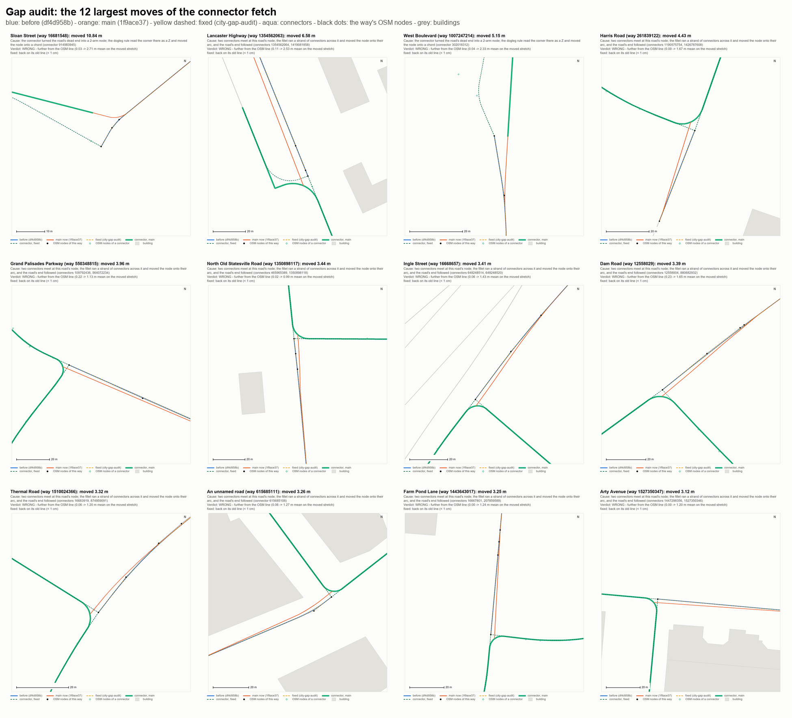

# Gap audit: the roads the connector fetch moved

2026-10-29, branch `city-gap-audit` (from main `de4a7a10`). The question: the
connector fetch (`d83a3d8b`, merged into main by `1f9ace37`; the data before it
is `df4d958b`) closed the data's gaps, and its commit says "20,434 of 20,566
existing ways move < 1 cm (the 74 that move > 20 cm meet a connector at a new
junction)". Nobody had checked that. This checks it, way by way.

**Answer.** The 74 do all sit at or next to a connector, but the junction is
not why most of them moved: the exporter's line work let the new ways re-fit
the network they join. 56 of the 74 moved wrongly (0.13-10.84 m, nearly all
further from the real road: mostly a junction node dragged off its OSM node),
12 were re-fitted by
simplify with no cause at that spot (within its tolerance; 7 nearer the OSM
line, 7 further, counting all 14), 5 moved rightly (a junction box the new
crossing street really makes), 1 did not move in main at all. The fix, on this
branch, keeps every closure and puts 82 of the 89 audited roads (the 74 and 15
more main moved) back on their old lines; 20,553 of the 20,566 existing ways
are now within 1 cm of `df4d958b`, and the 13 that are not are the two
junction boxes and their neighbours.

| | > 20 cm, old vertices to new line | < 1 cm, same | > 20 cm, both ways | < 1 cm, both ways |
|---|---|---|---|---|
| the fetch's own claim (`117689ee` -> `d83a3d8b`) | 74 | 20,434 | 86 | 20,416 |
| main (`df4d958b` -> `1f9ace37`) | 73 | 20,433 | 86 | 20,415 |
| this branch (`df4d958b` -> `city-gap-audit`) | 4 | 20,553 | 4 | 20,553 |

The claim's numbers were made by measuring each OLD vertex against the NEW
line; that misses a new line that leaves the old one between old vertices (13
more ways > 20 cm in main). `tools/city/waymoves.mjs` reproduces both measures
exactly (`node tools/city/waymoves.mjs df4d958b 1f9ace37`; a revision or a file).

## How each move was put down to its cause

1. **The set**: the 74 of the claim, plus the 15 more main moved > 20 cm both
   ways: 89 roads. One of the 74 (Wilkinson Boulevard, way 1351528724) moved
   0.48 m on the topology branch's own export but 0.00 m in main's: main does
   not carry that move.
2. **The stage**: the exporter at `de4a7a10` run twice, `PSX_CITY_CONNECTORS=0`
   (it reproduces `df4d958b`'s lines: all 20,566 ways identical) and as shipped
   (`charlotte_city.bytes` byte for byte), with the line work dumped after each
   step: the cut into edges, the dead-end weld, simplify, doglegs, TAPR, PARA,
   the fillet. A road's cause is the first step whose output differs (>= 5 cm).
   First steps: fillet 52, PARA 20, simplify 14, doglegs 2, none 1; the cut and
   the weld moved nothing. (A temporary read-only hook, not committed.)
3. **The mechanism**, per step, from what the step saw at that road (the arms
   at its nodes, PARA's pushers and exemptions, TAPR's offsets) - below.
4. **The verdict**, against the OSM source of truth: the road's raw OSM line
   from the cache (the moved stretch's mean and max distance from it, before
   and after), the building footprints (`charlotte_bld.bytes`: does the road's
   ribbon now reach a building), and for divided roads the twin carriageway.
   - **Buildings**: no moved stretch comes within its half width of a building,
     before or after, on any of the 89.
   - **Twins**: I-85 (way 459876003) drifted 0.6 m from its other carriageway
     (28.31 -> 28.94 m apart; OSM 28.29) and Yorkmont Road 0.4 m (17.91 -> 18.34;
     OSM 17.48): both wrong, both fixed. The Tuckaseegee Road pair moved
     together toward OSM (9.7 -> 7.5 m apart; OSM 5.7): the junction box, right.
     Concord Parkway South's pairs changed by under 0.4 m: fixed.

Where the 74 moved: at an end node 58, the whole (short) way 5, interior 10, not
in main 1. What they closed (FRNT of the topology branch at the junction): a box
cut 10, a minor-street gap 40, an island 1, an interior junction (no frontier
node) 23.

## The causes

| cause | in the 74 | all 89 | moved | verdict |
|---|---|---|---|---|
| A. Fillet: a connector strand across the network's node | 42 | 51 | 0.20-6.58 m | wrong: 48 further from OSM, 3 the node moved along/onto it |
| B. Doglegs: the corner where a connector carries on read as a Z | 2 | 2 | 5.15, 10.84 m | wrong |
| C. PARA: a pushed connector dragged the network's node | 5 | 5 | 0.32-1.33 m | wrong |
| D. TAPR: a connector made a lane change a junction mouth, PARA re-pushed | 7 | 7 | 0.13-0.45 m | wrong |
| E. Simplify: the connector cut the way, Douglas-Peucker re-fitted each piece | 11 | 14 | 0.20-0.74 m | no cause at the spot (7 closer, 7 further) |
| F. Knock-on of E at a shared node | 1 | 3 | 0.20-0.21 m | no cause at the spot |
| G. PARA junction box: the connector crosses the median in < 30 m | 5 | 6 | 0.21-1.52 m | **right** |
| not moved in main | 1 | 1 | - | - |

### A. Fillet: a connector strand across the network's node (42 of the 74)

The fillet (lib/fillet.mjs) runs on strands through 2-arm nodes. The fetch made
the connectors a strand set of their own, but at a node where the network meets
them it let a connector strand run on whenever exactly two CONNECTORS met there,
whatever else did. So where two connectors met at a network node - 43 times at
a road's end (a T into a cross street the fetch brought in as two connectors),
8 times where the road runs on through - the two were filleted as one curve
through the node and the node moved onto its arc, 0.2-6.6 m off its OSM
position; the road's arm followed it (`snapEnd`, eased over 20 x the move).
Lancaster Highway's end at the beltway box moved 6.6 m between its continuation
and Alice McGinn Drive. The fillet's own rule is that a junction node is fixed.

| way | name | class | length m | moved: max / mean m | where | connector(s) | gap it closes | off the OSM line, before -> main: mean / max m | verdict | fixed: max m | in the 74 |
|---|---|---|---|---|---|---|---|---|---|---|---|
| 1354562063 | Lancaster Highway | trunk 1-way | 627 | 6.58 / 1.09 | end | 1354562064, 1419081858 | box cut | 0.11 -> 2.53 / 0.41 -> 6.59 | wrong | 0.00 | yes |
| 261839122 | Harris Road | secondary | 45 | 4.43 / 1.35 | whole | 1190575754, 1426787608 | box cut | 0.00 -> 1.67 / 0.00 -> 4.43 | wrong | 0.00 | yes |
| 550348815 | Grand Palisades Parkway | tertiary | 689 | 3.96 / 0.30 | end | 109792436, 564072234 | box cut | 0.22 -> 1.13 / 0.41 -> 3.96 | wrong | 0.00 | yes |
| 1350898117 | North Old Statesville Road | primary | 96 | 3.44 / 0.75 | end | 465965389, 1350898118 | box cut | 0.02 -> 0.99 / 0.08 -> 3.44 | wrong | 0.00 | yes |
| 16668657 | Ingle Street | tertiary | 145 | 3.41 / 0.54 | end | 648248514, 648248520 | minor-street gap | 0.06 -> 1.43 / 0.24 -> 3.42 | wrong | 0.00 | yes |
| 12558029 | Dam Road | tertiary | 1181 | 3.39 / 0.07 | end | 12558004, 880682932 | box cut | 0.23 -> 1.65 / 0.39 -> 3.39 | wrong | 0.00 | yes |
| 1510024366 | Thermal Road | tertiary | 84 | 3.32 / 0.49 | end | 16683919, 874959091 | minor-street gap | 0.06 -> 1.20 / 0.22 -> 3.32 | wrong | 0.00 | yes |
| 615685111 | (unnamed) | local | 88 | 3.26 / 0.96 | end | 615685108 | island | 0.06 -> 1.27 / 0.62 -> 3.26 | wrong | 0.00 | yes |
| 1443643017 | Farm Pond Lane | tertiary | 236 | 3.25 / 0.30 | end | 16667801, 207859589 | minor-street gap | 0.00 -> 1.24 / 0.01 -> 3.25 | wrong | 0.00 | yes |
| 1527350347 | Arty Avenue | local | 170 | 3.12 / 0.68 | end | 1447298356, 1527350346 | minor-street gap | 0.00 -> 1.20 / 0.00 -> 3.12 | wrong | 0.00 | yes |
| 16667476 | Crater Street | local | 457 | 2.83 / 0.11 | end | 16699103, 16699106 | minor-street gap | 0.18 -> 0.98 / 0.38 -> 2.83 | wrong | 0.00 | yes |
| 120718178 | LaSalle Street | local | 638 | 2.76 / 0.07 | end | 16711986, 648248509 | minor-street gap | 0.21 -> 0.80 / 0.45 -> 2.76 | wrong | 0.00 | yes |
| 16670386 | Wellesley Avenue | local | 745 | 2.50 / 0.09 | end | 874919519, 874919520 | minor-street gap | 0.24 -> 0.82 / 0.34 -> 2.50 | wrong | 0.00 | yes |
| 631632956 | Prosperity Church Road | secondary | 89 | 2.18 / 0.34 | end | 1196072506, 1230930442 | minor-street gap | 0.06 -> 0.72 / 0.13 -> 2.18 | wrong | 0.00 | yes |
| 16439072 | Lower Rocky River Road | tertiary | 6984 | 1.76 / 0.00 | end | 29705181, 1077197165 | box cut | 0.14 -> 0.75 / 0.55 -> 1.76 | wrong | 0.00 | yes |
| 16714711 | Dupree Street | local | 461 | 1.45 / 0.01 | end | 264059879 | minor-street gap | 0.00 -> 0.32 / 0.00 -> 1.45 | wrong | 0.00 | yes |
| 459876003 | I-85 | motorway 1-way | 1404 | 1.04 / 0.04 | end | 41121098, 1001318774 | box cut | 0.00 -> 0.62 / 0.00 -> 1.04 | wrong | 0.00 | yes |
| 916463520 | (ramp) | ramp 1-way | 71 | 0.75 / 0.06 | end | 1257037736 | box cut | 0.00 -> 0.49 / 0.04 -> 0.75 | wrong | 0.00 | yes |
| 16710468 | Kirkland Avenue | local | 185 | 0.75 / 0.02 | end | 16718410 | minor-street gap | 0.00 -> 0.31 / 0.00 -> 0.75 | wrong | 0.00 | yes |
| 16696658 | Mount Harmony Church Road | tertiary | 1162 | 0.75 / 0.00 | end | 16691945 | minor-street gap | 0.00 -> 0.39 / 0.00 -> 0.75 | wrong | 0.00 | yes |
| 775833235 | Verhoeff Drive | tertiary | 197 | 0.75 / 0.00 | end | 611139327, 611139330 | minor-street gap | 0.00 -> 0.75 / 0.00 -> 0.75 | wrong | 0.00 | no |
| 12565783 | Gardendale Road | tertiary | 2053 | 0.75 / 0.00 | end | 12558004 | box cut | 0.06 -> 0.32 / 0.13 -> 0.75 | wrong | 0.00 | yes |
| 544054422 | (ramp) | ramp 1-way | 433 | 0.75 / 0.01 | end | 1536800225 | minor-street gap | 0.07 -> 0.56 / 0.26 -> 0.75 | wrong | 0.00 | yes |
| 1431596863 | Albemarle Road | trunk 1-way | 1025 | 0.69 / 0.00 | end | 1431596859, 1431596867 | box cut | 0.00 -> 0.46 / 0.00 -> 0.69 | wrong | 0.00 | yes |
| 172607031 | (ramp) | ramp 1-way | 75 | 0.57 / 0.03 | end | 262313031, 648895585 | minor-street gap | 0.00 -> 0.39 / 0.00 -> 0.57 | wrong | 0.00 | yes |
| 1301424861 | (ramp) | ramp 1-way | 49 | 0.52 / 0.04 | end | 1301424859 | minor-street gap | 0.00 -> 0.34 / 0.00 -> 0.52 | wrong | 0.00 | yes |
| 404391892 | (ramp) | ramp 1-way | 82 | 0.47 / 0.01 | end | 404391894, 404391895 | minor-street gap | 0.00 -> 0.47 / 0.00 -> 0.47 | wrong | 0.00 | no |
| 404391893 | (ramp) | ramp 1-way | 51 | 0.47 / 0.01 | end | 404391894, 404391895 | minor-street gap | 0.00 -> 0.07 / 0.00 -> 0.07 | wrong | 0.00 | yes |
| 563737208 | (ramp) | ramp 1-way | 90 | 0.46 / 0.02 | end | 731726757, 905709678 | minor-street gap | 0.00 -> 0.33 / 0.00 -> 0.45 | wrong | 0.00 | yes |
| 1408795808 | (ramp) | ramp 1-way | 49 | 0.41 / 0.03 | end | 546490480 | minor-street gap | 0.00 -> 0.32 / 0.03 -> 0.41 | wrong | 0.00 | yes |
| 1005382624 | (ramp) | ramp 1-way | 62 | 0.38 / 0.03 | end | 264196243, 1005382625 | minor-street gap | 0.01 -> 0.30 / 0.04 -> 0.38 | wrong | 0.00 | yes |
| 750437243 | Bartlett Road | tertiary | 1465 | 0.38 / 0.00 | end | 16677338 | box cut | 0.00 -> 0.38 / 0.00 -> 0.38 | wrong | 0.00 | no |
| 583508756 | (ramp) | ramp 1-way | 42 | 0.37 / 0.15 | end | 583508754 | minor-street gap | 0.01 -> 0.28 / 0.20 -> 0.37 | wrong | 0.00 | yes |
| 1112541063 | (ramp) | ramp 1-way | 58 | 0.35 / 0.03 | end | 847033169 | minor-street gap | 0.04 -> 0.30 / 0.13 -> 0.35 | wrong | 0.00 | yes |
| 247292611 | (ramp) | ramp 1-way | 78 | 0.35 / 0.02 | end | 247292539 | minor-street gap | 0.00 -> 0.28 / 0.00 -> 0.35 | wrong | 0.00 | yes |
| 1489359995 | Shopton Road | tertiary | 59 | 0.35 / 0.01 | end | 307091478 | minor-street gap | 0.00 -> 0.35 / 0.00 -> 0.35 | wrong | 0.00 | no |
| 1442746479 | Selwyn Avenue | tertiary | 58 | 0.34 / 0.03 | end | 16708291 | - | 0.00 -> 0.07 / 0.00 -> 0.07 | wrong | 0.00 | yes |
| 1442746480 | Selwyn Avenue | tertiary | 54 | 0.34 / 0.03 | end | 16708291 | - | 0.00 -> 0.34 / 0.00 -> 0.34 | wrong | 0.00 | no |
| 648281486 | Carnegie Boulevard | tertiary 1-way | 118 | 0.33 / 0.01 | end | 1162337563 | - | 0.00 -> 0.04 / 0.00 -> 0.04 | wrong | 0.00 | yes |
| 1057113875 | Carnegie Boulevard | tertiary 1-way | 57 | 0.33 / 0.01 | end | 1162337563 | - | 0.00 -> 0.33 / 0.00 -> 0.33 | wrong | 0.00 | no |
| 16680134 | Monterey Street | local | 62 | 0.31 / 0.00 | end | 16702750 | minor-street gap, island | 0.00 -> 0.31 / 0.00 -> 0.31 | wrong | 0.00 | no |
| 16691358 | Hampton Avenue | local | 1109 | 0.31 / 0.00 | end | 16685732 | minor-street gap | 0.00 -> 0.01 / 0.00 -> 0.01 | wrong | 0.00 | yes |
| 1418646608 | (ramp) | ramp 1-way | 27 | 0.27 / 0.03 | end | 578653656 | minor-street gap | 0.00 -> 0.27 / 0.00 -> 0.27 | wrong | 0.00 | yes |
| 1381952148 | West Tyvola Road | secondary | 23 | 0.24 / 0.03 | end | 823599144, 1381952150 | - | 0.11 -> 0.01 / 0.11 -> 0.01 | wrong | 0.00 | yes |
| 1381952151 | West Tyvola Road | secondary | 13 | 0.24 / 0.04 | end | 823599144, 1381952150 | - | 0.11 -> 0.21 / 0.11 -> 0.21 | wrong | 0.00 | no |
| 604191439 | (ramp) | ramp 1-way | 38 | 0.24 / 0.04 | end | 511384427 | minor-street gap | 0.00 -> 0.23 / 0.00 -> 0.24 | wrong | 0.00 | yes |
| 1083153717 | (ramp) | ramp 1-way | 41 | 0.23 / 0.02 | end | 330993108, 1488039378 | minor-street gap | 0.00 -> 0.18 / 0.00 -> 0.18 | wrong | 0.00 | yes |
| 16687443 | Mathis Drive | local | 368 | 0.23 / 0.00 | end | 16718410 | minor-street gap | 0.00 -> 0.01 / 0.00 -> 0.01 | wrong | 0.00 | yes |
| 1158219571 | (unnamed) | tertiary 1-way | 16 | 0.22 / 0.04 | end | 604191450 | minor-street gap | 0.00 -> 0.14 / 0.00 -> 0.14 | wrong | 0.00 | yes |
| 731726760 | (ramp) | ramp 1-way | 59 | 0.21 / 0.02 | end | 878804462, 879081238 | minor-street gap | 0.00 -> 0.20 / 0.00 -> 0.21 | wrong | 0.00 | yes |
| 365004969 | Deerfield Drive | tertiary | 810 | 0.20 / 0.00 | end | 545976487, 760664508 | minor-street gap | 0.00 -> 0.20 / 0.00 -> 0.20 | wrong | 0.00 | no |

### B. Doglegs: the corner where a connector carries on, read as a Z (2)

The dogleg rule (lib/lineclean.mjs step 4) straightens two opposite turns of 8
degrees or more within 20 m. Its strands ran through every 2-arm node, counting
connectors - so a road's dead end that a connector now carries on became a
plain 2-arm node, and the corner where the two meet (Sloan Street's 89-degree
turn into a service drive) was "straightened": the node moved onto the chord
between the next vertices, 12.3 m off Sloan Street's OSM node.

| way | name | class | length m | moved: max / mean m | where | connector(s) | gap it closes | off the OSM line, before -> main: mean / max m | verdict | fixed: max m | in the 74 |
|---|---|---|---|---|---|---|---|---|---|---|---|
| 16681548 | Sloan Street | local | 343 | 10.84 / 0.22 | end | 914983945 | minor-street gap | 0.03 -> 2.71 / 0.12 -> 8.55 | wrong | 0.00 | yes |
| 1007247214 | West Boulevard | tertiary | 200 | 5.15 / 0.32 | end | 302018312 | minor-street gap | 0.04 -> 2.33 / 0.20 -> 5.03 | wrong | 0.00 | yes |

### C. PARA: a pushed connector dragged the network's node (5)

PARA moves carriageways whose pavements overlap apart. A connector pushed clear
of another road (mostly another connector mapped beside it) carried every node
on its chain, and a node it shared with the network moved with it; the
network's arm eased in after (four ramps 0.7-1.0 m, Yorkmont Road 0.3 m).

| way | name | class | length m | moved: max / mean m | where | connector(s) | gap it closes | off the OSM line, before -> main: mean / max m | verdict | fixed: max m | in the 74 |
|---|---|---|---|---|---|---|---|---|---|---|---|
| 754768134 | (ramp) | ramp 1-way | 107 | 1.33 / 0.16 | end | 754768131, 754768133 | minor-street gap | 0.00 -> 0.92 / 0.02 -> 1.33 | wrong | 0.00 | yes |
| 785500728 | (ramp) | ramp 1-way | 142 | 1.11 / 0.10 | end | 754768138, 754768139, 764840494 | minor-street gap | 0.08 -> 0.87 / 0.22 -> 1.14 | wrong | 0.00 | yes |
| 331119409 | (ramp) | ramp 1-way | 53 | 0.80 / 0.12 | end | 331119419 | minor-street gap | 0.06 -> 0.53 / 0.26 -> 0.75 | wrong | 0.00 | yes |
| 331119408 | (ramp) | ramp 1-way | 50 | 0.69 / 0.15 | end | 331091153, 1054685604 | minor-street gap | 0.00 -> 0.53 / 0.03 -> 0.69 | wrong | 0.00 | yes |
| 1195996168 | Yorkmont Road | tertiary 1-way | 645 | 0.32 / 0.00 | end | 599866079, 599866091 | minor-street gap | 0.04 -> 0.26 / 0.07 -> 0.32 | wrong | 0.00 | yes |

### D. TAPR at a new junction mouth, then PARA (7)

TAPR (lane openings, step 5) decides a lane change's side, its re-anchoring and
its full-width mouth by whether the node is a junction (3+ arms) - counting
connectors. A connector at Concord Parkway South's lane-change node made it a
junction mouth: the ribbon was re-anchored (offset 1.83 m -> 0), so it faced its
twin a lane nearer, and PARA pushed the pair 0.4 m further apart. The same
count moved 14 ways' lane ribbons 1.8-3.7 m with no line move at all (10 of
them further from their OSM line, 2 nearer, 2 to the other side) - not in the
74, which measure the centreline only.

| way | name | class | length m | moved: max / mean m | where | connector(s) | gap it closes | off the OSM line, before -> main: mean / max m | verdict | fixed: max m | in the 74 |
|---|---|---|---|---|---|---|---|---|---|---|---|
| 684405553 | Concord Parkway South | primary 1-way | 1273 | 0.45 / 0.01 | end | 1550786045 | - | 0.00 -> 0.35 / 0.00 -> 0.45 | wrong | 0.00 | yes |
| 1070274972 | Concord Parkway South | primary 1-way | 34 | 0.45 / 0.33 | whole | 1550786045 | - | 0.00 -> 0.37 / 0.00 -> 0.45 | wrong | 0.00 | yes |
| 1534268858 | Concord Parkway South | primary 1-way | 14 | 0.41 / 0.39 | whole | - | - | 0.04 -> 0.43 / 0.07 -> 0.43 | wrong | 0.00 | yes |
| 676112677 | Concord Parkway South | primary 1-way | 1209 | 0.41 / 0.01 | end | - | - | 0.01 -> 0.33 / 0.01 -> 0.41 | wrong | 0.00 | yes |
| 676112679 | Concord Parkway South | primary 1-way | 114 | 0.36 / 0.13 | end | - | - | 0.03 -> 0.33 / 0.07 -> 0.43 | wrong | 0.00 | yes |
| 16437239 | (ramp) | ramp 1-way | 35 | 0.13 / 0.02 | end | 1550786045 | minor-street gap | - -> - / - -> - | wrong | 0.00 | yes |
| 120116899 | Concord Parkway South | primary 1-way | 97 | 0.13 / 0.01 | end | - | - | - -> - / - -> - | wrong | 0.00 | yes |

### E. Simplify at the connector's cut (11 of the 74), F. its knock-on (1)

A connector that meets a road at a vertex in the middle of a way cuts the way
there. Simplify (2 m collapse, Douglas-Peucker 0.5 m) runs per edge, so each
piece was re-fitted from scratch: Industrial Drive's line moved 0.47 m 480 m
from the connector. Both lines are within the tolerance of the OSM line (7
closer, 7 further): a re-fit, not an error the connector fixed. F: a neighbour
sharing a node with such a piece followed its re-fitted node (East Sugar Creek
Road) or PARA's samples on it (Freedom Drive / Alleghany Street).

| way | name | class | length m | moved: max / mean m | where | connector(s) | gap it closes | off the OSM line, before -> main: mean / max m | verdict | fixed: max m | in the 74 |
|---|---|---|---|---|---|---|---|---|---|---|---|
| 16672627 | Industrial Drive | tertiary | 1792 | 0.74 / 0.09 | interior | - | minor-street gap | 0.39 -> 0.06 / 0.74 -> 0.28 | no cause there | 0.00 | yes |
| 1072644907 | Queens Road West | tertiary 1-way | 750 | 0.56 / 0.13 | interior | - | - | 0.36 -> 0.30 / 0.67 -> 0.74 | no cause there | 0.00 | yes |
| 16720023 | Avalon Avenue | local | 1290 | 0.45 / 0.07 | interior | - | minor-street gap | 0.10 -> 0.25 / 0.24 -> 0.45 | no cause there | 0.00 | yes |
| 16679544 | Maryland Avenue | local | 1908 | 0.42 / 0.05 | interior | - | minor-street gap | 0.21 -> 0.30 / 0.67 -> 0.54 | no cause there | 0.00 | yes |
| 648281608 | Raleigh Street | local | 465 | 0.41 / 0.19 | interior | - | minor-street gap | 0.22 -> 0.11 / 0.44 -> 0.35 | no cause there | 0.00 | no |
| 16701785 | Holbrooks Road | tertiary | 2152 | 0.40 / 0.01 | interior | 611139330 | minor-street gap | 0.25 -> 0.13 / 0.59 -> 0.24 | no cause there | 0.00 | yes |
| 16701446 | Queens Road West | tertiary 1-way | 789 | 0.38 / 0.12 | interior | - | - | 0.36 -> 0.19 / 0.68 -> 0.42 | no cause there | 0.00 | yes |
| 205585500 | East W T Harris Boulevard | secondary 1-way | 1506 | 0.34 / 0.04 | interior | - | - | 0.98 -> 1.02 / 1.46 -> 1.29 | no cause there | 0.00 | yes |
| 264069350 | Poinsett Street | local | 222 | 0.33 / 0.09 | interior | 16664211 | - | 0.01 -> 0.27 / 0.03 -> 0.33 | no cause there | 0.00 | yes |
| 369312123 | Tuckaseegee Road | secondary | 863 | 0.31 / 0.07 | interior | - | - | 0.04 -> 0.20 / 0.13 -> 0.31 | no cause there | 0.00 | yes |
| 16701587 | Uwharrie River Road | local | 185 | 0.27 / 0.04 | interior | 928314972, 928314973 | - | 0.01 -> 0.25 / 0.04 -> 0.29 | no cause there | 0.00 | yes |
| 542612616 | East Sugar Creek Road | primary | 192 | 0.23 / 0.06 | end | 583508753, 583508754 | - | 0.29 -> 0.07 / 0.36 -> 0.14 | no cause there | 0.00 | yes |
| 1003865582 | Freedom Drive | primary 1-way | 119 | 0.22 / 0.06 | end | - | - | 1.01 -> 1.22 / 1.25 -> 1.44 | no cause there | 0.00 | no |
| 648895531 | Wilkinson Boulevard | primary 1-way | 851 | 0.20 / 0.06 | interior | 16556336 | box cut | 0.20 -> 0.00 / 0.20 -> 0.00 | no cause there | 0.00 | no |

F, the knock-on:

| way | name | class | length m | moved: max / mean m | where | connector(s) | gap it closes | off the OSM line, before -> main: mean / max m | verdict | fixed: max m | in the 74 |
|---|---|---|---|---|---|---|---|---|---|---|---|
| 648310383 | Alleghany Street | tertiary | 16 | 0.21 / 0.00 | end | - | - | 0.81 -> 1.02 / 0.81 -> 1.02 | no cause there | 0.00 | no |
| 1003880573 | Freedom Drive | primary 1-way | 224 | 0.21 / 0.01 | end | - | - | 0.78 -> 0.99 / 0.81 -> 1.02 | no cause there | 0.00 | no |
| 874831269 | East Sugar Creek Road | primary | 154 | 0.20 / 0.03 | end | - | - | 0.20 -> 0.00 / 0.20 -> 0.00 | no cause there | 0.00 | yes |

### G. PARA junction box (5 of the 74): right

Tuckaseegee Road's two carriageways leave their split node 47 m before the new
crossing street (Tennyson Drive, way 1229470773), whose 6.9 m piece crosses
between them; Wilkinson Boulevard's are crossed by Morris Field Drive's 14.9 m
piece (way 16705216). PARA's junction-box rule exempts a pair within reach of such a
crossing - the junction is paved whole there and pushing the pair apart would
tear the crossing street. Before the fetch the crossing was not in the data,
so PARA pushed the pair 1.5 m apart (their OSM lines are 5.7 m apart, their
pavements 4.5 m short of PARA's gap); now they are back toward their OSM lines
(1.83 -> 0.79 m mean). Kept.

| way | name | class | length m | moved: max / mean m | where | connector(s) | gap it closes | off the OSM line, before -> main: mean / max m | verdict | fixed: max m | in the 74 |
|---|---|---|---|---|---|---|---|---|---|---|---|
| 369312134 | Tuckaseegee Road | secondary 1-way | 47 | 1.52 / 1.03 | whole | 1229470773 | - | 1.83 -> 0.79 / 2.38 -> 1.60 | right | 1.52 | yes |
| 399264382 | Tuckaseegee Road | secondary 1-way | 49 | 1.51 / 1.01 | whole | 1229470773 | - | 1.91 -> 0.85 / 2.49 -> 1.84 | right | 1.51 | yes |
| 1046841370 | Tuckaseegee Road | secondary 1-way | 27 | 0.70 / 0.33 | end | 1229470773 | - | 2.38 -> 1.93 / 2.43 -> 2.21 | right | 0.75 | yes |
| 1030421449 | Tuckaseegee Road | secondary 1-way | 38 | 0.65 / 0.19 | end | 1229470773 | - | 2.69 -> 2.28 / 2.90 -> 2.65 | right | 0.65 | yes |
| 1344551490 | Wilkinson Boulevard | primary 1-way | 192 | 0.21 / 0.02 | end | 16705216 | - | 0.18 -> 0.06 / 0.18 -> 0.06 | right | 0.15 | yes |
| 1344554695 | Wilkinson Boulevard | primary 1-way | 58 | 0.21 / 0.04 | end | 16705216 | - | 0.18 -> 0.18 / 0.18 -> 0.18 | right | 0.15 | no |

**Not moved in main (1 of the 74)**: Wilkinson Boulevard 1351528724 moved 0.48 m at its end in the topology branch's own export (`117689ee` -> `d83a3d8b`), 0.00 m in main's (`df4d958b` -> `1f9ace37`).

## The fix (lib/fillet.mjs, lib/lineclean.mjs, export_osm.mjs)

The fetch's design was right - the connectors "join the graph but NOT the
network's own line work" - but five rules still let them in. Each now sees the
network as it was without the connectors; the connectors attach to it.

- **A, fillet**: a connector strand ENDS at a node it shares with the network.
  The node is the network's; a connector's end follows wherever the network's
  own fillet puts it.
- **B, doglegs**: strands of each kind, as in the chains and the fillet. A
  network node the fix moves takes the connectors' ends with it.
- **C, PARA**: a connector never carries a node it shares with the network
  (the connector eases back onto it), and is not pushed within 40 m of one
  (its push eased to nothing there, its samples there exempt, as a pair is near
  the node it really meets at). Without the exemption the pinned end never
  cleared and every pass pushed the rest further (3.8 m, 20 passes).
- **D, TAPR** (and the blip rule's fan test): a network chain's junction mouths
  are its own (3+ network arms); a connector's chain sees every arm.
- **E, connector cuts**: export_osm.mjs marks a network way cut only because a
  connector uses its node (`connCutA`/`connCutB`); lineclean's
  `connectorCuts` makes the network's line work run across such a cut as
  across the one piece it was - chains pair across it, simplify and PARA's
  samples and densification run across it. A cut vertex the simplified line
  kept stays (an OSM vertex of the road; the fillet treats it as the free vertex
  it was); one it dropped is put ON the line where the OSM node projects onto it
  and carried by the doglegs and the fillet, the connector's end with it.
  The 46 cut nodes: median 0.17 m, 95th percentile 0.94 m, max 2.14 m from their
  OSM node (main: 0.00 / 0.92 / 2.04 - there the road moved to them instead).
- **G** is unchanged: the junction box is the rule doing its job.

## After the fix

- **Existing ways vs `df4d958b`**: 20,553 < 1 cm, 9 at 1-20 cm, 4 > 20 cm (both
  measures). The 4: Tuckaseegee Road 369312134 (1.52 m), 399264382 (1.51),
  1046841370 (0.75), 1030421449 (0.65) - G, the junction box. The 9: the same
  two boxes' neighbours - Wilkinson Boulevard 1344573387 (0.17), 1344558876
  (0.16), 1344551490 and 1344554695 (0.15, G), Morris Field Drive 120719786
  (0.16), Tuckaseegee Road 1383929259 (0.07), 369312140 (0.05), the ramps
  369312137 (0.08) and 576205924 (0.03). Of the 74, 69 are back within 1 cm
  (every one of A-F, and the one main never moved); the 5 G ones stay:
  Tuckaseegee Road's 4 (0.65-1.52 m) and Wilkinson Boulevard 1344551490 (0.15 m).
- **Every closure stays**: the graph is main's edge for edge (25,560 edges,
  20,567 nodes, the same ends and ways in the same order) and FRNT is
  identical (442 nodes). DEM, buildings, decks and `charlotte_routes.json` are
  byte-identical to main's; the culvert decisions (`baseline/culverts_q8.csv`)
  too.
- **The connectors meet the roads at their OSM nodes**: a connector's end at a
  network node is 2.18 m from its OSM node at the 95th percentile in main (max
  10.0 m, 80 ends > 0.5 m), 0.23 m now (max 2.9 m, 17 ends > 0.5 m). Per
  connector (its worst point vs its OSM line): 54 nearer, 8 further, 310 the
  same. The worst further: Lancaster Highway's piece 1419081859 and Alice McGinn
  Drive meet at a sharp corner the fillet now rounds (4.7 m inside it; main
  held it square because the connector strand ran on through the T).
- **Fingerprint**: 599 fewer free vertices; kinks >= 5 deg 9,624 -> 9,433, >= 10
  deg 206 -> 207, folds > 10 cm 459 -> 460. The new >= 10 deg kinks are Sloan
  Street's and West Boulevard's ends: they meet their connectors at the mapped
  corner again (89 and 14 degrees), drawn as any unrounded 2-arm corner;
  rounding them would move the road's end again. The fold is a connector's.
- `export_osm.mjs --out Assets/PSXRacing/Resources --fingerprint
  tools/city/fingerprint.json` then `--check`: OK.
- **`charlotte_city.bytes` changed**: the road gates must run in a Unity sandbox
  before it ships.

## Seen on the way, not changed here

The dogleg rule has no cap on its turns, so a sharp corner whose first leg is
short reads as a Z: the connector ARFF Road (302018312) is moved 22.4 m by it
(its corner at (-12666, 985) cut; 27 m in main, where West Boulevard's end went
with it). The network's own Oaklawn Cemetery Drive (190901114) is moved 12.4 m
by the same step, already in `df4d958b` (not examined here). Capping the turn
(a dogleg's two turns cancel) would change the gated network's lines: a
package of its own, with the gates.

## Reproduce

- `node tools/city/waymoves.mjs df4d958b 1f9ace37` (main) and `node
  tools/city/waymoves.mjs df4d958b Assets/PSXRacing/Resources/charlotte_city.bytes`
  (this branch); `117689ee d83a3d8b` for the claim's own 74.
- The overlays: `Docs/shots/gap_audit/` - one per notable road (raw OSM nodes,
  the line before, in main and fixed, the connectors in main and fixed,
  buildings) and `gap_audit_worst12.png`, the 12 largest. `gap_01`-`gap_12`
  the 12 largest (B: 01 Sloan Street, 03 West Boulevard; A: the rest);
  `gap_13` Tuckaseegee Road (G), `gap_14` a ramp (C), `gap_15` Concord Parkway
  South (D), `gap_16` Industrial Drive (E), `gap_17` Freedom Drive (F),
  `gap_18` I-85 (A, its twin drift).

